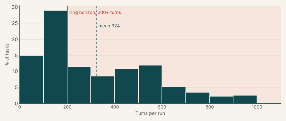

# OTS task catalogs

| Catalog | Tasks | % of all tasks | Average turn count |
|---|---:|---:|---:|
| [ProgramBench](programbench.md) | 435 | 32.4% | 692 |
| [System design](system-design.md) | 56 | 4.2% | 476 |
| [Diagnosis, Debugging, and Bug Fixing](debugging.md) | 378 | 28.2% | 396 |
| [Feature implementation](feature-implementation.md) | 120 | 8.9% | 345 |
| [Infrastructure as code](infrastructure-as-code.md) | 300 | 22.4% | 113 |
| [Data engineering](data-engineering.md) | 17 | 1.3% | 99 |
| [Migration](migration.md) | 36 | 2.7% | 321 |
| **Total** | **1,342** | **100%** |  |

