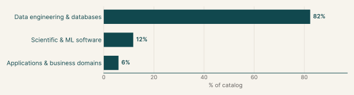
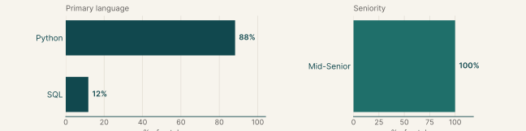
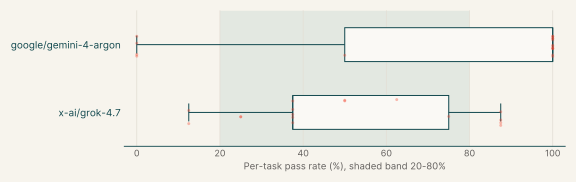
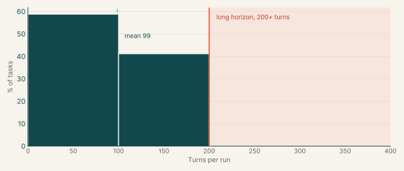
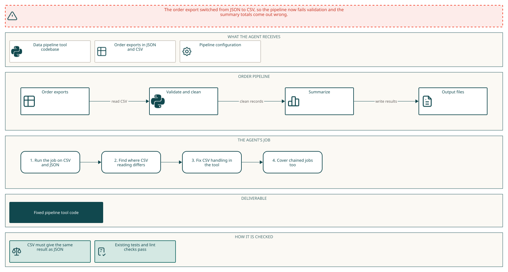
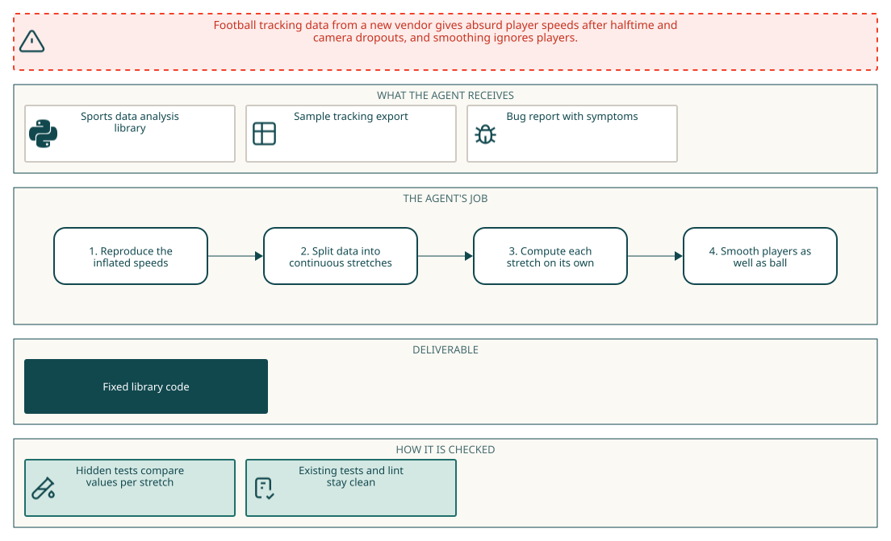
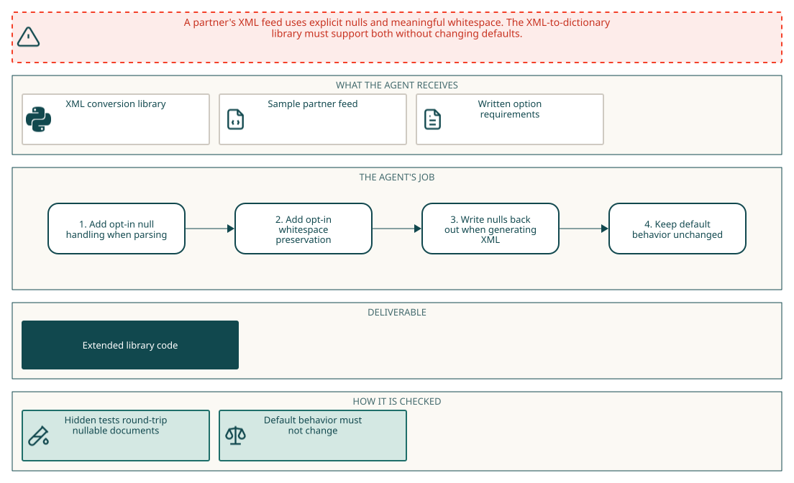

# Data engineering

## Why this catalog

### Problems engineers face

Data engineers and analytics engineers repair pipelines and libraries after an upstream feed changes its shape. In these tasks a vendor or connector changes format and the next run produces wrong data without failing. Fivetran or Stripe exports start resending changed records, so dbt models show duplicates and stale totals. Files change encoding or layout: a sep= line in CSV, CONTINUE records in XLS, locale formats in sheets, new Parquet types. Incremental loaders mis-track state when a schema changes mid-run or a site is added. Nightly ordering and failure handling go wrong. Each report also expects results to be the same on reruns and no regression in existing tests.

### How the tasks reproduce them

Each task is a public repository checked out at a pinned commit in `/app`, with a Python virtual environment in `/opt/venv` and, where needed, dbt and DuckDB. Sample inputs such as CSV, Parquet, XML, SQLite files or seeds are copied to `/data` or sit in the project. The agent has no network access. The prompt gives the symptom and the required behavior, but no pointer to the faulty code. After the agent finishes, a separate verifier applies the agent's diff of `/app`, adds hidden tests, runs the repository's own checks and the hidden suite as an unprivileged user, and grades both reports. Some prompts add lint, type or changelog requirements.

### Typical prompts

- A first person production symptom after a vendor or connector change, with a sample location in `/data`.
- A behavior spec in prose with edge cases, defaults and idempotence rules, ending with a request to fix the library without breaking existing tests.
- An opt-in feature request for a parser or loader, with defaults that must not change.
- A format or locale decoding failure where every sample file must read exactly as written.
- A dbt project fix that must stay in SQL models, macros and YAML and pass `dbt build`.

## Domain breakdown

| Domain | Sub-domain | % of catalog |
|---|---|---:|
| **Data engineering & databases** |  | **82.4%** |
|  | Data pipelines & ETL | 23.5% |
|  | Analytics engineering | 17.6% |
|  | Databases & storage engines | 17.6% |
|  | Data validation | 11.8% |
|  | Data formats & serialization | 11.8% |
| **Scientific & ML software** |  | **11.8%** |
|  | Scientific computing, Sports analytics | 11.8% |
| **Applications & business domains** |  | **5.9%** |
|  | Payments & banking | 5.9% |

## Language and seniority

### Primary language

| Primary language | % of catalog |
|---|---:|
| Python | 88.2% |
| SQL | 11.8% |

### Seniority

| Seniority | % of catalog |
|---|---:|
| Mid-Senior | 100.0% |

## Model pass rates across the catalog

| Model | Pass rate | Tasks at 0% | Tasks at 20-80% | Tasks at 100% |
|---|---:|---:|---:|---:|
| x-ai/grok-4.7 | 50% | 0% | 65% | 0% |
| google/gemini-4-argon | 74% | 24% | 6% | 71% |

## Turn counts and long-horizon tasks

A task's turn count is the average over its runs. A task is long horizon when that average is 200 or more turns.

| Measure | Value |
|---|---:|
| Average turn count | 98.6 |
| Median turn count | 90.4 |
| Range | 50 to 188 |
| Long-horizon tasks (200+ turns) | 0% of tasks |

| Model | % of tasks | Mean turns | % with 200+ turns |
|---|---:|---:|---:|
| x-ai/grok-4.7 | 100% | 79.9 | 1% |
| google/gemini-4-argon | 100% | 173.4 | 35% |

## Example tasks from the shortlist

### Example 1: Data pipelines & ETL (Python)

| Field | Value |
|---|---|
| Final category | Data engineering |
| Domain | Data engineering & databases |
| Sub-domain | Data pipelines & ETL |
| Language | Python |
| Seniority | Mid-Senior |
| Turn count | 248 (google/gemini-4-argon), 108 (x-ai/grok-4.7) |
| Long horizon | no |

Prompt shape: An export format switch with a failing command given verbatim and an equivalence requirement between two input formats.

#### Prompt

Full instruction given to the agent (instruction.md)

Since the night of 2026-10-04 the order platform writes its nightly export as CSV instead of JSON. That first night it wrote both, so /data/orders has orders-2026-10-04.json and orders-2026-10-04.csv with the same orders, the CSV from the next night, and our pipeline config, /data/orders/pipeline.yml. The pipeline validates and cleans the export, then summarizes the cleaned CSV. On the CSV export, `etlplus run --config /data/orders/pipeline.yml --job order_summary` fails validation, and with validation turned off the summary totals are wrong.

Any etlplus job that reads a CSV file should give the result it gives on the same records as JSON: every record exactly once with the same fields, and the same validation outcome, filter result, sort order and aggregate values. An empty cell is a missing value. This also holds for a job reading a CSV file that an earlier job in the run wrote. Values in the output files may stay text.

Please fix etlplus in /app. The existing tests in /app/tests and the ruff, pydocstyle, pydoclint and mypy checks the project runs in CI have to keep passing. There's no network; the project's environment is installed in /opt/venv.

#### Pass rates

| Model | Pass rate | Mean score |
|---|---:|---:|
| x-ai/grok-4.7 | 38% | 0.38 |
| google/gemini-4-argon | 0% | 0.00 |

#### Environment

#### How it maps to the work

A data engineer's nightly pipeline switched its export from JSON to CSV, so validation fails and totals are wrong. They fix the library so a CSV source gives the same records and results as JSON, including CSV written by an earlier job.

### Example 2: Sports analytics (Python)

| Field | Value |
|---|---|
| Final category | Data engineering |
| Domain | Scientific & ML software |
| Sub-domain | Sports analytics |
| Language | Python |
| Seniority | Mid-Senior |
| Turn count | 92 (google/gemini-4-argon), 39 (x-ai/grok-4.7) |
| Long horizon | no |

Prompt shape: A numeric symptom from real data with a precise definition of correct output per edge case and lint requirements.

#### Prompt

Full instruction given to the agent (instruction.md)

We've switched to a new tracking vendor and load their exports straight into TrackingData, like `TrackingData(pd.read_csv("/data/tracking/match_2026-09-27.csv"), provider="vendor", frame_rate=25)`. That file is a sample of Saturday's export. The physical numbers we get from it are off. add_velocity gives players speeds of 30 m/s and more right after halftime and around short camera dropouts, so the get_covered_distance totals and speed zone distances come out too high. Also, filter_tracking_data only smooths the ball; player positions don't change at all.

A frame's values should only come from its own stretch, meaning the frames of one period with no missing frame number between them. For each stretch, add_velocity, add_acceleration and filter_tracking_data (ball and players) should give what their usual calculation gives on that stretch alone, taken in frame order. A stretch of a single frame gets NaN velocity and acceleration. When smoothing is asked for, a stretch with no more frames than the window length keeps its unsmoothed values. Data without a frame column is taken in row order with no missing frames, and data without a period_id column is one period.

ruff check and ruff format --check on /app/databallpy and /app/tests have to stay clean, and the existing tests in /app/tests should keep passing.

Could you find what's going on and fix it? There's no network here; databallpy is installed in editable mode from /app.

#### Pass rates

| Model | Pass rate | Mean score |
|---|---:|---:|
| x-ai/grok-4.7 | 38% | 0.38 |
| google/gemini-4-argon | 100% | 1.00 |

#### Environment

#### How it maps to the work

A data engineer loads a new vendor's player tracking export and finds inflated speeds after halftime and camera dropouts. They fix the physical metric calculations so each contiguous stretch of frames is processed on its own.

### Example 3: Data formats & serialization (Python)

| Field | Value |
|---|---|
| Final category | Data engineering |
| Domain | Data engineering & databases |
| Sub-domain | Data formats & serialization |
| Language | Python |
| Seniority | Mid-Senior |
| Turn count | 84 (google/gemini-4-argon), 43 (x-ai/grok-4.7) |
| Long horizon | no |

Prompt shape: A feature request for a widely used library, written as a list of behaviors per option with compatibility constraints for existing behavior.

#### Prompt

Full instruction given to the agent (instruction.md)

Our partner's XML feed now carries explicit nulls and text where padding matters. A sample is in `/data/partner-feed.xml`. Extend the existing `xmltodict.parse` and `xmltodict.unparse` APIs in `/app` so callers can opt into the new feed without changing the defaults.

With `parse(..., xsi_nil=True)`, an element whose XML Schema instance `nil` attribute is `true` or `1` becomes `None`, regardless of its prefix, other attributes or text. Other values of `nil` and ordinary empty elements keep their existing behavior. This works with namespace processing on or off, and with streaming callbacks. With `parse(..., xml_space=True)`, `xml:space="preserve"` retains text and comment whitespace exactly, including whitespace only text; descendants inherit this policy until `xml:space="default"` restores the normal stripping rule. This also applies to streamed entries, even when the input arrives in byte chunks. The two options can be used together.

With `unparse(..., xsi_nil=True)`, every `None` element, including nested elements and list entries, emits an explicit schema instance nil attribute with a valid namespace binding. Empty strings remain ordinary empty elements. A nullable document can be parsed, written and parsed again without losing its null locations. Without the new options, existing parsing and writing behavior must stay the same. Malformed XML and invalid UTF-8 still raise Expat errors, and entity declarations remain disabled by default with `ValueError`.

The environment has Python 3.12, installed project dependencies and no network. The existing repository checks should still pass.

#### Pass rates

| Model | Pass rate | Mean score |
|---|---:|---:|
| x-ai/grok-4.7 | 50% | 0.50 |
| google/gemini-4-argon | 50% | 0.50 |

#### Environment

#### How it maps to the work

A data engineer ingests partner XML that now carries explicit nulls and whitespace that matters. They extend a parser and writer with opt-in options, keep defaults unchanged and make a document round trip without losing null positions.
