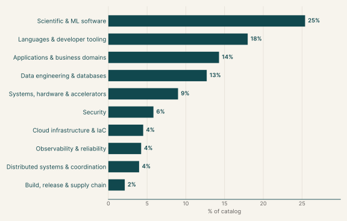
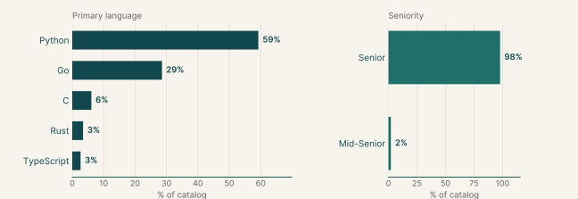
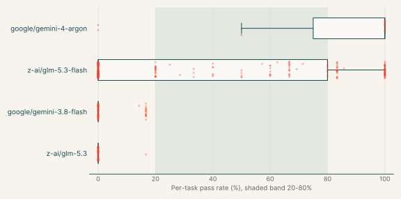
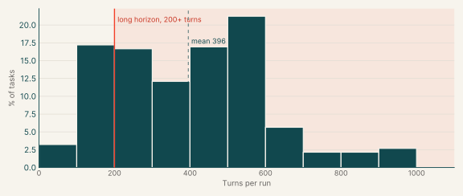
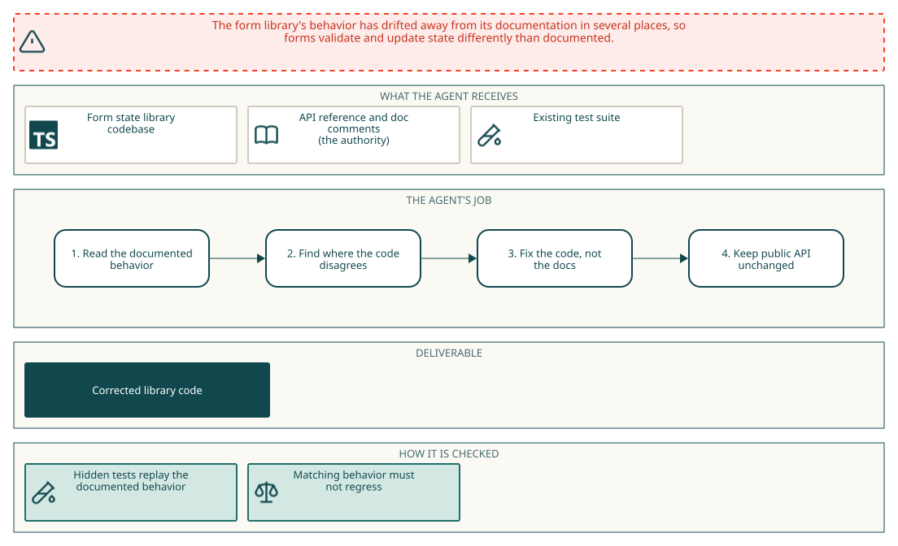
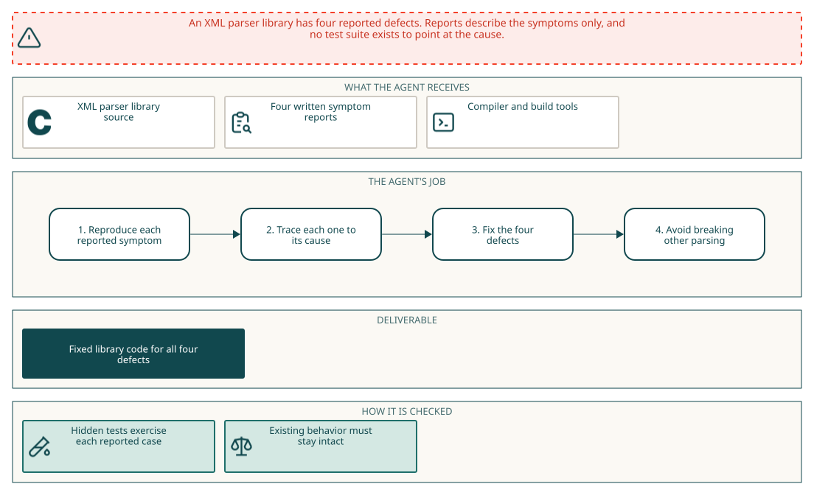
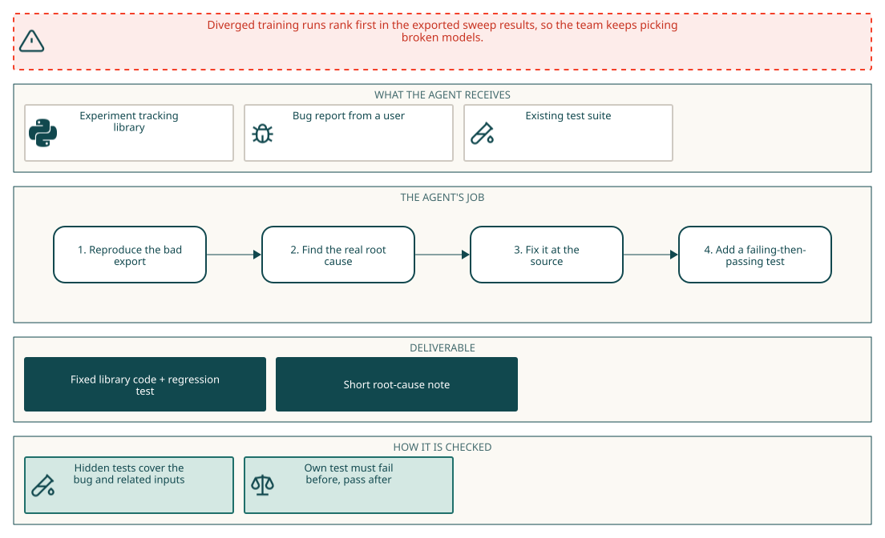

# Diagnosis, Debugging, and Bug Fixing

## Why this catalog

### Problems engineers face

Engineers who maintain libraries and backends are handed behaviour that is wrong in many small places and have to find the causes without a safety net. In the diagnosis tasks the repository has lost its tests and a block of symptoms describes many unrelated failures at once. In the spec-drift tasks the code still runs but contradicts its own README and docstrings. A third pattern is a single production symptom with a hidden root cause. Across all three, the engineer must reproduce the symptom, localize the faulty function, repair it without breaking neighbouring behaviour, and in many tasks say where the defect was.

### How the tasks reproduce them

Each task ships a pinned checkout of a real open-source project, with network disabled at run time and the tests removed or stubbed in the agent's tree. The prompt gives symptoms or a documentation scope but not the location of the faults. The diagnosis tasks ask for `/app/rca.json` listing file and function per edit, and a separate verifier container restores hidden tests and compares the report to an answer key. The spec-drift tasks keep the documentation as the authority and forbid editing it; the grader runs sealed cases as an unprivileged user and checks that the documentation is unchanged. Rewards combine fail-to-pass repairs with pass-to-pass regressions. Stated fault counts range from 4 in one task to 30 in several blind tasks.

### Typical prompts

- A first-person list of observed symptoms with a stated number of undocumented edits and a request for `/app/rca.json`.
- Symptom paragraphs grouped by feature with no file or function named, ending in a fix-and-report request.
- A repository description with an explicit in-scope and out-of-scope file list and the rule that documentation is authoritative and must not be edited.
- A short generic request to restore documented behaviour in a repository, with the docs location given.
- A single bug report written from a production symptom, with no pointer to the faulty module.

## Domain breakdown



| Domain | Sub-domain | % of catalog |
|---|---|---:|
| **Scientific & ML software** |  | **25.4%** |
|  | AI agents & retrieval, Machine learning & MLOps, Statistics & numerical methods, Scientific computing, Medical imaging & healthcare, Geospatial, Graph algorithms | 25.4% |
| **Languages & developer tooling** |  | **18.0%** |
|  | CLI tooling, API tooling, Compilers & language runtimes, General-purpose utility libraries, Logic programming, Data structures | 18.0% |
| **Applications & business domains** |  | **14.3%** |
|  | Web applications, Frontend & UI state, Media processing, Web crawling, Collaborative documents, Payments & banking, Education tooling, Spreadsheets | 14.3% |
| **Data engineering & databases** |  | **12.7%** |
|  | Data formats & serialization, Data validation, Databases & storage engines, Data pipelines & ETL, SQL tooling, Analytics engineering | 12.7% |
| **Systems, hardware & accelerators** |  | **9.0%** |
|  | Networking & HTTP, IoT & smart home, Compression & data integrity, Filesystems, Memory management, Emulators | 9.0% |
| **Security** |  | **5.8%** |
|  | Secrets & access control, Cloud security & compliance, Cryptography & secure protocols, Parser security hardening, Secret scanning | 5.8% |
| **Cloud infrastructure & IaC** |  | **4.5%** |
|  | Cloud infra: containers & self-hosted platforms, Configuration management, Cloud infra: serverless & event-driven | 4.5% |
| **Observability & reliability** |  | **4.2%** |
|  | Monitoring & observability, Rate limiting | 4.2% |
| **Distributed systems & coordination** |  | **4.0%** |
|  | Messaging & event streaming, Calendaring & recurrence, Blockchain, Job scheduling, Workflow automation | 4.0% |
| **Build, release & supply chain** |  | **2.1%** |
|  | Software supply chain, Build systems, CI/CD | 2.1% |

## Language and seniority



### Primary language

| Primary language | % of catalog |
|---|---:|
| Python | 59.3% |
| Go | 28.6% |
| C | 6.1% |
| Rust | 3.4% |
| TypeScript | 2.6% |

### Seniority

| Seniority | % of catalog |
|---|---:|
| Senior | 97.9% |
| Mid-Senior | 2.1% |

## Model pass rates across the catalog

| Model | Pass rate | Tasks at 0% | Tasks at 20-80% | Tasks at 100% |
|---|---:|---:|---:|---:|
| z-ai/glm-5.3-flash | 37% | 51% | 26% | 15% |
| google/gemini-3.8-flash | 4% | 76% | 0% | 0% |
| z-ai/glm-5.3 | 0% | 98% | 0% | 0% |
| google/gemini-4-argon | 80% | 13% | 13% | 73% |



## Turn counts and long-horizon tasks

A task's turn count is the average over its runs. A task is long horizon when that average is 200 or more turns.

| Measure | Value |
|---|---:|
| Average turn count | 395.5 |
| Median turn count | 413.8 |
| Range | 35 to 998 |
| Long-horizon tasks (200+ turns) | 80% of tasks |



| Model | % of tasks | Mean turns | % with 200+ turns |
|---|---:|---:|---:|
| z-ai/glm-5.3-flash | 71% | 392.7 | 78% |
| google/gemini-3.8-flash | 18% | 524.0 | 80% |
| z-ai/glm-5.3 | 14% | 207.3 | 41% |
| google/gemini-4-argon | 4% | 221.0 | 40% |
| x-ai/grok-4.7 | 1% | 38.8 | 0% |
| qwen/qwen3.8-max-0902 | 1% | 61.2 | 0% |
| moonshotai/kimi-k3.1-pro | <1% | 27.0 | 0% |

## Example tasks from the shortlist

### Example 1: Frontend & UI state (TypeScript)

| Field | Value |
|---|---|
| Final category | Diagnosis, Debugging, and Bug Fixing |
| Domain | Applications & business domains |
| Sub-domain | Frontend & UI state |
| Language | TypeScript |
| Seniority | Senior |
| Turn count | 552 (z-ai/glm-5.3-flash) |
| Long horizon | yes |

Prompt shape: A short brief naming the repository and the documentation in scope, stating that documentation wins over code, forbidding doc edits and API changes, and giving no list of the drifted behaviors.

#### Prompt

<details open><summary>Full instruction given to the agent (instruction.md)</summary>
<div class="prompt-md">

The repository at `/workdir` is TanStack Form, a TypeScript library for managing form state and validation across UI frameworks.

Fix all implementation drift from the documentation in this repository.
The @tanstack/form-core subsystem is specified by the API reference under docs/reference and the documentation comments in packages/form-core/src.

Where the code and the documentation disagree about runtime behavior, the documentation is the
authority: change the implementation so that it does what the documentation says, and do not edit
or delete documentation to make a disagreement go away. The documentation is those pages and the
JSDoc comments, including their examples; in-package code comments are only supporting
evidence, and when a comment conflicts with the documentation, follow the documentation.

The repository is at `/workdir`. The environment runs TypeScript on Node.js 24 with the repository's dependencies
installed, and has no network access. Keep the public API stable and keep every behavior that
already matches its documentation working exactly as it does now.

</div>
</details>

#### Pass rates

| Model | Pass rate | Mean score |
|---|---:|---:|
| z-ai/glm-5.3-flash | 40% | 0.40 |

#### Environment



#### How it maps to the work

A library maintainer finds that the runtime behavior of the form state and validation core has diverged from its published API reference and JSDoc examples. The engineer reads the reference pages, compares each documented behavior with what the code does, and corrects the implementation without editing the docs or changing the public API. Behavior that already matches the documentation has to stay as it is.

### Example 2: Parser security hardening (C)

| Field | Value |
|---|---|
| Final category | Diagnosis, Debugging, and Bug Fixing |
| Domain | Security |
| Sub-domain | Parser security hardening |
| Language | C |
| Seniority | Senior |
| Turn count | 183 (google/gemini-4-argon), 27 (moonshotai/kimi-k3.1-pro), 66 (qwen/qwen3.8-max-0902), 165 (z-ai/glm-5.3-flash) |
| Long horizon | no |

Prompt shape: Four prose symptom reports written from the caller's point of view, with no file or function named, followed by a request to fix them and list the responsible functions in `rca.json`.

#### Prompt

<details open><summary>Full instruction given to the agent (instruction.md)</summary>
<div class="prompt-md">

##### libexpat: diagnosing four real defects without a test suite

I set a maximum tolerated amplification factor and an activation threshold on a parser, then created a child parser for external entity content and handed that child a lone parameter entity declaration longer than the threshold I had chosen. Parsing came back successful every time; no limit breach was ever reported, however far below the length of the declaration I pushed the threshold.

I registered a comment handler that records the comment text and then asks the parser to stop, parsed a document whose element content references an entity that in turn expands to two further levels of nested entities, and looped calling resume until parsing finished. The recorded comments stopped partway: the text following the innermost entity reference, including the trailing comments of the two enclosing entities and the material after them, never arrived.

After feeding the parser one short chunk in a non-final call, I prepared to feed it a next chunk whose length is close to the largest value a signed int can hold. The parser agreed to take it and gave me room for it, instead of refusing with an out-of-memory indication, although a request that large cannot be met.

I fed the parser a document whose declaration carries a version pseudo-attribute with nothing at all between the quotes. The parser took it without complaint and carried on to the root element, instead of stopping and reporting an error about the declaration.

There are four separate defects in the source of libexpat behind the behaviour above,
each in a different function. This checkout has no test suite.

Fix the behaviour described above.

Record the functions that contain those defects in `/app/rca.json`, one entry each:

```json
{
  "causes": [
    {
      "file": "expat/lib/xmlrole.c",
      "function": "enclosing_function_name"
    }
  ]
}
```

`file` is the path of the file relative to the repository root, written exactly as it
appears in the tree. A file inside a directory keeps its directory prefix: the example
above is `expat/lib/xmlrole.c`, not `xmlrole.c`. An absolute path, or a path with a `..`
segment, does not name a file in the repository and counts as a wrong entry.

`function` is the name of the C function whose code is wrong: the function a fix of that
defect belongs in. A function defined through a macro may be named by the name the macro
expands to or by the name passed to the macro. Name every function one of the defects is
in, and only those, once each: a second entry for a function another entry already names,
or an entry for a function that holds none of the defects, counts as a wrong entry. Where
you wrote your fix does not matter: if you worked around a defect from a caller or from a
helper of your own, name the function that holds the wrong code rather than the one you
changed. If you suspect a function but found nothing wrong in it, leave it out.

</div>
</details>

#### Pass rates

| Model | Pass rate | Mean score |
|---|---:|---:|
| z-ai/glm-5.3-flash | 80% | 0.76 |
| google/gemini-4-argon | 100% | 0.78 |
| moonshotai/kimi-k3.1-pro | 0% | 0.00 |
| qwen/qwen3.8-max-0902 | 0% | 0.00 |

#### Environment



#### How it maps to the work

An engineer on a parser library receives user reports of wrong behaviour through the public C API: a missing amplification-limit report, dropped comments after a suspended parse, an oversized buffer request accepted, and an empty version pseudo-attribute accepted. The source has no tests, so the engineer reproduces each symptom, finds the faulty function, repairs it and records which function held each defect. This is the blind multi-bug diagnosis family, built from four real upstream bugs.

### Example 3: Machine learning & MLOps (Python)

| Field | Value |
|---|---|
| Final category | Diagnosis, Debugging, and Bug Fixing |
| Domain | Scientific & ML software |
| Sub-domain | Machine learning & MLOps |
| Language | Python |
| Seniority | Mid-Senior |
| Turn count | 35 (x-ai/grok-4.7) |
| Long horizon | no |

Prompt shape: A production complaint written as a ticket (diverged runs sort first in a sweep CSV while the live view shows NaN), with no module named, asking for a source-level fix, a regression test and a root-cause note in `rca.json`.

#### Prompt

<details open><summary>Full instruction given to the agent (instruction.md)</summary>
<div class="prompt-md">

**Diverged runs come out on top of our sweep CSV**

We run our hyperparameter sweeps in local mode with the CSVWriter plugin and pick the winner by
sorting swanlab_runs.csv on the final val/loss. The runs that blew up near the end (loss going to
NaN in the last epochs) show up in that CSV with a val/loss of 0.0, so they sort straight to the
top. We only caught it because last week's "best" learning rate turned out to have diverged. In
`swanlab watch` the same runs do end in NaN, like they should.

The checkout is in /workdir. Could you track down where this actually goes wrong and fix it
there? Please include a regression test, somewhere under tests/ (say tests/test_repro.py), that
fails on the current code because of this problem (a real test failure, not an import error) and
passes once it's fixed. Test the reported behaviour, not your patch: it should still pass if the
bug gets fixed some other correct way, so no asserting on source text or on helpers only your fix
has. It should run on its own from a clean checkout with just your test files added.

I doubt I'm the only one hitting this. Anything else that goes through that code is probably
wrong too, so please fix it at the source rather than special-casing my input. The fix belongs in
the library itself, not in the tests. CI runs the full test suite on every change, so it
shouldn't break anything else.

When you're done, leave a short root-cause note at /workdir/rca.json:

```json
{
  "root_causes": [{"file": "path/from/repo/root.py", "function": "Class.method"}],
  "reproducer": "tests/test_repro.py"
}
```

`root_causes` lists the function(s) where the problem actually starts (one or more), not where it
shows up: the file relative to the repo root and the name as `function` or `Class.method`. Don't
pad the list with functions that only pass the bad value along; extra entries count against the
note. `reproducer` is the repo-relative path of your regression test.

</div>
</details>

#### Pass rates

| Model | Pass rate | Mean score |
|---|---:|---:|
| x-ai/grok-4.7 | 0% | 0.00 |

#### Environment



#### How it maps to the work

A machine learning engineer maintains an experiment tracker and receives a complaint that diverged sweep runs rank first in the exported CSV. The engineer has to follow the NaN from the CSV plugin back to where the value is lost, repair it in the library so every consumer is fixed, add a regression test, and write down where the defect starts. The work mirrors an incident ticket against a shared tool.
