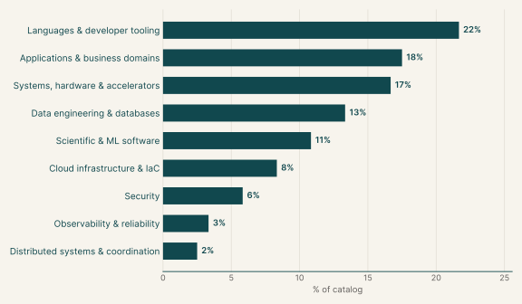
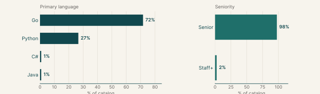
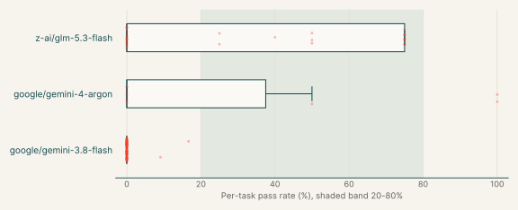
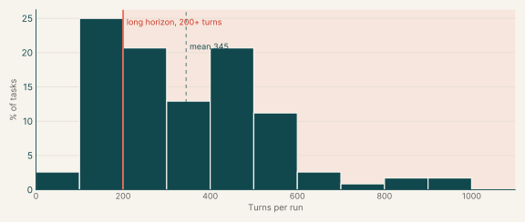
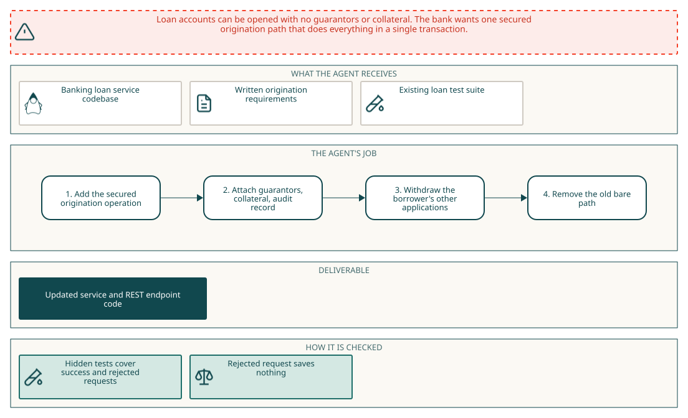
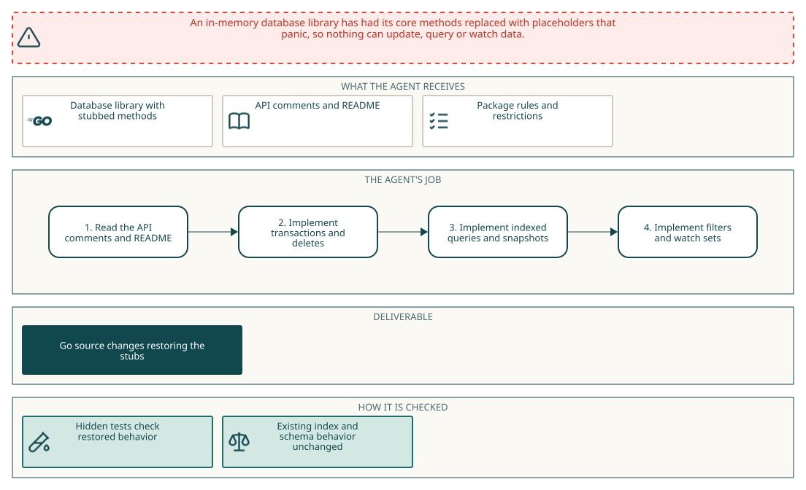

# Feature implementation

## Why this catalog

### Problems engineers face

Engineers in the catalog's main roles, such as library, backend and developer tools engineers, add a capability to an existing library or service and must leave unconfigured behavior unchanged. The tasks show four recurring patterns. One is an opt-in subsystem that spans many code paths with one shared model. A second is bounded or safe handling of untrusted input. A third is restoring stubbed functions that currently panic or throw. A fourth is concurrency and lifecycle correctness. Fixing a fail-open defect is also present in one task. Across all four, the engineer reads a large unfamiliar codebase, matches names and signatures given in the brief, and keeps existing tests passing.

### How the tasks reproduce them

Each task gives the agent a pinned repository inside an offline container and a written specification. The two provided tasks show the range. The Java example ships a pre-laid data layer and a Maven cache, and its instruction names methods, error types and a rollback rule. The Go example ships a library with panicking stubs and lists banned imports and calls. The agent's edits are collected as a `git diff` against a base commit. Grading runs hidden tests after the session, outside the agent's view, and for the minab task the verifier runs from a root-owned copy of the base repository so the session cannot alter it. Existing tests must also keep passing.

### Typical prompts

- A capability gap stated as 'X cannot Y', then a list of exact type names, signatures and edge-case rules, ending with a clause to preserve behavior when the feature is unused. Example.
- A first-person request to restore methods that currently panic or throw 'not implemented', named by file. Example.
- A compact feature brief tied to one product area, with a final step that removes or replaces an old API. Example.
- A short imperative request with exposed API signatures and a constraint such as no new crates. Example.
- A security-flavored defect report that asks for a corrected behavior and a regression guarantee. Example.

## Domain breakdown

| Domain | Sub-domain | % of catalog |
|---|---|---:|
| **Languages & developer tooling** |  | **21.7%** |
|  | CLI tooling | 11.7% |
|  | Compilers & language runtimes, API tooling, CI/CD | 10.0% |
| **Applications & business domains** |  | **17.5%** |
|  | Web applications, Media processing, Payments & banking, Frontend & UI state, Collaborative documents, Web crawling | 17.5% |
| **Systems, hardware & accelerators** |  | **16.7%** |
|  | Networking & HTTP | 13.3% |
|  | IoT & smart home | 3.3% |
| **Data engineering & databases** |  | **13.3%** |
|  | Data formats & serialization, Databases & storage engines, Data pipelines & ETL, SQL tooling | 13.3% |
| **Scientific & ML software** |  | **10.8%** |
|  | Machine learning & MLOps, AI agents & retrieval, Statistics & numerical methods, Geospatial | 10.8% |
| **Cloud infrastructure & IaC** |  | **8.3%** |
|  | Cloud infra: containers & self-hosted platforms, Configuration management | 8.3% |
| **Security** |  | **5.8%** |
|  | Cryptography & secure protocols, Secrets & access control | 5.8% |
| **Observability & reliability** |  | **3.3%** |
|  | Monitoring & observability | 3.3% |
| **Distributed systems & coordination** |  | **2.5%** |
|  | Messaging & event streaming, Calendaring & recurrence | 2.5% |

## Language and seniority

### Primary language

| Primary language | % of catalog |
|---|---:|
| Go | 71.7% |
| Python | 26.7% |
| C# | 0.8% |
| Java | 0.8% |

### Seniority

| Seniority | % of catalog |
|---|---:|
| Senior | 97.5% |
| Staff+ | 2.5% |

## Model pass rates across the catalog

| Model | Pass rate | Tasks at 0% | Tasks at 20-80% | Tasks at 100% |
|---|---:|---:|---:|---:|
| google/gemini-3.8-flash | 0% | 98% | 0% | 0% |
| z-ai/glm-5.3-flash | 23% | 52% | 48% | 0% |
| google/gemini-4-argon | 25% | 70% | 10% | 20% |

## Turn counts and long-horizon tasks

A task's turn count is the average over its runs. A task is long horizon when that average is 200 or more turns.

| Measure | Value |
|---|---:|
| Average turn count | 344.7 |
| Median turn count | 328.9 |
| Range | 92 to 956 |
| Long-horizon tasks (200+ turns) | 72% of tasks |

| Model | % of tasks | Mean turns | % with 200+ turns |
|---|---:|---:|---:|
| google/gemini-3.8-flash | 85% | 345.2 | 68% |
| z-ai/glm-5.3-flash | 25% | 300.6 | 66% |
| google/gemini-4-argon | 9% | 255.5 | 75% |
| claude-opus-5-5 | 2% | 55.0 | 0% |

## Example tasks from the shortlist

### Example 1: Payments & banking (Java)

| Field | Value |
|---|---|
| Final category | Feature implementation |
| Domain | Applications & business domains |
| Sub-domain | Payments & banking |
| Language | Java |
| Seniority | Senior |
| Turn count | 174 (google/gemini-4-argon), 60 (claude-opus-5-5), 156 (google/gemini-3.8-flash) |
| Long horizon | no |

Prompt shape: A dense feature specification that names the target service method, the exact fields and error types, a transactional rollback rule, and a final instruction to remove the old API while keeping existing tests green.

#### Prompt

Full instruction given to the agent (instruction.md)

Loan accounts can still be opened bare: `LoanAccountService.createLoanAccount(UUID, String)`, behind `POST /api/v1/loan-accounts`, opens an account with no guarantors or collateral and leaves the borrower's other applications pending. Make `createSecuredLoanAccount(SecuredOriginationRequest)` the only way to open one.

In one transaction it should:
- open the account from the approved application with today's checks and product terms (`IllegalArgumentException` on failure);
- attach every requested guarantor (customer, type, amount) and collateral item (all `CollateralRequest` details);
- set `territoryCode` and `originationReference` = `<territoryCode>/<lead guarantor customer id>/<account number>`, where the lead (`leadGuarantorCustomerId`) must be an `INDIVIDUAL` guarantor, or `CORPORATE` for a `corporateGroup`, else `IllegalArgumentException`;
- withdraw the borrower's other pending applications, or the group's (applicant plus `groupCustomerIds`), through `LoanApplicationService`, pointing them at the account and leaving everything else untouched;
- write one `LoanOriginationAudit` (application, analyst, territory, group flag, withdrawn count).

A rejected request saves nothing.

Then retire the bare path: remove `createLoanAccount(UUID, String)` and `LoanAccountCreateRequest`, and have `POST /api/v1/loan-accounts` take a `SecuredOriginationRequest` and still answer 201 with the account. All existing loan-service tests must pass (`mvn -pl loan/loan-service -am test`); don't edit the poms.

#### Pass rates

| Model | Pass rate | Mean score |
|---|---:|---:|
| google/gemini-3.8-flash | 0% | 0.00 |
| claude-opus-5-5 | 0% | 0.00 |
| google/gemini-4-argon | 100% | 1.00 |

#### Environment

#### How it maps to the work

A backend engineer on a banking platform is asked to close a gap where loan accounts can be opened without guarantors or collateral. The work spans the service layer, the persistence calls, the audit record and the REST endpoint, and it requires removing an old entry point without breaking existing tests. The engineer reads the existing services and the pre-laid data layer, then makes the new path transactional and retires the old one.

### Example 2: Databases & storage engines (Go)

| Field | Value |
|---|---|
| Final category | Feature implementation |
| Domain | Data engineering & databases |
| Sub-domain | Databases & storage engines |
| Language | Go |
| Seniority | Senior |
| Turn count | 76 (google/gemini-4-argon), 262 (z-ai/glm-5.3-flash) |
| Long horizon | yes |

Prompt shape: A first-person request to restore panicking methods in five named files, followed by a long list of banned packages and calls that the grader rejects outright.

#### Prompt

Full instruction given to the agent (instruction.md)

I'm restoring transaction and query support in our copy of go-memdb so callers can update data, query snapshots, and watch query results for updates. Could you implement the methods that currently panic in the root `memdb` package? They live in `txn.go`, `memdb.go`, `index.go`, `filter.go`, and `watch.go`. The missing pieces cover transaction lifecycle, deletion, indexed queries and iteration, snapshots, deferred callbacks, filtering, and watch sets.

The existing code, API comments, and `README.md` provide context for the restoration. A received value must wake `WatchCtx` just as a closed watched channel does. Please keep the restored public names and signatures unchanged, and retain `Txn.write` for package compatibility; private helper functions are up to you. I'll check the restored behavior alongside index and schema regressions. Submit text Go source changes without new symbolic links, binary Go diffs, or Go line-position directives (`//line` and `/*line`). Use Go filenames that produce unquoted, whitespace-free paths in Git diffs.

In the non-test code you add, please avoid: new `init()` functions; the `syscall`, `golang.org/x/sys`, `os/exec`, `os/signal`, `plugin`, `embed`, `runtime/cgo`, `runtime/pprof`, `runtime/trace`, `testing` and `flag` packages, cgo, and `//go:linkname` or `//go:embed` directives; `os.Exit`, `os.StartProcess`, `os.FindProcess` and `runtime.Goexit`; reading `os.Args`, `os.Executable`, `/proc/self` or `runtime/debug` build info; caller or stack lookups (`runtime.Caller`, `Callers`, `CallersFrames`, `FuncForPC`, `Stack`, `debug.Stack`, `debug.PrintStack`, `log.Lshortfile`, `log.Llongfile`, and `AddSource` selectors or identifier keys); literal U+0016 or the text `\x16`; and printing test-runner lines such as `--- PASS`. These are rejected outright. Some checks read raw text and also match comments.

#### Pass rates

| Model | Pass rate | Mean score |
|---|---:|---:|
| z-ai/glm-5.3-flash | 0% | 0.00 |
| google/gemini-4-argon | 50% | 0.50 |

#### Environment

#### How it maps to the work

A database engineer restores a vendored in-memory database library whose transaction, query, snapshot, deferred callback, filter and watch methods have been stubbed to panic. The engineer reads the surviving code, the API comments and the README, implements the methods without changing public signatures, and keeps to strict rules about what the new code may import or call. The result is judged by a hidden spec suite that includes index and schema regressions.
