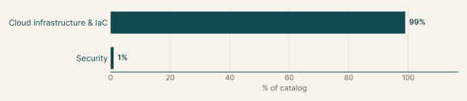
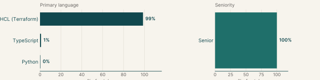
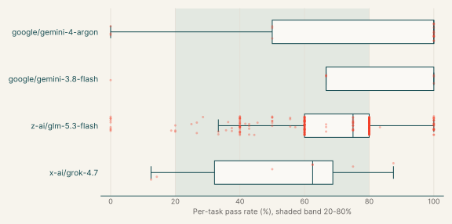
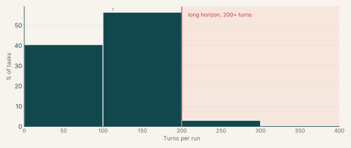
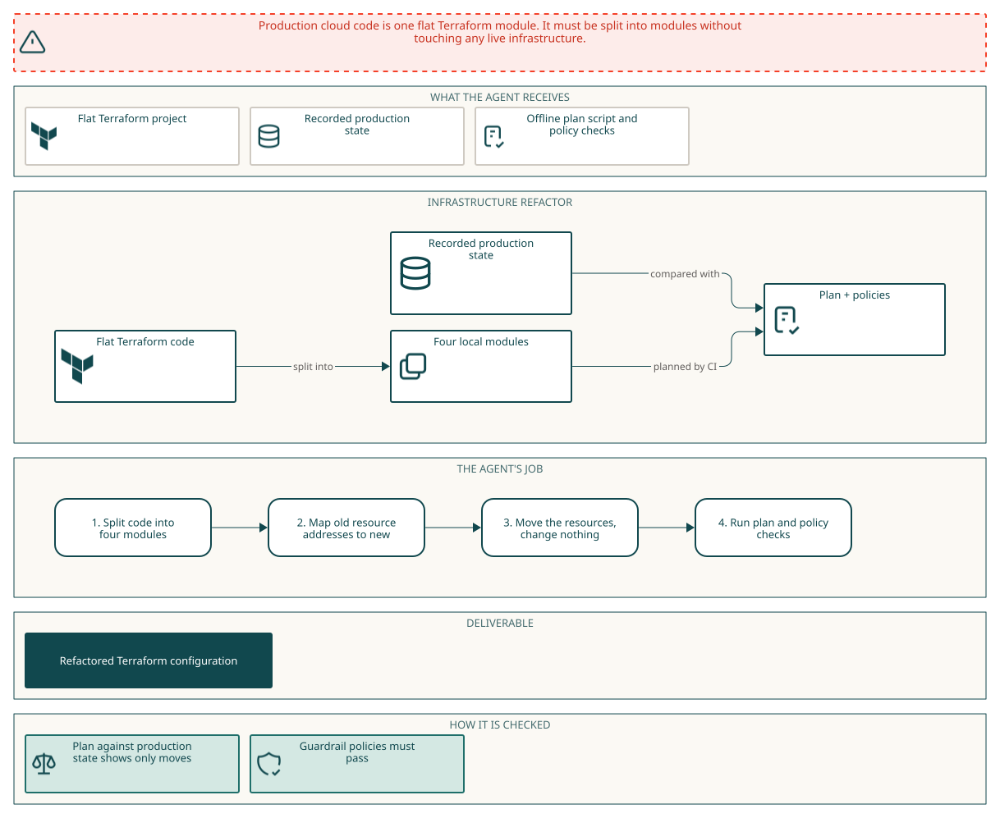
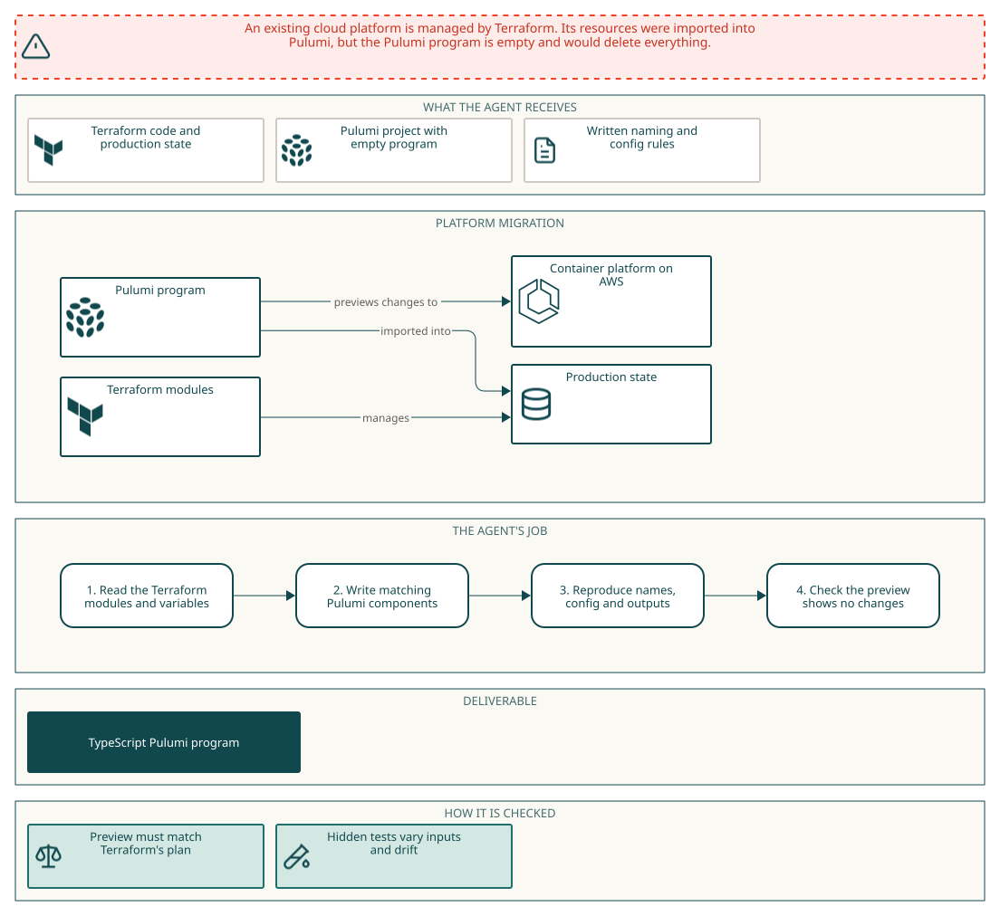
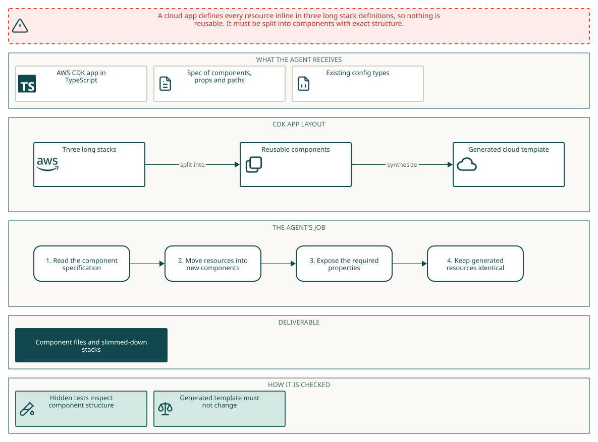

# Infrastructure as code

## Why this catalog

### Problems engineers face

Platform engineers in this catalog restructure infrastructure code that is already running. The most common task is a flat Terraform root module that has to become local modules with `for_each` keys. The change must reach production as address moves only, because the team cannot plan against a live account. A second pattern is replacing positional count with stable keys for zones, services or stages, where operations were indexed in several historical orders. A third is extracting reusable components from an app that builds everything inline, where synthesized output must not change. The example set adds two further problems: moving a stack between tools while a preview stays clean (the Pulumi ports) and bringing a stack under a policy pack without replacing resources.

### How the tasks reproduce them

Each task ships a copy of the stack with its recorded production state or recorded templates, an offline toolchain and no network. The Terraform refactor tasks include a CI script that plans with refresh disabled and runs conftest on the plan. The instruction states module ownership, key rules, root variables with today's defaults and outputs. A separate verifier container holds its own pristine state, plans the agent's configuration, and then plans hidden changes such as an added key under a fresh name, a removed key or a changed entry. The CDK task compares synthesized templates for hidden configurations. The Pulumi tasks run previews against an imported stack and against a copy with swapped generated IDs. Most tasks score zero when a gate fails.

### Typical prompts

- A refactor request for a named production stack that lists target modules, ownership, key rules, root variables and outputs, and requires a plan of moves only.
- A componentization request that lists every construct class with its path, props and public properties, and requires identical synthesized templates.
- A migration brief for an imported stack with an empty program, with naming, config and equivalence rules and banned options.
- A compliance remediation request with numbered requirements, a policy pack, a guardrail spec and an exceptions register, graded with hidden variable probes.
- A bulleted list of needs followed by constraints to keep working, such as a clean preview and unchanged owned files.

## Domain breakdown

| Domain | Sub-domain | % of catalog |
|---|---|---:|
| **Cloud infrastructure & IaC** |  | **99.0%** |
|  | Cloud infra: AWS platform stacks | 58.7% |
|  | Cloud infra: containers & self-hosted platforms | 28.3% |
|  | Cloud infra: serverless & event-driven | 12.0% |
| **Security** |  | **1.0%** |
|  | Cloud security & compliance | 1.0% |

## Language and seniority

### Primary language

| Primary language | % of catalog |
|---|---:|
| HCL (Terraform) | 98.7% |
| TypeScript | 1.0% |
| Python | 0.3% |

### Seniority

| Seniority | % of catalog |
|---|---:|
| Senior | 100.0% |

## Model pass rates across the catalog

| Model | Pass rate | Tasks at 0% | Tasks at 20-80% | Tasks at 100% |
|---|---:|---:|---:|---:|
| z-ai/glm-5.3-flash | 63% | 3% | 89% | 8% |
| google/gemini-4-argon | 78% | 15% | 15% | 70% |
| x-ai/grok-4.7 | 53% | 0% | 57% | 0% |
| google/gemini-3.8-flash | 71% | 14% | 43% | 43% |
| claude-opus-5-5 | 86% | 14% | 0% | 86% |
| gpt-6-astra | 100% | 0% | 0% | 100% |

## Turn counts and long-horizon tasks

A task's turn count is the average over its runs. A task is long horizon when that average is 200 or more turns.

| Measure | Value |
|---|---:|
| Average turn count | 112.6 |
| Median turn count | 109.0 |
| Range | 39 to 271 |
| Long-horizon tasks (200+ turns) | 3% of tasks |

| Model | % of tasks | Mean turns | % with 200+ turns |
|---|---:|---:|---:|
| z-ai/glm-5.3-flash | 98% | 115.9 | 10% |
| x-ai/grok-4.7 | 2% | 105.8 | 0% |
| google/gemini-4-argon | 7% | 74.6 | 5% |
| google/gemini-3.8-flash | 2% | 156.8 | 24% |
| gpt-6-astra | 2% | 41.0 | 0% |
| claude-opus-5-5 | 2% | 45.7 | 0% |
| meta/muse-wonder | <1% | 165.0 | 0% |

## Example tasks from the shortlist

### Example 1: Cloud infra: containers & self-hosted platforms (HCL (Terraform))

| Field | Value |
|---|---|
| Final category | Infrastructure as code |
| Domain | Cloud infrastructure & IaC |
| Sub-domain | Cloud infra: containers & self-hosted platforms |
| Language | HCL (Terraform) |
| Seniority | Senior |
| Turn count | 46 (google/gemini-4-argon), 100 (z-ai/glm-5.3-flash) |
| Long horizon | no |

Prompt shape: A refactor request for an IPv6 Kubernetes stack that names four target modules and constrains the result to a plan of moves against recorded state.

#### Prompt

Full instruction given to the agent (instruction.md)

The Terraform for our dual IPv6 Kubernetes production stack in `/workspace/infra` has grown into one flat root module: everything is declared at the top level, the per-AZ resources are `count`-indexed by list position, and names, settings and tags are hard-coded all over the files. Split it into four local modules (network, bootstrap, platform and observability) without touching the running infrastructure: against the current state, the plan has to come out as nothing but moves.

There is no AWS access from this machine. `terraform init` works offline from the local provider mirror, `terraform.tfstate` is a copy of the production state, and `scripts/ci-plan.sh` runs what CI runs: a `terraform plan -refresh=false` against the state followed by the guardrail policies in `policies/`.

###### Detailed Constraints

**How CI judges the change.** CI takes the repository alone and plans it with `terraform plan -refresh=false` against its own copy of the production state. Local `terraform state` commands and edits to `terraform.tfstate` never reach it, so the whole migration has to be expressed in the configuration. That plan must:
- still manage every resource that is in the state today, and
- contain no create, update, replace, destroy or forget: only resources moving to new addresses.

The guardrail policies in `policies/` must pass on that plan, and `providers.tf` and everything in `policies/` stay exactly as they are, byte for byte.

**Layout.**
- The root module calls `module "network"`, `module "bootstrap"`, `module "platform"` and `module "observability"`, with sources `./modules/network`, `./modules/bootstrap`, `./modules/platform` and `./modules/observability` and one instance each, calls no other module and declares no resources of its own.
- Which module owns what (every instance of the resources described, wherever they are declared today):
  - network: both VPCs, their internet gateways, public and workload subnets, Elastic IPs and NAT64-capable NAT gateways, route tables, IPv4 and IPv6 routes, and route table associations;
  - bootstrap: the bootstrap KMS key and alias, S3 bucket and every bucket settings resource, the per-pool bootstrap objects, the DynamoDB bootstrap table, and the network and worker SSM configuration catalogs;
  - platform: both clusters' control-plane and worker IAM roles, inline policies and instance profiles, security groups and rules, CloudWatch log groups, launch templates and auto scaling groups;
  - observability: the alert SNS topic, SQS queue, subscription and queue policy, and both clusters' per-pool capacity alarms.
- Each of these modules declares the resources it owns itself and calls no other module.
- Modules get each other's IDs and ARNs through module outputs and variables. Never paste an ID, ARN, IP address or DNS name of an existing resource, or any part of one (such as an ARN suffix), into the `.tf` files or templates. The configuration reads files only through literal paths inside its own module (such as `"${path.module}/templates/..."`; in a child module a path starts with `${path.module}/`, because Terraform resolves any other relative path from the root directory, not from the module): no computed paths, no `terraform_remote_state` data sources, and never the state or a plan file.

**Keys.**
- Everything that exists once per availability zone today is a `for_each` resource keyed by the AZ name (for example `["us-east-1a"]`), including each instance of a list that also holds things that belong to no single availability zone.
- Everything that exists once per worker pool today is a `for_each` resource keyed by the pool name (for example `["mesh"]`), including each instance of a list that also holds things that belong to no single worker pool.
- Don't use `count` anywhere. Other repeated resources use `for_each` with string keys that are not numbers (a name such as `["assets"]`, never `["0"]`).
- Each existing availability zone's entry in `availability_zones` is the only source of its values: changing an entry changes, for that availability zone alone, exactly the settings the entry provides, and changes nothing else.
- Adding an availability zone to `availability_zones` must plan only the creation of that availability zone's resources, each configured exactly like its counterparts in the existing availability zones apart from the availability zone itself and the values its entry in `availability_zones` gives it (same settings, names and tags), and removing one only the destruction of that availability zone's resources. Beyond that, the only change either may plan is an in-place update of the settings that collect something from every availability zone today (wherever a setting holds a part of every availability zone: their names, IDs, ARNs, subnets or CIDRs, say, in a list, a policy document or an environment value): each of them must take in, or drop, exactly that availability zone's part where it belongs, in the same form as today (today's parts keep their order; where a new part goes is up to you), and change nothing else. No other resource may be created, updated, replaced or destroyed.
- Each existing worker pool's entry in `worker_pools` is the only source of its values: changing an entry changes, for that worker pool alone, exactly the settings the entry provides, and changes nothing else.
- Adding a worker pool to `worker_pools` must plan only the creation of that worker pool's resources, each configured exactly like its counterparts in the existing worker pools apart from the worker pool itself and the values its entry in `worker_pools` gives it (same settings, names and tags), and removing one only the destruction of that worker pool's resources. Beyond that, the only change either may plan is an in-place update of the settings that collect something from every worker pool today (wherever a setting holds a part of every worker pool: their names, IDs, ARNs, subnets or CIDRs, say, in a list, a policy document or an environment value): each of them must take in, or drop, exactly that worker pool's part where it belongs, in the same form as today (today's parts keep their order; where a new part goes is up to you), and change nothing else. No other resource may be created, updated, replaced or destroyed.

**Root variables.** Declare these in the root module, each defaulting to today's value:
- `project` (`string`, `"v6mesh"`): every whole-word occurrence of `v6mesh` in a resource name, identifier or tag value today comes from it (whole word: not part of a longer run of letters and digits, so `v6mesh-api`, `v6mesh_key` and `/v6mesh/` count, while a longer word that merely contains `v6mesh` stays as it is), and so does every mention of those names elsewhere in the configuration (for example a resource name inside a policy); inside documents such as policies, container definitions and environment values, every whole-word occurrence of `v6mesh` that stands for it comes from it too; This includes the `PROJECT` value in every launch template's user data, project fields in the SSM catalogs and bootstrap objects, and the project token in alarm namespaces and dimensions.
- `environment` (`string`, `"prod"`): every whole-word occurrence of `prod` in a resource name, identifier or tag value today, and the `ENVIRONMENT` value in every launch template's user data, the environment fields in the SSM catalogs and bootstrap objects, and the environment token in alarm namespaces and dimensions, comes from it (whole word: not part of a longer run of letters and digits, so `prod-api`, `prod_key` and `/prod/` count, while a longer word that merely contains `prod` stays as it is), and so does every mention of those names elsewhere in the configuration (for example a resource name inside a policy); inside documents such as policies, container definitions and environment values, every whole-word occurrence of `prod` that stands for it comes from it too.
- `primary_vpc_cidr` (`string`, `"172.20.0.0/16"`): the alpha cluster VPC's IPv4 CIDR and its control-plane API security-group rule.
- `secondary_vpc_cidr` (`string`, `"172.21.0.0/16"`): the beta cluster VPC's IPv4 CIDR and its control-plane API security-group rule.
- `availability_zones`: `map(object({ order = number, primary_public_cidr = string, primary_workload_cidr = string, secondary_public_cidr = string, secondary_workload_cidr = string }))`, keyed by AZ name, defaulting to today's three AZs, their stable collection order and all four subnet CIDRs. It is the only source of AZ membership, AZ order and subnet CIDRs.
- `worker_pools`: `map(object({ order = number, instance_type = string, disk_size = number, min_size = number, max_size = number, desired_size = number }))`, keyed by pool name, defaulting to today's gateway, system and mesh pools, their stable collection order, instance type, root disk size and scaling bounds. It is the only source of worker-pool membership, order and sizing.
- `tags` (`map(string)`, `{ Owner = "soloio-platform", CostCenter = "cc-6204", ManagedBy = "terraform" }`): the shared tags (`Owner`, `CostCenter` and `ManagedBy`) that tagged resources carry today. Wherever the configuration writes them out today, in any form, they come from this variable, so that a different map (other keys, other values) reaches every one of those places; a resource's other tags stay as they are, and resources that are untagged today stay untagged.
- `node_ami_id` (`string`, `"ami-0009de7aaac3fdbb1"`): the AMI of every control-plane and worker launch template.
- `master_instance_type` (`string`, `"t3.medium"`): the instance type of both control-plane launch templates.
- `log_retention_days` (`number`, `30`): the retention period of every control-plane and worker CloudWatch log group.
- `bootstrap_version_retention_days` (`number`, `30`): the bootstrap bucket's noncurrent-version retention period.
- `alarm_period_seconds` (`number`, `60`): the metric period of every worker-pool capacity alarm.
- Changing `primary_vpc_cidr`, `secondary_vpc_cidr`, `node_ami_id`, `master_instance_type`, `log_retention_days`, `bootstrap_version_retention_days` and `alarm_period_seconds` changes only what each one's line above says it controls: every other setting keeps today's value, including a setting that merely has the same value today.

**Root outputs.** Keep `primary_vpc_id`, `secondary_vpc_id`, `bootstrap_bucket_name` and `alerts_topic_arn` with their current values. `primary_workload_subnet_ids` becomes a map from the AZ name to the `id` of that availability zone's `aws_subnet.primary_workload`. `secondary_workload_subnet_ids` becomes a map from the AZ name to the `id` of that availability zone's `aws_subnet.secondary_workload`. `primary_nat64_public_ips` becomes a map from the AZ name to the `public_ip` of that availability zone's `aws_eip.primary_nat64`. `secondary_nat64_public_ips` becomes a map from the AZ name to the `public_ip` of that availability zone's `aws_eip.secondary_nat64`. `primary_worker_asg_names` becomes a map from the pool name to the `name` of that worker pool's `aws_autoscaling_group.primary_worker`. `secondary_worker_asg_names` becomes a map from the pool name to the `name` of that worker pool's `aws_autoscaling_group.secondary_worker`. `bootstrap_object_keys` is a new output: a map from the pool name to the `key` of that worker pool's `aws_s3_object.pool_bootstrap`. Each output passes through outputs of the module that owns the resource (network for `primary_vpc_id`, `secondary_vpc_id`, `primary_workload_subnet_ids`, `secondary_workload_subnet_ids`, `primary_nat64_public_ips` and `secondary_nat64_public_ips`; bootstrap for `bootstrap_bucket_name` and `bootstrap_object_keys`; platform for `primary_worker_asg_names` and `secondary_worker_asg_names`; observability for `alerts_topic_arn`): the root output is a plain reference to an output of that module, and that module output is a plain reference to the resource. A plain reference is a reference such as `module.network.<output>` or `<resource type>.<name>.<attribute>`, a local that holds one, or a `for` expression that only re-keys one (`{ for k, v in <reference> : k => v.id }`) or iterates a plain reference and looks each key up in one (`{ for k, v in var.<map> : k => <reference>[k].id }`); no literals, function calls, conditionals or string templates anywhere along the way.

**Not allowed anywhere in the configuration:** `ignore_changes`, `prevent_destroy` and `replace_triggered_by`, `removed` and `import` blocks, provisioners, `external` data sources, backend or cloud blocks, provider blocks other than the one in `providers.tf`, override files and `.tf.json` files.

#### Pass rates

| Model | Pass rate | Mean score |
|---|---:|---:|
| z-ai/glm-5.3-flash | 40% | 0.40 |
| google/gemini-4-argon | 0% | 0.00 |

#### Environment

#### How it maps to the work

A platform engineer maintains the Terraform for two test Kubernetes clusters whose VPCs, NAT64 gateways, auto scaling groups and worker pools were written with positional count. The engineer needs to restructure it into four modules and make clusters, zones and pools data-driven, without any resource being replaced. The check is the plan against the recorded production state.

### Example 2: Cloud infra: containers & self-hosted platforms (TypeScript)

| Field | Value |
|---|---|
| Final category | Infrastructure as code |
| Domain | Cloud infrastructure & IaC |
| Sub-domain | Cloud infra: containers & self-hosted platforms |
| Language | TypeScript |
| Seniority | Senior |
| Turn count | 89 (google/gemini-4-argon), 210 (google/gemini-3.8-flash), 68 (gpt-6-astra), 39 (claude-opus-5-5), 92 (x-ai/grok-4.7) |
| Long horizon | no |

Prompt shape: A migration brief written as a bulleted list of needs, with naming and equivalence rules, constraints on Pulumi options and the checks to keep passing.

#### Prompt

Full instruction given to the agent (instruction.md)

##### Pulumi program for AtlasGrid's imported `dev` stack

AtlasGrid's production ECS platform is managed with Terraform (`/workspace/terraform`; `terraform.tfstate` is production). The platform team bulk-imported every production resource into stack `dev` of the Pulumi project `/workspace/pulumi`, but its entry point `index.ts` declares nothing, so a preview would delete everything. We need the matching TypeScript program.

###### What we need

- Each module call is a `pulumi.ComponentResource` under the stack, named after the module and typed `atlasgrid:modules:<Module>` (`Network`, `Identity`, `Edge`, `Cluster`, `Workloads`, `Observability`).
- Each Terraform resource instance is one `@pulumi/aws` resource under its module's component, named after the Terraform resource plus `-<key>` for `for_each` instances (`ecs-us-east-1a`).
- Each variable in `variables.tf` is a same-named config key (`atlasgrid-ecs:project`, …) holding its value as plain YAML (integers, strings, mappings); unset keys take the Terraform default.
- For any values Terraform and AWS accept, `pulumi preview` plans the same creates, updates, replacements, deletions, settings and outputs as `terraform plan` with those values.
- Values Terraform reads from another resource's attribute come from that attribute's output (unknown in preview exactly where unknown in Terraform's plan).
- Lists built from maps use sorted key order, and later maps win in `merge()`.
- If the stack state drifts, the preview reverts the drift as Terraform would.
- Stack outputs match `outputs.tf`: same names and values (maps as objects).
- Default `aws` provider only; no `protect`, `ignoreChanges`, `retainOnDelete`, `deletedWith`, `import`, `aliases`, `replaceOnChanges`, `replaceWith`, `customTimeouts`, `transforms` or `hooks` options, stack transforms, remote components, `.get()` lookups, `StackReference`s or provider functions like `aws.getRegion()`.
- No production-generated IDs, ARNs, account ID, IPs or DNS names anywhere in `/workspace/pulumi`, even partly or in notes; constants from the Terraform code are fine.
- The program runs offline from the regular files in `/workspace/pulumi` alone (no symlinks).

###### Keep working

- Production: `pulumi preview --refresh=false` on `dev` shows no changes
- A clean `npx tsc --noEmit`
- `Pulumi.yaml`, `Pulumi.dev.yaml`, `package.json`, `tsconfig.json`, `templates/`, byte for byte (undo any `pulumi config set`)

###### Setup

No AWS access; `pulumi preview --refresh=false` works offline (backend `/workspace/pulumi-state` and passphrase preset) and `pulumi stack export` shows every URN. In `/workspace/terraform`, `terraform init -input=false` and `terraform plan -refresh=false` work offline from a provider mirror, including with `-var`/`-var-file`. `node_modules` links to the image's packages (Node.js 22, versions per `package.json`; `@pulumi/aws` 6.83.0 is built on Terraform's AWS provider 5.100.0); nothing can be installed. `templates/userdata.sh.tpl` copies the cluster module's template.

#### Pass rates

| Model | Pass rate | Mean score |
|---|---:|---:|
| x-ai/grok-4.7 | 12% | 0.12 |
| google/gemini-3.8-flash | 67% | 0.67 |
| google/gemini-4-argon | 50% | 0.50 |
| claude-opus-5-5 | 100% | 1.00 |
| gpt-6-astra | 100% | 1.00 |

#### Environment

#### How it maps to the work

A platform engineer ports an ECS platform from Terraform to Pulumi on top of an already imported stack. The engineer has to reproduce module structure, `for_each` naming and Terraform defaults so the preview shows no changes, and also reproduce what Terraform would plan under new inputs. Drift in the stack must be reverted as Terraform would.

### Example 3: Cloud infra: AWS platform stacks (TypeScript)

| Field | Value |
|---|---|
| Final category | Infrastructure as code |
| Domain | Cloud infrastructure & IaC |
| Sub-domain | Cloud infra: AWS platform stacks |
| Language | TypeScript |
| Seniority | Senior |
| Turn count | 145 (google/gemini-4-argon), 116 (x-ai/grok-4.7) |
| Long horizon | no |

Prompt shape: A componentization request that spells out every construct class with its path, props and public properties, and requires identical synthesized templates for any valid configuration.

#### Prompt

Full instruction given to the agent (instruction.md)

The Orion accelerator CDK app builds every resource inline in three long stack constructors. Nothing in it is reusable: a stage's queue, topic, task definition, routing and alarms are just lines in one loop.

To close this out:

- Split it into components; only tags, outputs and what aws-cdk-lib adds at a stack's root stay outside them. Each is a `Construct` exported from `lib/components/<class-name-in-kebab-case>.ts`, at the given path under its stack, props in parentheses. Props use `lib/config.ts` types (`settings` is one entry, lists are `string[]`, `stageTopics` and `stageQueues` are plain objects keyed by stage name) and take aws-cdk-lib constructs as `I` interfaces (`ec2.IVpc`), except `OperationsMonitoring`'s `fn`, a `lambda.Function`. Public properties are read-only, concretely typed, and `fooBar` is the child `FooBar` unless noted; `<name>` is the config entry's key.
- `NetworkStack`: `CoreNetwork` at `Network` (`cidr`, `maxAzs`, `natGateways`) exposing `vpc`; `GatewayAccess` at `Gateway` (`vpc`) exposing `endpoint`; `FlowLogging` at `FlowLogs` (`vpc`, `project`, `stage`, `logRetentionDays`) exposing `logGroup`, `flowLog`; `NetworkSecurity` at `Security` (`vpc`, `prefix`, `cidr`, `containerPort`) exposing `deliverySecurityGroup` (`Delivery`), `runtimeSecurityGroup` (`Runtime`), `notificationSecurityGroup` (`Notifications`). The S3 gateway endpoint and the flow log hang off the VPC today; they move out from under it into `GatewayAccess` and `FlowLogging`.
- `DeliveryStack`: `ArtifactEncryption` at `Encryption` (`prefix`) exposing `key`; `ArtifactBucket` at `Buckets/<name>` (`name`, `settings`, `prefix`, `account`, `isProd`, `encryptionKey`) exposing `bucket`; `ReleaseCatalog` at `Releases` (`prefix`, `encryptionKey`) exposing `table`; `RuntimePlatform` at `Platform` (`prefix`, `vpc`, `isProd`) exposing `repository`, `cluster`; `DeliveryGateway` at `Gateway` (`vpc`, `securityGroup`, `prefix`) exposing `loadBalancer`, its `listener` (`LoadBalancer/HttpListener`, added to the load balancer), `zone` (`HostedZone`); `StageRuntime` at `Stages/<name>` (`project`, `environment`, `name`, `settings`, `prefix`, `image`, `containerPort`, `logRetentionDays`, `queueRetentionDays`, `encryptionKey`, `storageBucket`, `releaseTable`) exposing `queue` (`DeployQueue`), `topic` (`EventsTopic`), `taskDefinition`, holding `ServiceLogs`, `TaskDocument`; `StageRouting` at `Routes/<name>` (`name`, `settings`, `prefix`, `vpc`, `listener`, `loadBalancer`, `zone`, `containerPort`, `healthCheckPath`, `deregistrationSeconds`) exposing `blueTarget`, `greenTarget`, `record` (`AliasRecord`), holding `ListenerRule` (the target groups and rule move out from under the listener); `DiscoveryParameters` at `Parameters` (`project`, `stage`, `repository`, `loadBalancer`) holding `RepositoryArnParameter`, `LoadBalancerDnsParameter`.
- `OperationsStack`: `NotificationChannel` at `Channel` (`prefix`, `encryptionKey`, `emails`) exposing `topic`; `NotificationProcessor` at `Processor` (`project`, `stage`, `prefix`, `stageNames`, `memoryMiB`, `timeoutSeconds`, `logRetentionDays`, `vpc`, `securityGroup`, `encryptionKey`, `channel`, `stageTopics`, `stageQueues`) exposing `fn` (`Function`), holding `Logs`; `PipelineEventRule` at `Rules/<name>` (`name`, `prefix`, `settings`, `topic`) exposing `rule`; `OperationsMonitoring` at `Monitoring` (`project`, `stage`, `prefix`, `fn`, `topic`, `stageQueues`) exposing `healthAlarm` (`Health`), `dashboard`, holding `TopicParameter`, `FunctionParameter`.
- For any config that fits `lib/config.ts`, not just `prod` and `staging`, every stack synthesizes today's template, each resource made by the same aws-cdk-lib construct class, with no raw overrides. The one change is a `component` tag on each `owner`-tagged resource inside a component, holding that component's lower-cased path under the stack (`stages/dev`).
- `bash scripts/ci.sh` passes.

The stacks keep their signatures and public properties, and `bin/accelerator.ts`, `lib/config.ts`, the root config files, `config/`, `lambda/`, `deployed/`, `tools/` and `scripts/` stay untouched, apart from adding `config/<name>.json` and `deployed/<name>/` to try configs.

Everything runs offline in `/workspace/accelerator-platform` (`npx cdk synth -c stage=<stage>`; see the README); git has today's app.

#### Pass rates

| Model | Pass rate | Mean score |
|---|---:|---:|
| x-ai/grok-4.7 | 50% | 0.50 |
| google/gemini-4-argon | 100% | 1.00 |

#### Environment

#### How it maps to the work

A platform engineer receives a CDK app whose stacks build everything inline and has to turn it into reusable constructs for a team that wants to share them. The CloudFormation output for the deployed environments must not change, apart from a component tag. The engineer works from the recorded templates and synth results.
