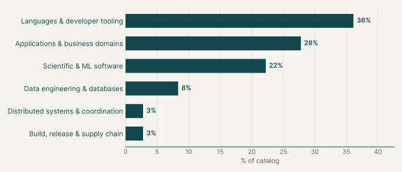
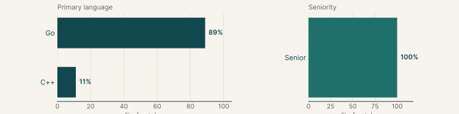
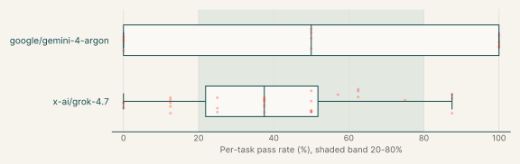
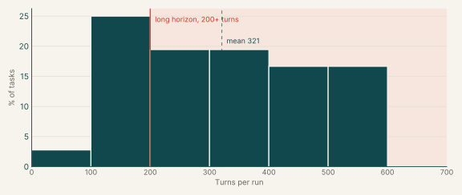
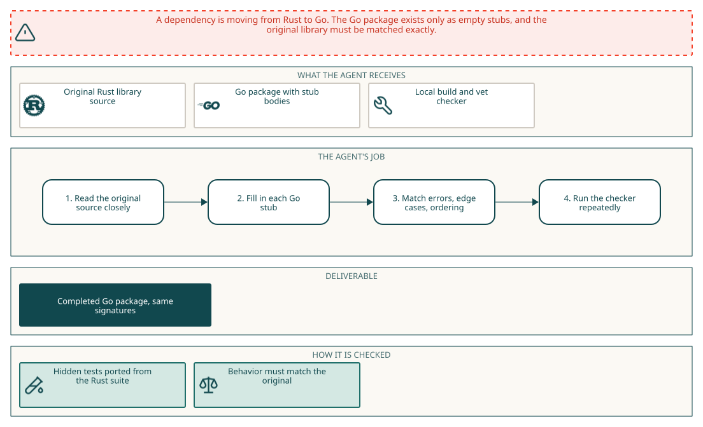
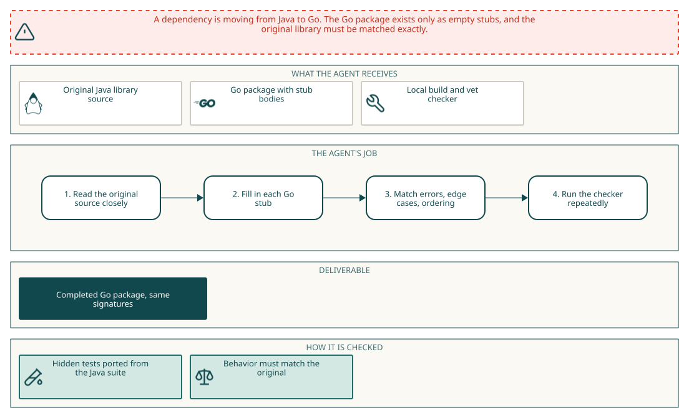

# Migration

## Why this catalog

### Problems engineers face

Engineers in the catalog's main roles remove a dependency in one language by replacing it with a port in another. In these tasks the source is Java or Rust and the target is Go, with a few C++ targets such as `mamrhein/fpdec.rs`, cydhra/vers, toeverything/y-octo and houseme/qrcode-rs. The recurring difficulty is exact behavioral equivalence without seeing the tests: numeric precision in dynatrace-oss/dynahist and `fpdec.rs`, bit-exact random sequences in commons-rng-core, parser and error-case fidelity in rust-php-parser and htmlunit-xpath, and ordering of results in rust-rrule and dagre-rs. A second difficulty is the target language's runtime rules, such as Go's RE2 regular expressions panicking at start-up, or C++ header conventions in the `PORTING.md` for `fpdec.rs`. A third is working inside house constraints on imports and naming for code that ends up in a sandboxed service. The engineer reads the original source as the specification.

### How the tasks reproduce them

Each task provides the source library under `/app`, a skeleton in the target language with final signatures and stub bodies, and a mig-check tool that compares the skeleton, builds and vets the port. The tests of the original project, translated to the target language, are withheld and run in a separate container after the session. The agent's edits are collected as a `git diff` against a tagged base commit. The instruction states per-test time and memory limits and bans some standard packages. In the provided tasks a manifest lists the required tests, and the grader module records a reward from the passing results.

### Typical prompts

- A first-person request to port a named library or crate to Go from a reference folder, with a stub skeleton and withheld tests. Example.
- A request framed by a business reason for the move, such as retiring a JVM dependency, with emphasis on exact reproduction of seeded output. Example.
- A request for a C++ port because a tool cannot link Rust, with a pointer to a `PORTING.md` that lists house rules for headers. Example.
- A structured prompt with a title, a list of provided inputs, a how-to-work section and a statement that hidden tests grade the port. Example.
- A bullet list of language-specific pitfalls, such as RE2 regular expression syntax and reserved name prefixes. Example.

## Domain breakdown

| Domain | Sub-domain | % of catalog |
|---|---|---:|
| **Languages & developer tooling** |  | **36.1%** |
|  | Compilers & language runtimes | 19.4% |
|  | CLI tooling | 11.1% |
|  | Text & NLP processing, Data structures | 5.6% |
| **Applications & business domains** |  | **27.8%** |
|  | Media processing | 19.4% |
|  | Collaborative documents, Games & game engines | 8.3% |
| **Scientific & ML software** |  | **22.2%** |
|  | Statistics & numerical methods | 11.1% |
|  | Graph algorithms, Scientific computing, Probabilistic data structures | 11.1% |
| **Data engineering & databases** |  | **8.3%** |
|  | Data formats & serialization | 8.3% |
| **Distributed systems & coordination** |  | **2.8%** |
|  | Calendaring & recurrence | 2.8% |
| **Build, release & supply chain** |  | **2.8%** |
|  | Software supply chain | 2.8% |

## Language and seniority

### Primary language

| Primary language | % of catalog |
|---|---:|
| Go | 88.9% |
| C++ | 11.1% |

### Seniority

| Seniority | % of catalog |
|---|---:|
| Senior | 100.0% |

## Model pass rates across the catalog

| Model | Pass rate | Tasks at 0% | Tasks at 20-80% | Tasks at 100% |
|---|---:|---:|---:|---:|
| x-ai/grok-4.7 | 40% | 9% | 66% | 0% |
| google/gemini-4-argon | 50% | 33% | 33% | 33% |

## Turn counts and long-horizon tasks

A task's turn count is the average over its runs. A task is long horizon when that average is 200 or more turns.

| Measure | Value |
|---|---:|
| Average turn count | 320.7 |
| Median turn count | 335.4 |
| Range | 99 to 600 |
| Long-horizon tasks (200+ turns) | 72% of tasks |

| Model | % of tasks | Mean turns | % with 200+ turns |
|---|---:|---:|---:|
| x-ai/grok-4.7 | 89% | 287.5 | 52% |
| google/gemini-4-argon | 33% | 293.9 | 79% |
| z-ai/glm-5.3-flash | 11% | 600.0 | 100% |

## Example tasks from the shortlist

### Example 1: Graph algorithms (Go)

| Field | Value |
|---|---|
| Final category | Migration |
| Domain | Scientific & ML software |
| Sub-domain | Graph algorithms |
| Language | Go |
| Seniority | Senior |
| Turn count | 306 (google/gemini-4-argon), 441 (x-ai/grok-4.7) |
| Long horizon | yes |

Prompt shape: A first-person request to port a named library to Go from a source directory, with stubbed signatures given and the tests withheld, followed by a bullet list of build, naming and import rules.

#### Prompt

Full instruction given to the agent (instruction.md)

We're moving a dependency from Rust to Go, and I need a Go port of the `kookyleo/dagre-rs` crate. The Rust source is in `/app/rust_reference/`. I've already laid out the Go package in `/app/port/`: every type and function our code calls is there with its final signature, but the bodies are just stubs. Could you fill in the implementation so it behaves exactly like the Rust crate?

When you're done, I'll run the crate's own test suite, ported to Go, against `/app/port`. I'm not including those tests here, so please work from the Rust source itself and match it closely: error cases, edge cases, numeric precision and the order things come back in.

A few things that will save you some pain:

- Keep the signatures and the package name in `/app/port` as they are; our callers use them as-is. Edit the existing files in place and declare each type and function once.
- Run `mig-check` (on the PATH) often. It compares `/app/port` with the original stubs, runs `go build` and `go vet`, and flags package-level names that clash with our test helpers (they start with `mig` or `Mig`).
- Go's `regexp` is RE2, so Rust-only syntax such as the `(?u)` flag, `\u{...}` escapes, back-references and look-around makes a package-level `regexp.MustCompile` panic at start-up.
- This package ends up inside a sandboxed service, so every non-test `.go` file under `/app/port` must stay off `os`, `os/exec`, `syscall`, `runtime`, `plugin`, `net`, `net/http`, `net/rpc`, `io/ioutil`, `embed`, `unsafe`, `flag` or `testing` (and anything under `testing/`), cgo, and the `//go:linkname` and `//go:embed` directives. Write the logic yourself rather than calling out to another program; the rest of the standard library is fine.
- Our test machine has 2 vCPUs, and each test gets 60 seconds and a 2 GB address-space limit, so keep things reasonably efficient.

#### Pass rates

| Model | Pass rate | Mean score |
|---|---:|---:|
| x-ai/grok-4.7 | 38% | 0.38 |
| google/gemini-4-argon | 50% | 0.50 |

#### Environment

#### How it maps to the work

A library engineer is replacing a Rust graph-layout dependency with a Go package. The engineer has the crate source and a Go skeleton with final signatures. The work is to read the layout stages in the Rust source and reproduce their output, including coordinates and edge points, in Go.

### Example 2: Software supply chain (Go)

| Field | Value |
|---|---|
| Final category | Migration |
| Domain | Build, release & supply chain |
| Sub-domain | Software supply chain |
| Language | Go |
| Seniority | Senior |
| Turn count | 352 (x-ai/grok-4.7) |
| Long horizon | yes |

Prompt shape: A first-person request to port a named library to Go from a source directory, with stubbed signatures given and the tests withheld, followed by a bullet list of build, naming and import rules.

#### Prompt

Full instruction given to the agent (instruction.md)

We're moving a dependency from Java to Go, and I need a Go port of the `nscuro/versatile` library. The Java source is in `/app/java_reference/`. I've already laid out the Go package in `/app/port/`: every type and function our code calls is there with its final signature, but the bodies are just stubs. Could you fill in the implementation so it behaves exactly like the Java library?

When you're done, I'll run the library's own test suite, ported to Go, against `/app/port`. I'm not including those tests here, so please work from the Java source itself and match it closely: error cases, edge cases, numeric precision and the order things come back in.

A few things that will save you some pain:

- Keep the signatures and the package name in `/app/port` as they are; our callers use them as-is. Edit the existing files in place and declare each type and function once.
- Run `mig-check` (on the PATH) often. It compares `/app/port` with the original stubs, runs `go build` and `go vet`, and flags package-level names that clash with our test helpers (they start with `mig` or `Mig`).
- Go's `regexp` is RE2, so Java-only syntax such as the `(?u)` flag, back-references, look-around and `\u{...}` escapes makes a package-level `regexp.MustCompile` panic at start-up.
- This package ends up inside a sandboxed service, so every non-test `.go` file under `/app/port` must stay off `os`, `os/exec`, `syscall`, `runtime`, `plugin`, `net`, `net/http`, `net/rpc`, `io/ioutil`, `embed`, `unsafe`, `flag` or `testing` (and anything under `testing/`), cgo, and the `//go:linkname` and `//go:embed` directives. Write the logic yourself rather than calling out to another program; the rest of the standard library is fine.
- Our test machine has 2 vCPUs, and each test gets 60 seconds and a 2 GB address-space limit, so keep things reasonably efficient.

#### Pass rates

| Model | Pass rate | Mean score |
|---|---:|---:|
| x-ai/grok-4.7 | 50% | 0.50 |

#### Environment

#### How it maps to the work

A build and release engineer who works on software supply-chain tooling needs a Go version of a Java version and version-range library (the skeleton files cover versions, ranges and overlap). The engineer reads the Java code and reproduces its handling of edge-case inputs and ordering.

### Example 3: CLI tooling (Go)

| Field | Value |
|---|---|
| Final category | Migration |
| Domain | Languages & developer tooling |
| Sub-domain | CLI tooling |
| Language | Go |
| Seniority | Senior |
| Turn count | 214 (google/gemini-4-argon), 140 (x-ai/grok-4.7) |
| Long horizon | no |

Prompt shape: A first-person request to port a named library to Go from a source directory, with stubbed signatures given and the tests withheld, followed by a bullet list of build, naming and import rules.

#### Prompt

Full instruction given to the agent (instruction.md)

We're moving a dependency from Java to Go, and I need a Go port of the `argparse4j/argparse4j` library. The Java source is in `/app/java_reference/`. I've already laid out the Go package in `/app/port/`: every type and function our code calls is there with its final signature, but the bodies are just stubs. Could you fill in the implementation so it behaves exactly like the Java library?

When you're done, I'll run the library's own test suite, ported to Go, against `/app/port`. I'm not including those tests here, so please work from the Java source itself and match it closely: error cases, edge cases, numeric precision and the order things come back in.

A few things that will save you some pain:

- Keep the signatures and the package name in `/app/port` as they are; our callers use them as-is. Edit the existing files in place and declare each type and function once.
- Run `mig-check` (on the PATH) often. It compares `/app/port` with the original stubs, runs `go build` and `go vet`, and flags package-level names that clash with our test helpers (they start with `mig` or `Mig`).
- Go's `regexp` is RE2, so Java-only syntax such as the `(?u)` flag, back-references, look-around and `\u{...}` escapes makes a package-level `regexp.MustCompile` panic at start-up.
- This package ends up inside a sandboxed service, so every non-test `.go` file under `/app/port` must stay off `os`, `os/exec`, `syscall`, `runtime`, `plugin`, `net`, `net/http`, `net/rpc`, `io/ioutil`, `embed`, `unsafe`, `flag` or `testing` (and anything under `testing/`), cgo, and the `//go:linkname` and `//go:embed` directives. Write the logic yourself rather than calling out to another program; the rest of the standard library is fine.
- Our test machine has 2 vCPUs, and each test gets 60 seconds and a 2 GB address-space limit, so keep things reasonably efficient.

#### Pass rates

| Model | Pass rate | Mean score |
|---|---:|---:|
| x-ai/grok-4.7 | 62% | 0.62 |
| google/gemini-4-argon | 100% | 1.00 |

#### Environment

#### How it maps to the work

A developer-tools engineer moving a command-line tool from Java to Go needs the argument-parsing library in Go. The engineer reads the Java parsing and help-formatting code and reproduces parsing, formatting, error cases and result ordering as the instruction requires.
