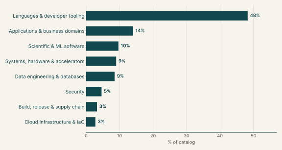
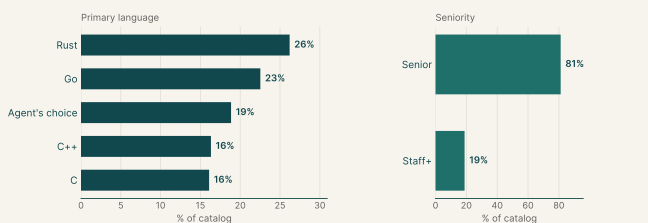
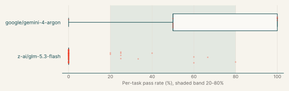
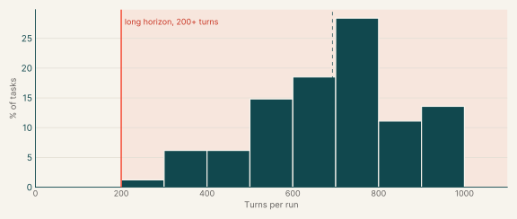
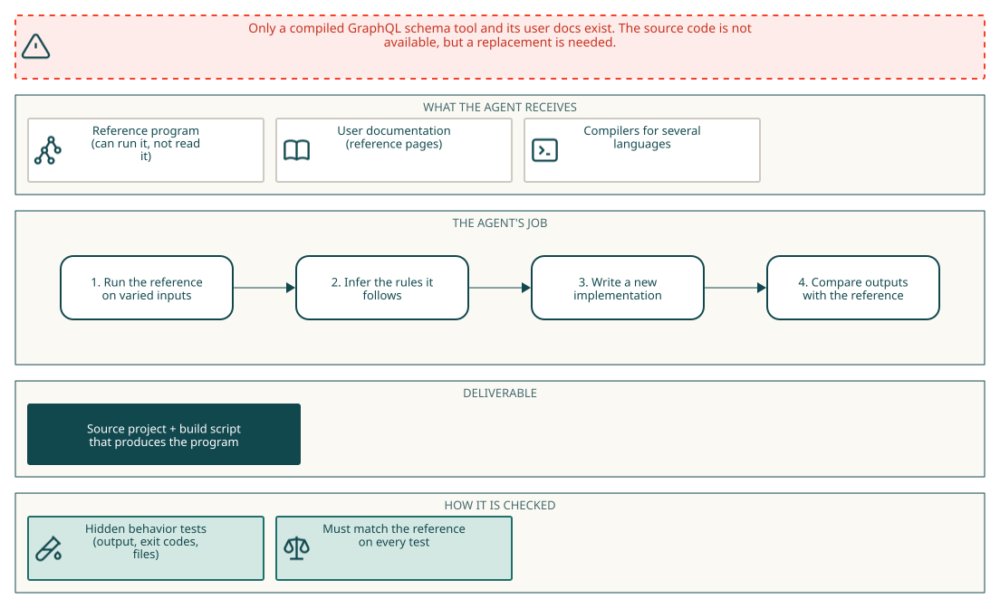

# ProgramBench

## Why this catalog

### Problems engineers face

Engineers are often asked to reproduce what a program does when its source is not available to them or no longer fits: replacing a legacy tool, rebuilding a component in another language, or bringing a codebase up to the behavior of a newer release. In that situation the documentation and the program's observable behavior are the specification. The engineer chooses the language and architecture, writes the code and the build, and checks the result against the original's outputs. ProgramBench frames this as rebuilding a program from scratch. The agent receives a compiled executable and its documentation, cannot read or decompile the executable, and has no internet access. It gets no method signatures, class skeletons or requirement documents, so every design decision is the agent's own. A hidden behavioral test suite, generated by agent-driven fuzzing, compares the candidate with the original, and a task counts as resolved only when all of its tests pass. This catalog also includes repository-upgrade tasks, which apply the same black-box comparison to an existing codebase that must reach a later release's behavior.

### How the tasks reproduce them

Each task gives a reference program that can be run but not read, plus documentation that may be outdated. Upgrade tasks place a repository in `/app/repo` and require a fixed build command, `/opt/task/build.sh`. Reimplementation tasks give only docs in `/workspace/docs` and require a source project with `compile.sh` that builds.`/executable` offline in a clean container. The language is the existing one for upgrades and the agent's choice for reimplementation. Grading replays hidden recorded behaviors against the rebuilt executable and compares exit code, output and file effects. Upgrade instructions say every hidden test must pass and include tests for unchanged behavior. Reimplementation scoring is the fraction of behaviors matched. Some upgrade tasks also require a research and planning file before any edit.

### Typical prompts

- Update an existing repository to match a reference binary, with a note that docs in the repo may be outdated.
- Preserve existing behavior while adding required changes, stated as hidden tests that cover both.
- Write a research and plan document before editing any code, then implement.
- Reproduce the documented behavior of a program from docs and an execute-only binary, delivered as source plus `compile.sh`.
- Close with a self-check list that compares every option and subcommand of the reference against the rebuilt program.

## Domain breakdown

| Domain | Sub-domain | % of catalog |
|---|---|---:|
| **Languages & developer tooling** |  | **48.3%** |
|  | Compilers & language runtimes | 26.9% |
|  | CLI tooling | 14.3% |
|  | API tooling, Logic programming, Text & NLP processing | 7.1% |
| **Applications & business domains** |  | **14.0%** |
|  | Media processing, Fonts & text rendering, Web applications, Games & game engines, Payments & banking, Calendaring & recurrence, Web crawling, Frontend & UI state | 14.0% |
| **Scientific & ML software** |  | **9.7%** |
|  | Scientific computing, Geospatial, Machine learning & MLOps, CAD / CAM, Graph algorithms, AI agents & retrieval, Probabilistic data structures | 9.7% |
| **Systems, hardware & accelerators** |  | **9.0%** |
|  | Compression & data integrity, Filesystems, Networking & HTTP, Hardware RTL, IoT & smart home, Emulators, Memory management | 9.0% |
| **Data engineering & databases** |  | **8.5%** |
|  | Data formats & serialization, Databases & storage engines, SQL tooling, Data validation | 8.5% |
| **Security** |  | **4.6%** |
|  | Binary analysis, Cryptography & secure protocols, Secrets & access control, Secret scanning, Parser security hardening, Cloud security & compliance | 4.6% |
| **Build, release & supply chain** |  | **3.2%** |
|  | Build systems, CI/CD, Software supply chain | 3.2% |
| **Cloud infrastructure & IaC** |  | **2.8%** |
|  | Configuration management, Cloud infra: containers & self-hosted platforms, Cloud infra: AWS platform stacks | 2.8% |

## Language and seniority

### Primary language

| Primary language | % of catalog |
|---|---:|
| Rust | 26.2% |
| Go | 22.5% |
| Agent's choice | 18.9% |
| C++ | 16.3% |
| C | 16.1% |

### Seniority

| Seniority | % of catalog |
|---|---:|
| Senior | 81.1% |
| Staff+ | 18.9% |

## Model pass rates across the catalog

| Model | Pass rate | Tasks at 0% | Tasks at 20-80% | Tasks at 100% |
|---|---:|---:|---:|---:|
| z-ai/glm-5.3-flash | 6% | 85% | 15% | 0% |
| google/gemini-4-argon | 63% | 10% | 50% | 40% |

## Turn counts and long-horizon tasks

A task's turn count is the average over its runs. A task is long horizon when that average is 200 or more turns.

| Measure | Value |
|---|---:|
| Average turn count | 692.5 |
| Median turn count | 713.2 |
| Range | 299 to 1000 |
| Long-horizon tasks (200+ turns) | 100% of tasks |

| Model | % of tasks | Mean turns | % with 200+ turns |
|---|---:|---:|---:|
| z-ai/glm-5.3-flash | 100% | 713.3 | 95% |
| google/gemini-4-argon | 12% | 319.5 | 79% |

## Example tasks from the shortlist

### Example 1: Build systems (Agent's choice)

| Field | Value |
|---|---|
| Final category | ProgramBench reimplementation |
| Domain | Build, release & supply chain |
| Sub-domain | Build systems |
| Language | Agent's choice |
| Seniority | Staff+ |
| Turn count | 698 (z-ai/glm-5.3-flash) |
| Long horizon | yes |

Prompt shape: A fixed template that names an execute-only reference binary and its docs, asks for a source project plus `compile.sh`, and ends with scoring rules and a self-comparison checklist.

#### Prompt

Full instruction given to the agent (instruction.md)

###### Task context

Reproduce the documented behavior of the program in this workspace. The reference program is `/opt/task-reference/executable`. Its bundled documentation is available in the workspace. The task runs model commands as the non-root `agent` user. The reference is execute-only for that user, so it can be run but not read, copied, hard-linked, or recovered through `/proc`. A root model shell means the task platform did not honor the declared user and is not part of the task contract.

###### Required result

Write a source code project and an executable `./compile.sh`. Running `./compile.sh` on a fresh checkout must produce `./executable` in the workspace root. The rebuilt executable must match the reference program's observable behavior, including output, exit codes, and file system effects.

You may choose the implementation language and design. You can learn the behavior from the bundled documentation and by running the reference program.

The grader checks only your submission's fresh offline build and its observable behavior. It does not assess your implementation language or how you learned the behavior. Do not include the reference executable's bytes in the submission under another name or embedded inside another file. Do not read or inspect the grader harness, hidden tests, or recorded expectations, even if a platform defect makes them accessible. During grading, the internet, package registries, the reference program, and system copies of the same tool are unavailable. Your build and executable must work without them.

###### Reusable input assets

When `/workspace/assets` exists, it contains hard-to-create reusable inputs
such as media, archives, databases, or custom binary files. You may inspect,
copy, or modify these inputs while recreating the program. Ordinary source and
text inputs are not provided and should be created as needed.

###### How your work is scored

Your executable is graded by replaying many recorded behaviors of the
reference program against it and scoring the fraction that match. A
match always requires the same exit code and the same file system effects.
Plain output and ordinary files are compared byte for byte. JSON output and
JSON files are normally compared as parsed values, so insignificant whitespace
and object key order do not matter unless the documentation makes formatting or
ordering part of the behavior. SQLite files are compared by their logical
contents. Terminal progress output is compared by its final visible text. A
recorded behavior can require exact bytes when formatting or ordering is part
of the documented behavior. Partial credit is the norm, so every additional
behavior you match raises your score, and there is no bonus for finishing early.

###### Coverage to aim for

Grading samples behavior from the documented interface. Only behavior that can be tested reliably in a bounded offline run is graded.

When applicable, support:

- commands, subcommands, options, aliases, and short forms
- representative documented values
- help and version output
- standard input, files, and directories
- configuration files and environment variables
- standard output, standard error, exit codes, and file system effects
- error handling
- empty, non-ASCII, binary, and unusually named inputs

The test suite may not cover every documented behavior.

###### Using the reference program

Run `/opt/task-reference/executable` to observe the reference. The file is
outside the submitted workspace and is unavailable during grading. Your
`./compile.sh` can therefore write `./executable` without replacing the
reference while you work.

###### Before you finish

Passing tests you wrote yourself is not evidence that you are done.
Before you stop:

1. list every option and subcommand in the reference program's help output;
2. for each one, run `/opt/task-reference/executable` and your executable on the
   same input and compare output using the scoring rules above, along with the
   exit code and files written;
3. fix every disagreement you find, then repeat from step 1.

Stop when no disagreement remains or when your budget is spent,
whichever comes first.

#### Pass rates

| Model | Pass rate | Mean score |
|---|---:|---:|
| z-ai/glm-5.3-flash | 0% | 0.13 |

#### Environment

#### How it maps to the work

A build engineer is asked to replace a build file generator whose source is not at hand, using its manual and the installed binary. They run the tool on small Go and protobuf trees, record which BUILD.bazel files and directives it produces, and write a program that produces the same files. The work resembles porting an internal build tool to a new stack while keeping existing repositories building.

### Example 2: Compression & data integrity (Agent's choice)

| Field | Value |
|---|---|
| Final category | ProgramBench reimplementation |
| Domain | Systems, hardware & accelerators |
| Sub-domain | Compression & data integrity |
| Language | Agent's choice |
| Seniority | Staff+ |
| Turn count | 88 (google/gemini-4-argon), 387 (z-ai/glm-5.3-flash) |
| Long horizon | yes |

Prompt shape: A fixed template naming an execute-only reference binary, with a single README so most behavior must be learned by running the program.

#### Prompt

Full instruction given to the agent (instruction.md)

###### Task context

Reproduce the documented behavior of the program in this workspace. The reference program is `/opt/task-reference/executable`. Its bundled documentation is available in the workspace. The task runs model commands as the non-root `agent` user. The reference is execute-only for that user, so it can be run but not read, copied, hard-linked, or recovered through `/proc`. A root model shell means the task platform did not honor the declared user and is not part of the task contract.

###### Required result

Write a source code project and an executable `./compile.sh`. Running `./compile.sh` on a fresh checkout must produce `./executable` in the workspace root. The rebuilt executable must match the reference program's observable behavior, including output, exit codes, and file system effects.

You may choose the implementation language and design. You can learn the behavior from the bundled documentation and by running the reference program.

The grader checks only your submission's fresh offline build and its observable behavior. It does not assess your implementation language or how you learned the behavior. Do not include the reference executable's bytes in the submission under another name or embedded inside another file. Do not read or inspect the grader harness, hidden tests, or recorded expectations, even if a platform defect makes them accessible. During grading, the internet, package registries, the reference program, and system copies of the same tool are unavailable. Your build and executable must work without them.

###### Reusable input assets

When `/workspace/assets` exists, it contains hard-to-create reusable inputs
such as media, archives, databases, or custom binary files. You may inspect,
copy, or modify these inputs while recreating the program. Ordinary source and
text inputs are not provided and should be created as needed.

###### How your work is scored

Your executable is graded by replaying many recorded behaviors of the
reference program against it and scoring the fraction that match. A
match always requires the same exit code and the same file system effects.
Plain output and ordinary files are compared byte for byte. JSON output and
JSON files are normally compared as parsed values, so insignificant whitespace
and object key order do not matter unless the documentation makes formatting or
ordering part of the behavior. SQLite files are compared by their logical
contents. Terminal progress output is compared by its final visible text. A
recorded behavior can require exact bytes when formatting or ordering is part
of the documented behavior. Partial credit is the norm, so every additional
behavior you match raises your score, and there is no bonus for finishing early.

###### Coverage to aim for

Grading samples behavior from the documented interface. Only behavior that can be tested reliably in a bounded offline run is graded.

When applicable, support:

- commands, subcommands, options, aliases, and short forms
- representative documented values
- help and version output
- standard input, files, and directories
- configuration files and environment variables
- standard output, standard error, exit codes, and file system effects
- error handling
- empty, non-ASCII, binary, and unusually named inputs

The test suite may not cover every documented behavior.

###### Using the reference program

Run `/opt/task-reference/executable` to observe the reference. The file is
outside the submitted workspace and is unavailable during grading. Your
`./compile.sh` can therefore write `./executable` without replacing the
reference while you work.

###### Before you finish

Passing tests you wrote yourself is not evidence that you are done.
Before you stop:

1. list every option and subcommand in the reference program's help output;
2. for each one, run `/opt/task-reference/executable` and your executable on the
   same input and compare output using the scoring rules above, along with the
   exit code and files written;
3. fix every disagreement you find, then repeat from step 1.

Stop when no disagreement remains or when your budget is spent,
whichever comes first.

#### Pass rates

| Model | Pass rate | Mean score |
|---|---:|---:|
| z-ai/glm-5.3-flash | 60% | 0.57 |
| google/gemini-4-argon | 50% | 0.50 |

#### Environment

#### How it maps to the work

A systems engineer must produce a compressor and decompressor that is byte compatible with an existing Snappy tool. With a short README and the binary, they feed it varied and malformed inputs, study the output and error cases, and write an implementation whose files and exit codes match.

### Example 3: API tooling (Agent's choice)

| Field | Value |
|---|---|
| Final category | ProgramBench reimplementation |
| Domain | Languages & developer tooling |
| Sub-domain | API tooling |
| Language | Agent's choice |
| Seniority | Staff+ |
| Turn count | 188 (google/gemini-4-argon), 776 (z-ai/glm-5.3-flash) |
| Long horizon | yes |

Prompt shape: A fixed template naming an execute-only reference binary, with one documentation page per language feature as the specification.

#### Prompt

Full instruction given to the agent (instruction.md)

###### Task context

Reproduce the documented behavior of the program in this workspace. The reference program is `/opt/task-reference/executable`. Its bundled documentation is available in the workspace. The task runs model commands as the non-root `agent` user. The reference is execute-only for that user, so it can be run but not read, copied, hard-linked, or recovered through `/proc`. A root model shell means the task platform did not honor the declared user and is not part of the task contract.

###### Required result

Write a source code project and an executable `./compile.sh`. Running `./compile.sh` on a fresh checkout must produce `./executable` in the workspace root. The rebuilt executable must match the reference program's observable behavior, including output, exit codes, and file system effects.

You may choose the implementation language and design. You can learn the behavior from the bundled documentation and by running the reference program.

The grader checks only your submission's fresh offline build and its observable behavior. It does not assess your implementation language or how you learned the behavior. Do not include the reference executable's bytes in the submission under another name or embedded inside another file. Do not read or inspect the grader harness, hidden tests, or recorded expectations, even if a platform defect makes them accessible. During grading, the internet, package registries, the reference program, and system copies of the same tool are unavailable. Your build and executable must work without them.

###### Reusable input assets

When `/workspace/assets` exists, it contains hard-to-create reusable inputs
such as media, archives, databases, or custom binary files. You may inspect,
copy, or modify these inputs while recreating the program. Ordinary source and
text inputs are not provided and should be created as needed.

###### How your work is scored

Your executable is graded by replaying many recorded behaviors of the
reference program against it and scoring the fraction that match. A
match always requires the same exit code and the same file system effects.
Plain output and ordinary files are compared byte for byte. JSON output and
JSON files are normally compared as parsed values, so insignificant whitespace
and object key order do not matter unless the documentation makes formatting or
ordering part of the behavior. SQLite files are compared by their logical
contents. Terminal progress output is compared by its final visible text. A
recorded behavior can require exact bytes when formatting or ordering is part
of the documented behavior. Partial credit is the norm, so every additional
behavior you match raises your score, and there is no bonus for finishing early.

###### Coverage to aim for

Grading samples behavior from the documented interface. Only behavior that can be tested reliably in a bounded offline run is graded.

When applicable, support:

- commands, subcommands, options, aliases, and short forms
- representative documented values
- help and version output
- standard input, files, and directories
- configuration files and environment variables
- standard output, standard error, exit codes, and file system effects
- error handling
- empty, non-ASCII, binary, and unusually named inputs

The test suite may not cover every documented behavior.

###### Using the reference program

Run `/opt/task-reference/executable` to observe the reference. The file is
outside the submitted workspace and is unavailable during grading. Your
`./compile.sh` can therefore write `./executable` without replacing the
reference while you work.

###### Before you finish

Passing tests you wrote yourself is not evidence that you are done.
Before you stop:

1. list every option and subcommand in the reference program's help output;
2. for each one, run `/opt/task-reference/executable` and your executable on the
   same input and compare output using the scoring rules above, along with the
   exit code and files written;
3. fix every disagreement you find, then repeat from step 1.

Stop when no disagreement remains or when your budget is spent,
whichever comes first.

#### Pass rates

| Model | Pass rate | Mean score |
|---|---:|---:|
| z-ai/glm-5.3-flash | 20% | 0.12 |
| google/gemini-4-argon | 50% | 0.41 |

#### Environment

#### How it maps to the work

A developer tools engineer must reproduce a schema language compiler that expands extended GraphQL into plain GraphQL. They write input schemas that use each documented feature, compare the generated files and diagnostics against the binary, and implement the same expansion.
