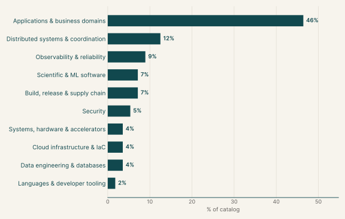
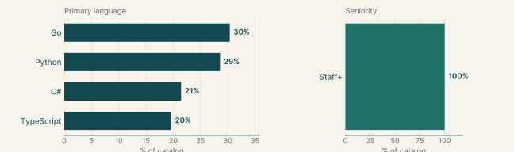
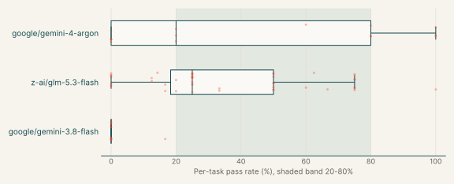
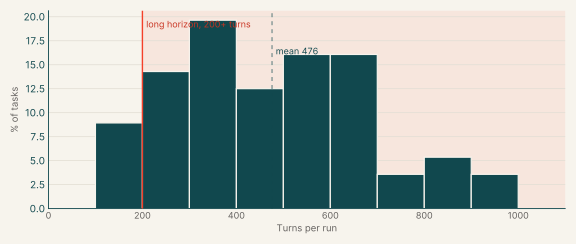
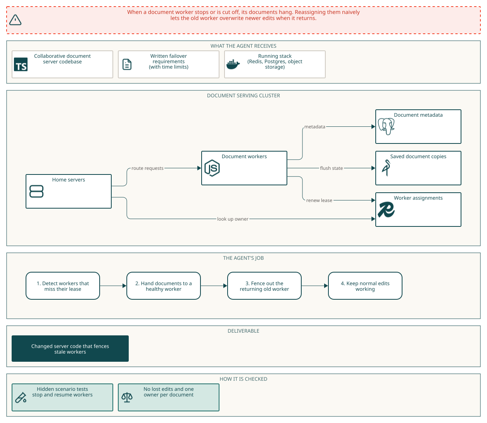
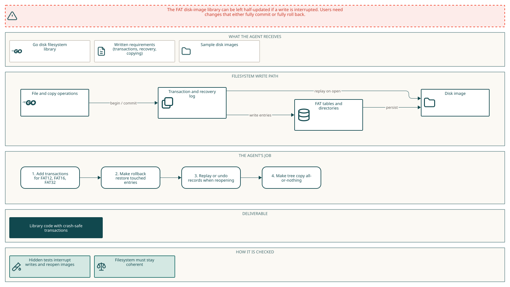
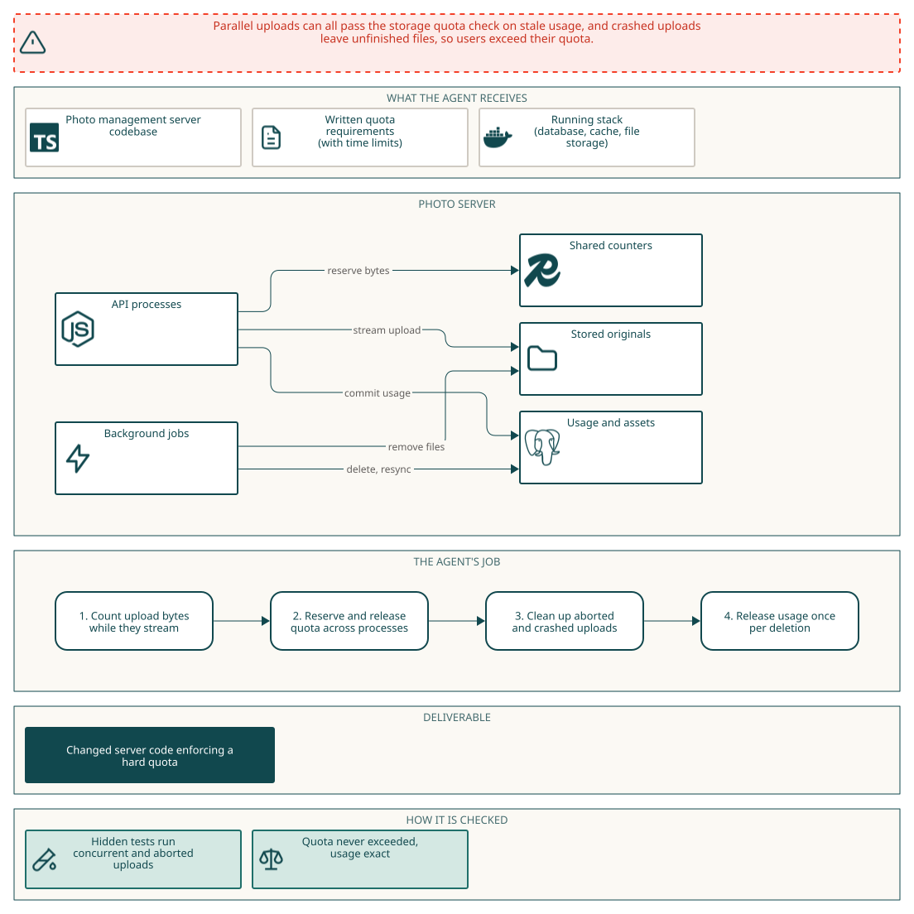

# System design

## Why this catalog

### Problems engineers face

Engineers in this catalog work on services where several processes share state and any of them can stop at any moment. The tasks show five recurring problems. First, duplicate effects after retries or worker restarts. Second, lost notifications when a broker or cache is down after the database commit. Third, stale writers that return after takeover. Fourth, limits and counters that hold in one process but not across instances. Fifth, partial state after a crash. The cluster tasks are system design; the single-component tasks are fault tolerance. Most specs also require that existing behaviour keeps working during the change, so a fix that blocks all writes does not pass. Time bounds such as 45 seconds after recovery turn vague reliability goals into testable ones.

### How the tasks reproduce them

Each task pins a real open source repository at a base commit and gives the agent a short written spec with time bounds, such as recovery within 45 seconds. Cluster tasks supply databases, caches or brokers locally or through a compose file, and the instruction says the agent runs separate processes for each role. Docker is unavailable inside the agent container, so the agent starts local services itself. The agent produces a patch to the repository. The verifier runs in a separate environment, applies the patch and hidden tests, and kills or pauses processes and services to check the stated behaviour. The tests also check that existing behaviour listed in a keep-working section still passes.

### Typical prompts

- A production symptom with its mechanism, then a bulleted list of measurable requirements with time limits.
- A missing capability stated in the form 'X cannot do Y', followed by dense behavioural paragraphs.
- A story-style problem report from a team, then 'To close this out' requirements.
- A requirements list plus an explicit list of exported names and signatures to implement.
- A closing environment paragraph giving the repo path, service start commands, build command and the note that Docker is unavailable.

## Domain breakdown

| Domain | Sub-domain | % of catalog |
|---|---|---:|
| **Applications & business domains** |  | **46.4%** |
|  | Web applications | 30.4% |
|  | Payments & banking, Collaborative documents, Media processing | 16.1% |
| **Distributed systems & coordination** |  | **12.5%** |
|  | Workflow automation, Messaging & event streaming, Job scheduling | 12.5% |
| **Observability & reliability** |  | **8.9%** |
|  | Monitoring & observability | 8.9% |
| **Scientific & ML software** |  | **7.1%** |
|  | AI agents & retrieval, Graph algorithms, Medical imaging & healthcare | 7.1% |
| **Build, release & supply chain** |  | **7.1%** |
|  | CI/CD, Software supply chain | 7.1% |
| **Security** |  | **5.4%** |
|  | Secrets & access control | 5.4% |
| **Systems, hardware & accelerators** |  | **3.6%** |
|  | IoT & smart home, Filesystems | 3.6% |
| **Cloud infrastructure & IaC** |  | **3.6%** |
|  | Cloud infra: containers & self-hosted platforms | 3.6% |
| **Data engineering & databases** |  | **3.6%** |
|  | Data pipelines & ETL | 3.6% |
| **Languages & developer tooling** |  | **1.8%** |
|  | API tooling | 1.8% |

## Language and seniority

### Primary language

| Primary language | % of catalog |
|---|---:|
| Go | 30.4% |
| Python | 28.6% |
| C# | 21.4% |
| TypeScript | 19.6% |

### Seniority

| Seniority | % of catalog |
|---|---:|
| Staff+ | 100.0% |

## Model pass rates across the catalog

| Model | Pass rate | Tasks at 0% | Tasks at 20-80% | Tasks at 100% |
|---|---:|---:|---:|---:|
| z-ai/glm-5.3-flash | 35% | 15% | 72% | 2% |
| google/gemini-3.8-flash | 1% | 91% | 0% | 0% |
| google/gemini-4-argon | 44% | 33% | 47% | 20% |

## Turn counts and long-horizon tasks

A task's turn count is the average over its runs. A task is long horizon when that average is 200 or more turns.

| Measure | Value |
|---|---:|
| Average turn count | 475.9 |
| Median turn count | 464.3 |
| Range | 107 to 948 |
| Long-horizon tasks (200+ turns) | 91% of tasks |

| Model | % of tasks | Mean turns | % with 200+ turns |
|---|---:|---:|---:|
| z-ai/glm-5.3-flash | 84% | 559.1 | 93% |
| google/gemini-3.8-flash | 20% | 281.3 | 58% |
| google/gemini-4-argon | 27% | 349.9 | 88% |

## Example tasks from the shortlist

### Example 1: Collaborative documents (TypeScript)

| Field | Value |
|---|---|
| Final category | System design |
| Domain | Applications & business domains |
| Sub-domain | Collaborative documents |
| Language | TypeScript |
| Seniority | Staff+ |
| Turn count | 556 (z-ai/glm-5.3-flash) |
| Long horizon | yes |

Prompt shape: A failure scenario described as current behaviour, then outcome requirements with a configured lease value, followed by a keep-working paragraph and a setup paragraph.

#### Prompt

Full instruction given to the agent (instruction.md)

##### Fenced failover for document workers

We need documents served by a stopped or partitioned document worker to move to another worker, without the old worker overwriting edits if it comes back. Today such a worker keeps its Redis assignments after its liveness report expires, so requests to those documents hang, and simply reassigning them would let the old worker overwrite edits when it resumes.

###### What we need

- With `GRIST_DOC_WORKER_LEASE_SECONDS=3`, a worker that no longer renews its lease relinquishes its documents on the next home-server lookup. Another available worker serves the last flushed document and accepts edits. Concurrent lookups from two home servers agree on one owner and do not duplicate the document.
- A worker reporting within its lease retains its assignments.
- An old worker resuming after takeover refuses actions from its existing websocket clients and cannot publish another document state or overwrite its checksum. An upload started before takeover but completed afterward cannot become the current document, even if the new owner has already saved edits.

###### Keep working

Normal document reads and edits on multiple workers, the existing worker lookup and `GET /status`, and coordinated moves through `POST /api/docs/:docId/assign` that retain flushed edits. Healthy assignments stay stable across home servers and distribute documents across available workers.

###### Setup

The checkout is at `/app`. Redis, PostgreSQL and a versioned S3-compatible object store are available through `REDIS_URL`, `TYPEORM_*` and `GRIST_DOCS_S3_*`. Home and doc workers are separate processes from this build (`GRIST_SERVERS=home` or `GRIST_SERVERS=docs`). The solver container has no Docker daemon or internet; dependencies are installed. Run TypeScript builds from `/app` with `yarn run build`.

#### Pass rates

| Model | Pass rate | Mean score |
|---|---:|---:|
| z-ai/glm-5.3-flash | 20% | 0.20 |

#### Environment

#### How it maps to the work

An engineer operating a multi-worker document service has a stopped worker that keeps its Redis assignments, so requests hang, and a naive reassignment would let the old worker overwrite edits on resume. The engineer must add lease-based takeover and fence the stale worker at the websocket, state publication and upload paths.

### Example 2: Filesystems (Go)

| Field | Value |
|---|---|
| Final category | Fault tolerance |
| Domain | Systems, hardware & accelerators |
| Sub-domain | Filesystems |
| Language | Go |
| Seniority | Staff+ |
| Turn count | 295 (z-ai/glm-5.3-flash) |
| Long horizon | yes |

Prompt shape: A capability gap stated in one sentence, dense behavioural requirements, then an explicit list of exported names and signatures the solution must provide.

#### Prompt

Full instruction given to the agent (instruction.md)

go-diskfs cannot make crash-recoverable FAT metadata changes on whole disks or numbered partitions. Implement transactions for FAT12, FAT16, and FAT32 so committed mutations survive reopening completely, while rollback or interruption restores the prior coherent filesystem state. Make filesystem tree copying publish one recoverable destination outcome without changing established successful-copy behavior.

Rollback or interruption restores every touched allocation entry exactly, and overlapping transactions on one filesystem cannot publish conflicting outcomes or displace the active transaction. Reject unrepresentable clusters and values without writing bytes, and make durable state authoritative before reporting success. Include file, directory, allocation-chain, mirrored-table, and FAT32 free-space metadata in one outcome. Keep FAT12 and FAT16 fixed-root behavior without FSInformationSector writes.

Make recovery idempotent. Validate records against the selected filesystem geometry, never touch neighboring bytes, and return a coherent view before disk opening completes. Preserve existing probing errors, rename matching and replacement behavior, copy exclusions, contents, structure, timestamp handling, and label handling: an ordinary SetLabel made outside any transaction stays durable after the image is reopened. Keep existing exported signatures and concrete return types unchanged; in particular FileSystem.OpenFile continues to return a concrete *fat12.File.

Atomic copying must expose the complete reachable destination tree after reopening through Disk.GetFilesystem, or restore exactly the preceding tree after any source or destination failure. Nested directories and files must commit as one reachable tree.

Package github.com/diskfs/go-diskfs/filesystem/fat12 exports TransactionState, FATTransaction, ErrTransactionActive, RecoveryDisposition, and RecoveryReport; ErrTransactionActive reports exactly "FAT transaction already active". Package github.com/diskfs/go-diskfs/disk exposes Disk.RecoverFAT, and github.com/diskfs/go-diskfs/sync exposes CopyTransactionResult and CopyFileSystemAtomic. Disk.RecoverFAT returns an error, and writes no bytes, when the selected whole disk or partition holds no recognized FAT filesystem.

A FAT12 transaction spanning adjacent packed entries must reopen with byte-exact rollback or identical committed mirrored tables after durable synchronization. Interrupted file growth must restore the prior contents, length, allocation chain, and mirror agreement. Reject a malformed FAT32 transaction for incompatible partition geometry before changing reserved entries or neighboring partition bytes. Interrupted FAT32 commit recovery must leave allocation entries and FSInformationSector free-space hints describing the same durable outcome.

These are required in what you deliver:

- TransactionState: TransactionActive = iota, TransactionCommitted, TransactionRolledBack
- FATTransaction: SetCluster(cluster uint32, value uint32) error; Commit() error; Rollback() error; State() TransactionState
- (fs *FileSystem) BeginFATTransaction() (FATTransaction, error)
- (fs *FileSystem) RecoverFATTransaction() (RecoveryReport, error)
- ErrTransactionActive = errors.New("FAT transaction already active")
- RecoveryDisposition: RecoveryNone = iota, RecoveryRolledBack, RecoveryCompleted
- RecoveryReport{Disposition RecoveryDisposition}
- (d *Disk) RecoverFAT(partition int) (fat12.RecoveryReport, error)
- CopyTransactionResult{State fat12.TransactionState}
- CopyFileSystemAtomic(src fs.FS, dst *fat12.FileSystem) (CopyTransactionResult, error)

#### Pass rates

| Model | Pass rate | Mean score |
|---|---:|---:|
| z-ai/glm-5.3-flash | 75% | 0.75 |

#### Environment

#### How it maps to the work

An engineer maintaining a filesystem library needs FAT12, FAT16 and FAT32 metadata changes to survive a crash. They must add transactions with rollback and idempotent recovery, validate records against partition geometry, and make tree copying publish one recoverable result.

### Example 3: Media processing (TypeScript)

| Field | Value |
|---|---|
| Final category | System design |
| Domain | Applications & business domains |
| Sub-domain | Media processing |
| Language | TypeScript |
| Seniority | Staff+ |
| Turn count | 252 (google/gemini-4-argon), 383 (z-ai/glm-5.3-flash) |
| Long horizon | yes |

Prompt shape: A race condition described from the mechanism, then a bulleted list of behavioural requirements with time limits, and a closing environment paragraph with build command.

#### Prompt

Full instruction given to the agent (instruction.md)

Concurrent asset uploads can each pass the quota check using the same old usage value, after their files have already been written. A terminated API leaves an unfinished original on disk. The quota needs to remain a hard limit even while requests are still streaming.

To close this out:
- Make the per-user quota a hard limit across separate API processes, including uploads through shared links. Count bytes while multipart `POST /api/assets` bodies are arriving, including bodies without a declared file size. Refuse an upload that would exceed committed usage plus in-flight bytes with a quota error (HTTP 400 or 413), leaving no asset or rejected file. An active slow stream retains its space.
- Return space and remove unfinished originals on client abort within 5 seconds, and after an API process dies within 45 seconds, without requiring another request. Completing an upload charges its original once. `GET /api/users/me` reports committed usage, not in-flight bytes.
- Permanent deletion, whether requested repeatedly by emptying trash or through duplicate `AssetDelete` jobs on the `backgroundTask` queue, releases the original's usage exactly once; trash and restore leave it charged. Uploads whose checksum matches an existing asset return the existing id without charging twice. Users with no quota remain unrestricted.
- Admin quota updates and `UserSyncUsage` jobs cannot erase in-flight space; finishing concurrent uploads charges their accepted bytes exactly.

Work in `/app` (Immich at the pinned revision). PostgreSQL with VectorChord, Valkey/Redis and the shared `/data` upload directory are available through `DB_HOSTNAME=postgres`, `DB_USERNAME=postgres`, `DB_PASSWORD=postgres`, `DB_DATABASE_NAME=immich`, and `REDIS_HOSTNAME=redis`. Build with `pnpm --filter immich build` from `/app`. `api` and `microservices` run as separate workers via `IMMICH_WORKERS_INCLUDE`; Docker is unavailable inside the agent container.

#### Pass rates

| Model | Pass rate | Mean score |
|---|---:|---:|
| z-ai/glm-5.3-flash | 25% | 0.25 |
| google/gemini-4-argon | 80% | 0.80 |

#### Environment

#### How it maps to the work

An engineer on a media platform finds that concurrent uploads each pass a quota check against stale usage and that a killed API leaves partial files. The task is to turn the quota into a hard limit that counts streaming bytes across processes, reclaims space after aborts and process death, and releases usage once on deletion.
