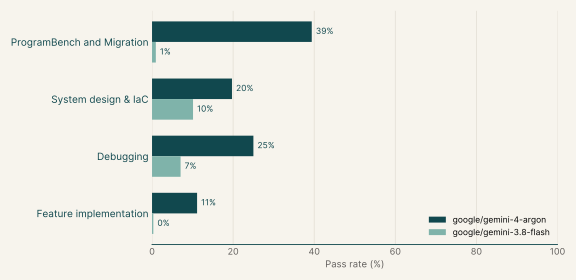
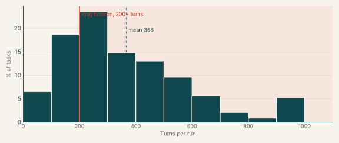

# Coding OTS RL Envs

605

Tasks

23%

Gemini 4 Argon pass rate

2%

Gemini 3.8 Flash pass rate

We selected our coding RL Envs where Gemini models fail and grouped them into four catalogs.

| Catalog | Tasks (estimated) | What the tasks do | % of all tasks | Average turn count |
|---|---:|---|---:|---:|
| [ProgramBench and Migration](programbench.md) | 283 | Rebuild or upgrade programs to match a reference exactly, or port libraries to another language. | 46.8% | 425 |
| [System design & IaC](system-design.md) | 123 | Keep running services and live infrastructure correct through failures and refactors. | 20.3% | 265 |
| [Diagnosis, Debugging, and Bug Fixing](debugging.md) | 98 | Find and fix faults in real codebases from symptoms or documentation. | 16.2% | 417 |
| [Feature implementation](feature-implementation.md) | 101 | Add capabilities to existing libraries and services without breaking current behaviour. | 16.7% | 348 |
| **Total** | **605** |  | **100%** |  |

## Gemini pass rates

| Model | Pass rate |
|---|---:|
| google/gemini-4-argon | 23% |
| google/gemini-3.8-flash | 2% |

## Samples

| Sample | Catalog | Example | Task id | Gemini 4 Argon | Gemini 3.8 Flash |
|---|---|---|---|---:|---:|
| Main | ProgramBench and Migration | [Example 1: Statistics & numerical methods (Go)](programbench.md#example-1-statistics-numerical-methods-go) | [`dynahist-go-port`](https://drive.google.com/file/d/1ChoekorIF6oHhZTUyDkKJex0iPC334b8/view) | 33% | 0% |
| Main | ProgramBench and Migration | [Example 2: Media processing (Agent's choice)](programbench.md#example-2-media-processing-agents-choice) | [`svtav1-encoder-rebuild`](https://drive.google.com/file/d/1JmlCRxmj-7RJ9yZ698lASh-GGDr2N9Je/view) | 0% |  |
| Main | ProgramBench and Migration | [Example 3: Graph algorithms (Go)](programbench.md#example-3-graph-algorithms-go) | [`dagre-go-port`](https://drive.google.com/file/d/1LEUYx_W7eOkFA8s4EEXnSfVbyYqMdLiD/view) | 50% |  |
| Main | System design & IaC | [Example 1: Payments & banking (TypeScript)](system-design.md#example-1-payments-banking-typescript) | [`actual-sync-compaction`](https://drive.google.com/file/d/1_sEAFRDztsqj6IIzgfOQ4KVr7m7Ff0-0/view) | 20% |  |
| Main | System design & IaC | [Example 2: Secrets & access control (Go)](system-design.md#example-2-secrets-access-control-go) | [`harbor-scanner-credentials`](https://drive.google.com/file/d/1aHmGorPxaObXqhuZbCDJxOM00L7U6V0m/view) | 20% |  |
| Main | System design & IaC | [Example 3: Software supply chain (C#)](system-design.md#example-3-software-supply-chain-c) | [`bagetter-fenced-writes`](https://drive.google.com/file/d/1yHr7nw0bfAZG5xO4uxrn_gH3GXffUFla/view) | 20% |  |
| Main | Diagnosis, Debugging, and Bug Fixing | [Example 1: Compilers & language runtimes (Python)](debugging.md#example-1-compilers-language-runtimes-python) | [`exo-canonical-ots`](https://drive.google.com/file/d/1hqLtS09dPnqztGyE15JRg9AZ0pS3fdAD/view) | 0% |  |
| Main | Diagnosis, Debugging, and Bug Fixing | [Example 2: Medical imaging & healthcare (Python)](debugging.md#example-2-medical-imaging-healthcare-python) | [`torchio-canonical-ots`](https://drive.google.com/file/d/1dAuRMjByz3IKD2Q7Qux8ZUoDjKNsHrvc/view) | 0% |  |
| Main | Diagnosis, Debugging, and Bug Fixing | [Example 3: Machine learning & MLOps (Python)](debugging.md#example-3-machine-learning-mlops-python) | [`swanlab-nanpair-ots`](https://drive.google.com/file/d/1ycCPNxGlpkKdgs2MHARCrZvTi6koSwwP/view) | 0% |  |
| Main | Feature implementation | [Example 1: Databases & storage engines (Go)](feature-implementation.md#example-1-databases-storage-engines-go) | [`memdb-txn-ots`](https://drive.google.com/file/d/1M3HCkXFdoznYOiY4yc3LlI8olgAA1K15/view) | 67% |  |
| Main | Feature implementation | [Example 2: Databases & storage engines (Python)](feature-implementation.md#example-2-databases-storage-engines-python) | [`sqlite-history-repair`](https://drive.google.com/file/d/146Un1dIq2RerHMbYpd5aWBnrQ6VpXLLV/view) | 0% |  |
| Main | Feature implementation | [Example 3: Data pipelines & ETL (Python)](feature-implementation.md#example-3-data-pipelines-etl-python) | [`etlplus-csv-pipeline`](https://drive.google.com/file/d/1j76u3l7Bo5yUlUhQCeFMMRASnZxfB8WD/view) | 0% |  |
| Attached | ProgramBench and Migration | Probabilistic data structures (Go) | [`heavykeeper-go-port`](https://drive.google.com/file/d/13JG9-uLtmoWpJ6xDy7VUyn2UjxIfHsyo/view) | 75% |  |
| Attached | System design & IaC | Cloud infra: containers & self-hosted platforms (HCL (Terraform)) | [`dualipv6-module-refactor`](https://drive.google.com/file/d/1Yg1iLWpltsqLdJS0jpUj4v3Wb3K4JlE-/view) | 0% |  |
| Attached | System design & IaC | Cloud infra: AWS platform stacks (HCL (Terraform)) | [`centralwatch-module-refactor`](https://drive.google.com/file/d/18b23bcb7ot9dDpaMF3nvcUVTGvYhg3aA/view) | 0% |  |
| Attached | System design & IaC | Cloud infra: AWS platform stacks (HCL (Terraform)) | [`modelrouter-module-refactor`](https://drive.google.com/file/d/1VrmncKJo_ub16T50JNG8Ep_0vONojAMq/view) | 50% |  |
| Attached | System design & IaC | Cloud infra: containers & self-hosted platforms (TypeScript) | [`atlasgrid-pulumi-migration`](https://drive.google.com/file/d/1l8nNQLGUM8GbW_dp8HFuPQb2nHNGh6J-/view) | 50% | 67% |
| Attached | System design & IaC | Web applications (TypeScript) | [`dittofeed-user-deletion`](https://drive.google.com/file/d/1cxE8Is6I9_6PCr0kAZZnMWp-ao9Z--xN/view) | 75% |  |
| Attached | System design & IaC | Media processing (TypeScript) | [`immich-storage-quotas`](https://drive.google.com/file/d/1iooMPQxDSF99aj7XHO7rn2HfRhoZEiYJ/view) | 80% |  |
| Attached | System design & IaC | Payments & banking (TypeScript) | [`medusa-cart-completion`](https://drive.google.com/file/d/1U6jZxHDbr-NnxBgwRvkZQplrsuJlpWCD/view) | 80% |  |
| Attached | Diagnosis, Debugging, and Bug Fixing | Web crawling (Python) | [`scrapy-pdk-ots`](https://drive.google.com/file/d/1REQsLCXJtRnoruzB2WlCUywZX56GZX8F/view) | 67% | 100% |
| Attached | Feature implementation | Data formats & serialization (Python) | [`xmltodict-nulls-etl`](https://drive.google.com/file/d/1seIRx1v4KsVyJvkEOHKyRWaV64otchUF/view) | 50% |  |

## Turn counts

A task's turn count is the average over its Gemini runs. Across all catalogs the average is 367 turns, and 75% of tasks average 200 turns or more.

