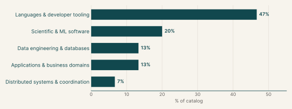
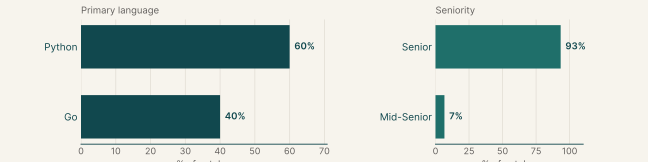
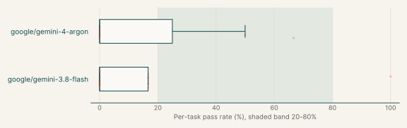
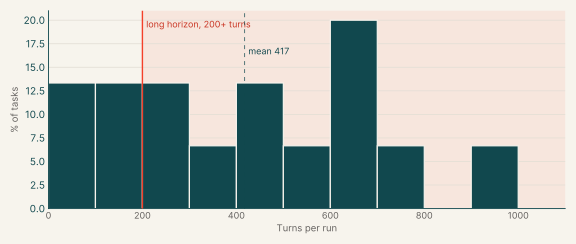
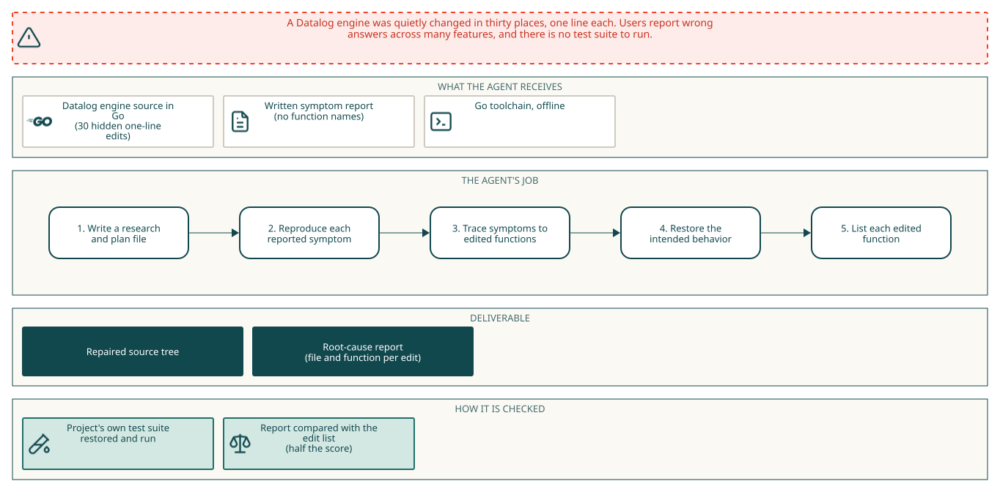
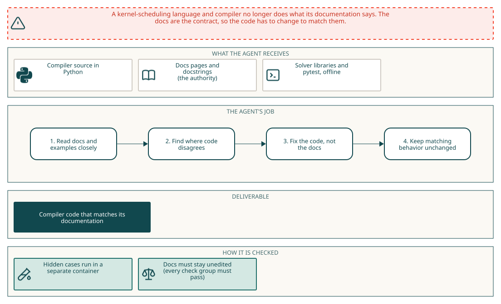
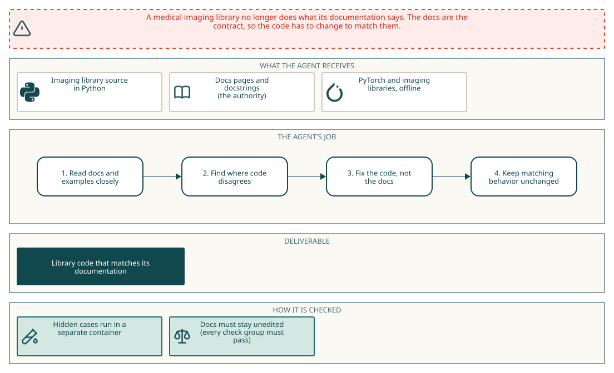
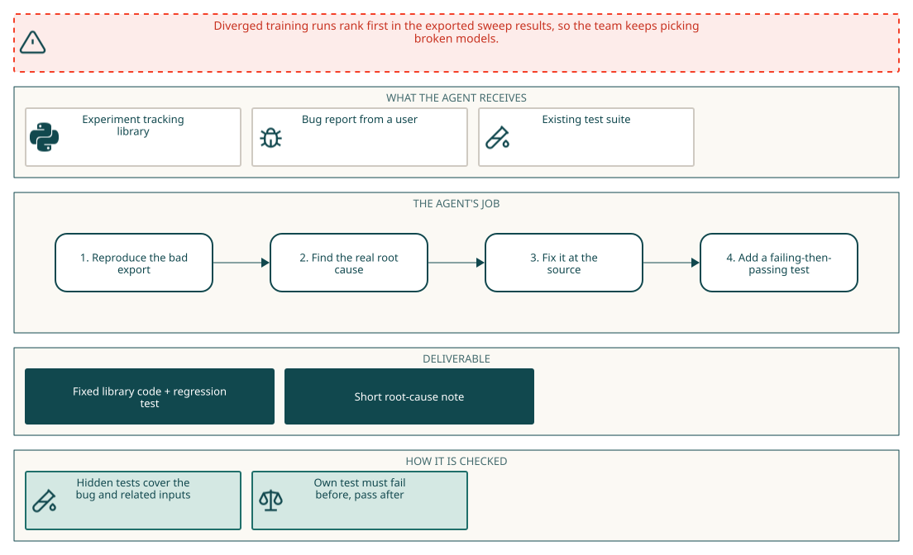

# Diagnosis, Debugging, and Bug Fixing

## Executive summary

<div class="kpis"><div class="kpi"><div class="kpi-value">98</div><div class="kpi-label">Tasks</div></div><div class="kpi"><div class="kpi-value">25%</div><div class="kpi-label">Gemini 4 Argon pass rate</div></div><div class="kpi"><div class="kpi-value">7%</div><div class="kpi-label">Gemini 3.8 Flash pass rate</div></div></div>

Each task gives the agent a codebase that misbehaves and a description of the symptoms or the documentation it should follow. The agent finds the faulty code, fixes it without breaking what already works, and in some tasks writes a report naming each root cause. Hidden tests check both the fixes and the code that was already correct.

Gemini 4 Argon passes 25% of its runs on these tasks, and it fails every run on 71% of the tasks. Gemini 3.8 Flash passes 7%, and it fails every run on 67% of the tasks. The main languages are Python (60%) and Go (40%).

| Domain | What the tasks do | % of catalog |
|---|---|---:|
| Languages & developer tooling | Find and fix faults in command-line tools, a compiler, a logic-programming engine and a utility library. | 47% |
| Scientific & ML software | Bring ML tracking, medical imaging and agent libraries back in line with their documentation. | 20% |
| Data engineering & databases | Fix SQL tooling and data validation libraries. | 13% |
| Applications & business domains | Fix a web crawler and a collaborative documents application. | 13% |
| Distributed systems & coordination | Fix a calendaring and recurrence library. | 7% |

## Why this catalog

### Problems engineers face

Maintainers are handed code that is wrong in several places and must find the causes without a test suite to lean on. In the diagnosis tasks, many undocumented edits break unrelated features at once. In the documentation-drift tasks, the code still runs but contradicts its own documentation. One task starts from a single production symptom with a hidden root cause. In all of them the engineer reproduces the symptom, finds the faulty function and repairs it without breaking neighbouring behaviour.

### How the tasks reproduce them

Each task ships a pinned checkout of an open-source project, with the tests withheld and no network. The prompt describes the symptoms or names the documentation in scope, never the location of the faults. Most diagnosis tasks also ask for `/app/rca.json`, which lists the file and function of each edit and is compared with an answer key. Drift tasks treat the documentation as the authority and forbid editing it. Hidden tests check the repairs and the behaviour that was already correct.

### Typical prompts

- A first-person list of symptoms grouped by feature, with no file or function named, ending in a request to fix and report.
- A stated number of undocumented edits and a JSON schema for the root-cause report.
- A library description with the source paths and documentation pages in scope, and the rule that documentation outranks code.

## Domain breakdown



## Language and seniority



### Primary language

| Primary language | % of catalog |
|---|---:|
| Python | 60.0% |
| Go | 40.0% |

### Seniority

| Seniority | % of catalog |
|---|---:|
| Senior | 93.3% |
| Mid-Senior | 6.7% |

## Gemini pass rates across the catalog

| Model | Pass rate | Tasks at 0% | Tasks at 20-80% | Tasks at 100% |
|---|---:|---:|---:|---:|
| google/gemini-4-argon | 25% | 71% | 29% | 0% |
| google/gemini-3.8-flash | 7% | 67% | 0% | 8% |



## Turn counts and long-horizon tasks

A task's turn count is the average over its Gemini runs. A task is long horizon when that average is 200 or more turns.

| Measure | Value |
|---|---:|
| Average turn count | 417.5 |
| Median turn count | 433.0 |
| Range | 54 to 916 |
| Long-horizon tasks (200+ turns) | 73% of tasks |



| Model | % of tasks | Mean turns | % with 200+ turns |
|---|---:|---:|---:|
| google/gemini-3.8-flash | 80% | 539.5 | 86% |
| google/gemini-4-argon | 47% | 280.6 | 67% |

## Example tasks from the shortlist

The first example is a main sample for the catalog; the others are attached samples. All of them come from the shortlist and have Gemini runs that pass at most half the time.

### Example 1: Logic programming (Go)

| Field | Value |
|---|---|
| Sample | Main sample for the catalog |
| Final category | Diagnosis, Debugging, and Bug Fixing |
| Domain | Languages & developer tooling |
| Sub-domain | Logic programming |
| Language | Go |
| Seniority | Senior |
| Turn count | 582 (google/gemini-4-argon), 658 (google/gemini-3.8-flash) |
| Long horizon | yes |

Prompt shape: A first-person symptom report grouped by subsystem and written in user terms without function names, followed by a request to restore the behavior, a JSON schema for `/app/rca.json` with one file and function per edit, and a requirement to write `/app/RESEARCH_AND_PLANNING.md` before touching code.

#### Prompt

<details open><summary>Full instruction given to the agent (instruction.md)</summary>
<div class="prompt-md">

##### Repairing google/mangle's Datalog toolchain without a test suite

I use this to write rules over stored rows and derive new rows from them. The repository has received 30 separate undocumented edits. Ordinary programs still load and evaluate, so the damage is scattered rather than total; what follows is everything I could pin down by using the system normally.

Submitting a program to be vetted before it runs now goes wrong in both directions. Programs that could never be ordered for evaluation are waved through: two relations each negating the other, a rule negating the very relation it defines, and a recursive rule that tallies over its own output all pass without complaint. The opposite happens too, and programs whose rules agree perfectly with the argument types written for them are refused as type errors: a lone rule copying a number out of one relation into another, and likewise the cases involving several alternatives offered as one type, element types of lists and of maps, and prefix conditions on strings and on hierarchical names. Two mistakes at minimum feed those refusals, one in how the outcome of comparing an inferred type against a written one is read and one in which type is taken for an argument position of a body condition, so curing either alone leaves the refusals in place.

The smaller questions that same vetting leans on are answered wrongly too. Where one relation's argument is written to range over another relation's argument, the type it inherits once every annotation is worked out is no longer every alternative written for that other relation taken together: annotations offering several alternatives and annotations offering exactly one behave as though swapped. Normalizing a goal so that no variable occurs twice mishandles the anonymous placeholder — an argument written as an underscore, which should be left alone, is renamed and picks up an extra equality, an ordinary variable already used elsewhere is left in place instead of getting a new name of its own and an equality, and the list of variables the goal is said to bind no longer agrees. Asking a list of variables whether a given variable is among them answers inverted, calling one that is present absent and one that is absent present, while asking for a variable's position still gives the right index and still gives -1 for one that is missing. Gathering the hierarchical name constants used as types no longer reaches the ones nested inside compound types, so after scanning a handful of annotations the gathered set differs from the names they mention, and asking which gathered prefix covers /something/something/foo no longer answers /something/something. And looking up the type written for a named member of a compound type gives a wrong answer for the required member and the optional one alike, though listing that compound's required and optional members separately still returns exactly what was written.

Getting programs and outside data in has its own failures. A type annotation that nests a pair holding a compound with one optional member and one required member whose type is a list of alternatives comes back with a different shape than was written, while the simpler annotations in the same file, including one using a tagged variant with two branches, come back intact. A source unit whose statements include the header naming the unit it belongs to now fails outright with an error, whether that header carries only the name or extra annotations alongside it; a unit with no such header is handled as it always was. And converting a document in the usual textual interchange notation holding a string, a floating point number, an array of booleans and a nested object fails with an error instead of coming back as a value with named members.

Running a program and reading the answers back has lost whole kinds of rule. A rule that keeps rows of one relation only when they are absent from another produces nothing at all, so a "present here but not there" query comes back empty, and the ordering of such conditions inside a body no longer matters because none of them work. A rule whose body compares two quantities for order also stops contributing, so conclusions that depend on one node lying between two others, or on a cycle being found by comparison, never appear. Asking the supplied comparison whether one floating point number is strictly greater than another yields an error instead of yes or no, while less-than, less-or-equal and greater-or-equal on the same numbers still answer, so a query for readings above a threshold yields nothing while the other four threshold queries are fine. Asking whether a string starts with a given prefix now gives the wrong verdict, including for a string tested against itself.

Answers that have to be assembled rather than read off are wrong in their own ways. A rule that groups over a body of several conditions and takes a maximum produces no result whatsoever, and when such a rule is reshaped into two rules the intermediate relation invented for the first half is numbered one too high, so the helper that should carry a 1 in its name carries a 2 and the pair of rules that comes out does not line up with the original at all. In a program keeping only the best value per key, written with an annotation saying that two arguments fix the third together with the name of a helper relation choosing the shorter of two lists, the shortest route is no longer the one retained: the four-step route survives in the store when only the direct one should, and two distinct misreadings of that annotation contribute, one in the part saying which arguments determine which and one in the part naming the helper. Querying one of the interchangeable stores for a two-argument relation with the first argument pinned to a name and the second left open returns the wrong set of rows, while the same query against the other stores returns both answers, and other query shapes against that same store are fine.

Asking why a conclusion holds is unreliable. With no depth limit requested, the account that comes back is cut short: for a conclusion reached through a negated condition I no longer get one complete account with its two supporting steps and an absence entry for the missing row. The second way of obtaining an account, by replaying a trace of the evaluation, disagrees with the direct search for the same goal about which stored rows the proof finally rests on. And writing an account out as tuples into a store now fails with an error rather than emitting them, so neither the per-shape tallies nor the single absence entry can be had at all.

Moments and spans of time are subtly wrong in several places. A moment built from a year, a month and a day comes out a minute after midnight instead of at midnight, though the day, month, year and zone are right. Shifting a moment in a named zone forward by one week, where the clocks change within that week, lands nowhere near the expected instant, while shifting by days, months or years over the same kind of change, and shifting by zero units, all land where they should. Asking whether two spans cross when the first ends exactly at the instant the second begins answers no, although that shared instant should count; nested, partly crossing, earlier and later pairs all answer as expected. Asking whether one span lies entirely earlier than another answers yes when the first ends exactly where the second starts, which should not count, while genuinely separated, crossing and reversed pairs answer as expected. Asking whether one span falls within another answers no when the two are identical, while one strictly inside another still answers yes and a partial crossing still answers no. The cap on how many spans may be attached to a single item is enforced one too late: with a cap of three a fourth is accepted, and with a cap of a hundred the hundred-and-first is accepted instead of being refused. And asking for back-to-back spans to be joined leaves them apart: two where the second begins one nanosecond after the first ends still count as two afterwards.

It worked before a set of undocumented edits to the source of mangle. The repository has
no test suite to run: finding out what is wrong, and convincing yourself you have fixed
it, is part of the task.

Restore the behavior described above.

Record the functions that contain those edits in `/app/rca.json`, one entry each:

```json
{
  "causes": [
    {
      "file": "analysis/declcheck.go",
      "function": "enclosing_function_name"
    },
    {
      "file": "analysis/declcheck.go",
      "function": "Type.method_name"
    }
  ]
}
```

`file` is the path of the file relative to the repository root, written exactly as it
appears in the tree. A file inside a directory keeps its directory prefix: the example
above is `analysis/declcheck.go`, not `declcheck.go`.

`function` is the function name. A class or receiver prefix, written `Type.name`, is
accepted anywhere and is required when two functions in the same file share a name: the
bare name cannot tell them apart. When an edit sits inside a function nested in another
function, either name is accepted. Name every function one of the undocumented edits is
in, and only those. Where you wrote the fix does not matter: if you restored the behavior
from a caller or from a helper of your own, name the function the edit is in rather than
the one you wrote. If you suspect a function but found no edit in it, leave it out.


Before you edit any code, write your research and your plan to /app/RESEARCH_AND_PLANNING.md. Cover what you learned about the existing code and the constraints that shape the change, then how you intend to carry it out and why, including how you will know it works. Be concrete - the files, names and decisions specific to this codebase, not generalities. Complete the document before you touch any code: it is the record of your up-front investigation and decisions, and it should not be rewritten to match whatever the implementation turns into afterwards. Once it is done, implement the plan.

</div>
</details>

#### Pass rates

| Model | Pass rate | Mean score |
|---|---:|---:|
| google/gemini-4-argon | 50% | 0.50 |
| google/gemini-3.8-flash | 0% | 0.00 |

#### Environment



#### How it maps to the work

A maintainer of a Datalog engine receives a user report that undocumented single-line edits have broken parsing, type checking, evaluation, provenance and temporal arithmetic, and no test suite is available. The maintainer starts from the faulted source tree and the written symptoms only. The hard part is tracing each symptom to the function that holds the edit, including symptoms that need two separate fixes before they disappear, and then naming exactly those functions in a root-cause report.

### Example 2: Compilers & language runtimes (Python)

| Field | Value |
|---|---|
| Sample | Attached sample |
| Final category | Diagnosis, Debugging, and Bug Fixing |
| Domain | Languages & developer tooling |
| Sub-domain | Compilers & language runtimes |
| Language | Python |
| Seniority | Senior |
| Turn count | 280 (google/gemini-4-argon) |
| Long horizon | yes |

Prompt shape: A repository summary, an exact in-scope code and documentation list, and the instruction to change the implementation and never the documentation.

#### Prompt

<details open><summary>Full instruction given to the agent (instruction.md)</summary>
<div class="prompt-md">

The repository at `/workdir` is Exo, a Python-embedded language and compiler for writing high-performance
kernels. Procedures written in Exo object code (`@proc`, `@instr`, `@config`) are parsed, type-checked and
bounds-checked, rewritten by user-scheduling primitives (loop and scope, buffer, configuration, sub-procedure,
memory/precision/parallelism and other operations) that are addressed through cursors and patterns, and compiled
to C (`exocc`, `compile_procs`, `Procedure.c_code_str`), with user-defined memories, instructions and externs and a
standard library of higher-level scheduling and inspection functions.

Fix all implementation drift from the documentation in this repository.
The code under repair is the Exo package src/exo except the platform instruction libraries in src/exo/platforms/.
The documentation in scope is: README.md, every page under docs/ (including docs/primitives/), and the module,
class and function docstrings of the in-scope modules of src/exo, including their examples.

Where the code and the documentation disagree about runtime behavior, the documentation is the
authority: change the implementation so that it does what the documentation says, and do not edit
or delete documentation to make a disagreement go away. The documentation is those pages and those
docstrings; in-package code comments are only supporting evidence, and when a comment conflicts with the
documentation, follow the documentation.

The environment runs Python 3.12 with PySMT, z3-solver, asdl-adt, yapf and pytest, and has no network access;
exo is imported from `/workdir/src`. Keep the public API stable and keep every behavior that already matches its
documentation working exactly as it does now.

</div>
</details>

#### Pass rates

| Model | Pass rate | Mean score |
|---|---:|---:|
| google/gemini-4-argon | 0% | 0.00 |

#### Environment



#### How it maps to the work

A compiler engineer working on a scheduling language finds that primitives, cursors or code generation behave differently from the documentation pages and docstring examples. The engineer treats the docs as the contract and repairs the compiler code without touching the docs. This is the documentation-drift repair family.

### Example 3: Medical imaging & healthcare (Python)

| Field | Value |
|---|---|
| Sample | Attached sample |
| Final category | Diagnosis, Debugging, and Bug Fixing |
| Domain | Scientific & ML software |
| Sub-domain | Medical imaging & healthcare |
| Language | Python |
| Seniority | Senior |
| Turn count | 312 (google/gemini-4-argon) |
| Long horizon | yes |

Prompt shape: A short description of the library, a one-line directive to fix implementation drift from the documentation, an explicit list of in-scope source paths and documentation pages, a rule that documentation outranks code and comments, and a note on the installed offline environment.

#### Prompt

<details open><summary>Full instruction given to the agent (instruction.md)</summary>
<div class="prompt-md">

The repository at `/workdir` is TorchIO 2, a Python library for loading, preprocessing, augmenting and
patch-sampling 3D medical images for deep learning with PyTorch. Its data model holds images (scalar images and
label maps with their affine matrices), subjects, points and bounding boxes, with lazy file backends and batch
containers for data loaders; its transforms cover composition, spatial transforms (resampling, affine and elastic
deformation, flipping, cropping, padding, reorientation and resizing), intensity transforms (normalization,
standardization, noise, blur, gamma, MRI artifacts and more) and label transforms, with random parameter
specifications, transform history and inversion; and its patch pipeline provides samplers, a queue and a patch
aggregator.

Fix all implementation drift from the documentation in this repository.
Everything in scope is the torchio Python package under src/torchio/ except src/torchio/datasets/, src/torchio/download.py, src/torchio/external/, src/torchio/visualization.py, src/torchio/cli.py, src/torchio/transforms/monai_adapter.py and src/torchio/transforms/cornucopia_adapter.py, together with the documentation pages docs/concepts/ (data-model, lazy-loading, transforms, per-instance-augmentation), docs/get-started/quickstart.md, docs/tutorials/ (first-pipeline, augmentation, large-volumes, annotations), docs/how-to/ (dataloader, custom-reader, save-nii-zarr, annotations, patch-inference, patch-training, tta), docs/reference/ (image, subject, points, bboxes, affine, axes, backends, loader, patches, random_parameters, transforms) and every page in docs/reference/transforms/ except monai_adapter.md and cornucopia_adapter.md, and the module, class and function docstrings of the in-scope modules.

Where the code and the documentation disagree about runtime behavior, the documentation is the
authority: change the implementation so that it does what the documentation says, and do not edit
or delete documentation to make a disagreement go away. The documentation is those pages and the
in-package docstrings, including their examples; in-package code comments are only supporting
evidence, and when a comment conflicts with the documentation, follow the documentation.

The environment runs Python 3.12 with TorchIO's runtime dependencies (PyTorch for CPU, NumPy, SimpleITK, NiBabel,
einops, jaxtyping, loguru, rich, tyro, humanize, platformdirs, fsspec and torch-interpol), the optional
NIfTI-Zarr backend (nifti-zarr and zarr), matplotlib and pytest installed, and has no network access; torchio is
imported from `/workdir/src`. Keep the public API stable and keep every behavior that already matches its
documentation working exactly as it does now.

</div>
</details>

#### Pass rates

| Model | Pass rate | Mean score |
|---|---:|---:|
| google/gemini-4-argon | 0% | 0.00 |

#### Environment



#### How it maps to the work

A maintainer of a medical imaging library treats the documentation as the specification and repairs the places where the code has drifted from it. The engineer starts from the source tree with its pages, docstrings and examples, and has no list of the discrepancies. The hard part is reading a large documented surface of transforms, data containers and patch sampling closely enough to find each behavioral mismatch, fixing the code rather than the docs, and leaving every behavior that already matches untouched.

### Example 4: Machine learning & MLOps (Python)

| Field | Value |
|---|---|
| Sample | Attached sample |
| Final category | Diagnosis, Debugging, and Bug Fixing |
| Domain | Scientific & ML software |
| Sub-domain | Machine learning & MLOps |
| Language | Python |
| Seniority | Mid-Senior |
| Turn count | 54 (google/gemini-4-argon) |
| Long horizon | no |

Prompt shape: A production complaint written as a ticket (diverged runs sort first in a sweep CSV while the live view shows NaN), with no module named, asking for a source-level fix, a regression test and a root-cause note in `rca.json`.

#### Prompt

<details open><summary>Full instruction given to the agent (instruction.md)</summary>
<div class="prompt-md">

**Diverged runs come out on top of our sweep CSV**

We run our hyperparameter sweeps in local mode with the CSVWriter plugin and pick the winner by
sorting swanlab_runs.csv on the final val/loss. The runs that blew up near the end (loss going to
NaN in the last epochs) show up in that CSV with a val/loss of 0.0, so they sort straight to the
top. We only caught it because last week's "best" learning rate turned out to have diverged. In
`swanlab watch` the same runs do end in NaN, like they should.

The checkout is in /workdir. Could you track down where this actually goes wrong and fix it
there? Please include a regression test, somewhere under tests/ (say tests/test_repro.py), that
fails on the current code because of this problem (a real test failure, not an import error) and
passes once it's fixed. Test the reported behaviour, not your patch: it should still pass if the
bug gets fixed some other correct way, so no asserting on source text or on helpers only your fix
has. It should run on its own from a clean checkout with just your test files added.

I doubt I'm the only one hitting this. Anything else that goes through that code is probably
wrong too, so please fix it at the source rather than special-casing my input. The fix belongs in
the library itself, not in the tests. CI runs the full test suite on every change, so it
shouldn't break anything else.

When you're done, leave a short root-cause note at /workdir/rca.json:

```json
{
  "root_causes": [{"file": "path/from/repo/root.py", "function": "Class.method"}],
  "reproducer": "tests/test_repro.py"
}
```

`root_causes` lists the function(s) where the problem actually starts (one or more), not where it
shows up: the file relative to the repo root and the name as `function` or `Class.method`. Don't
pad the list with functions that only pass the bad value along; extra entries count against the
note. `reproducer` is the repo-relative path of your regression test.

</div>
</details>

#### Pass rates

| Model | Pass rate | Mean score |
|---|---:|---:|
| google/gemini-4-argon | 0% | 0.00 |

#### Environment



#### How it maps to the work

A machine learning engineer maintains an experiment tracker and receives a complaint that diverged sweep runs rank first in the exported CSV. The engineer has to follow the NaN from the CSV plugin back to where the value is lost, repair it in the library so every consumer is fixed, add a regression test, and write down where the defect starts. The work mirrors an incident ticket against a shared tool.
