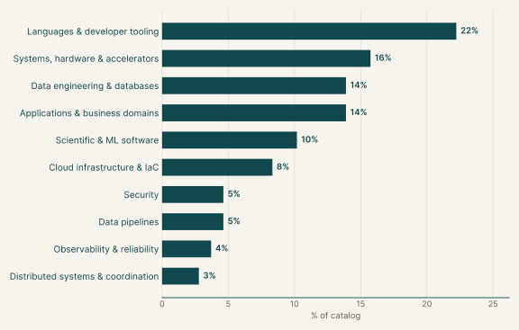
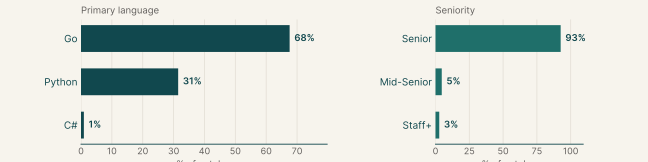
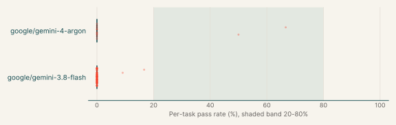
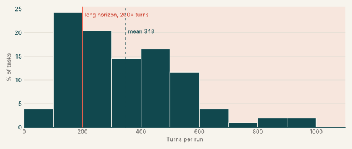
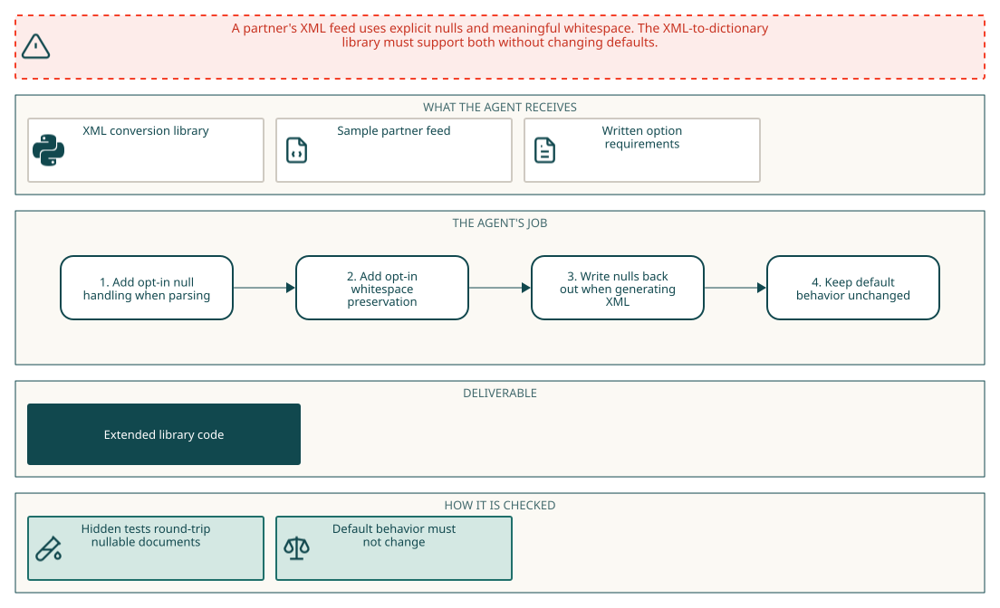
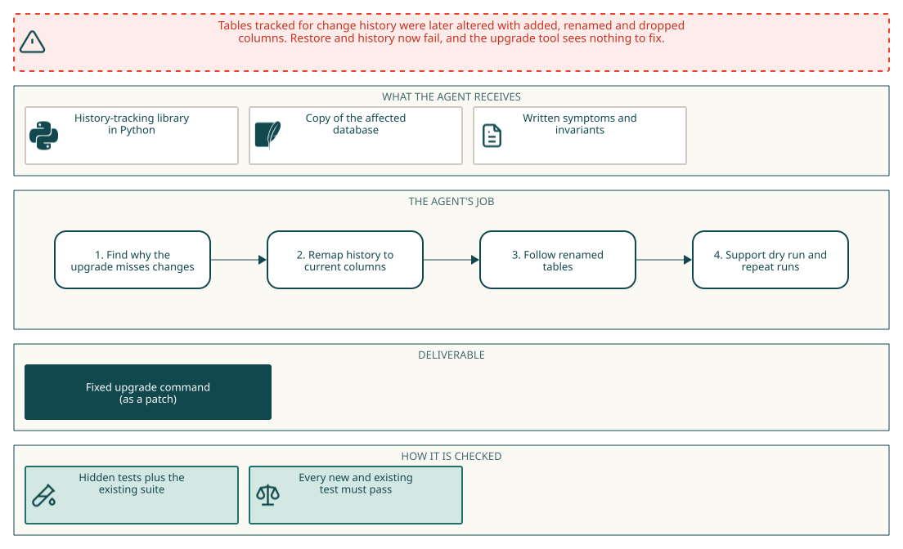
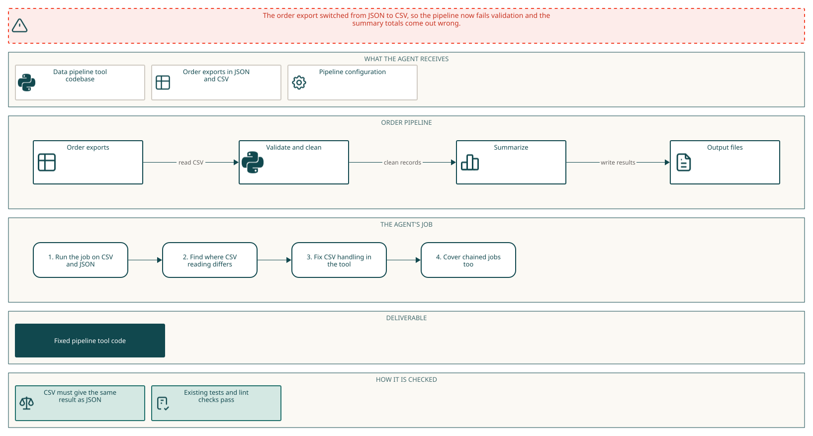

# Feature implementation

## Executive summary

101

Tasks

11%

Gemini 4 Argon pass rate

&lt;1%

Gemini 3.8 Flash pass rate

Each task asks the agent to add a capability to an existing open-source library or service, specified as the public types and functions to deliver. The data pipeline tasks extend data libraries so pipelines keep producing correct results after an upstream format or schema change. The main languages are Go (68%), Python (32%) and C# (1%).

Gemini 4 Argon passes 11% of its runs and fails every run on 85% of them. Gemini 3.8 Flash passes <1% of its runs and fails every run on 98% of them.

## Why this catalog

### Problems engineers face

Maintainers add a capability that runs through many code paths of an unfamiliar library or service, while existing callers must see no change. Typical requests add an opt-in mode or policy, keep information the library currently drops, or make a subsystem safe under concurrency and failure.

Data engineers face a related problem: after an upstream format or schema change, a pipeline keeps running but produces wrong results. The library has to handle the new data while old inputs still work.

### How the tasks reproduce them

Each task pins an open-source repository, mostly Go or Python, in an offline container and gives a written specification of the new behaviour. The agent's edits are collected as a diff against the base commit. After the session, hidden acceptance tests check the new behaviour and the project's existing tests check that nothing else changed. The data pipeline tasks also provide sample inputs in `/data`.

### Typical prompts

- A capability gap stated as "X cannot Y", then dense paragraphs on the behaviour to add and the behaviour to preserve.
- A bullet list of required exported names, constants and signatures, with a research and plan file due before any code change.
- A first-person data problem after an upstream change, with sample files in `/data` and a request to keep existing results unchanged.

## Domain breakdown

The tasks span 10 domains. The largest, Languages & developer tooling, makes up 22% of the catalog.

## Language and seniority

### Primary language

| Primary language | % of catalog |
|---|---:|
| Go | 67.6% |
| Python | 31.5% |
| C# | 0.9% |

### Seniority

| Seniority | % of catalog |
|---|---:|
| Senior | 92.6% |
| Mid-Senior | 4.6% |
| Staff+ | 2.8% |

## Gemini pass rates across the catalog

| Model | Pass rate | Tasks at 0% | Tasks at 20-80% | Tasks at 100% |
|---|---:|---:|---:|---:|
| google/gemini-4-argon | 11% | 85% | 15% | 0% |
| google/gemini-3.8-flash | <1% | 98% | 0% | 0% |

## Turn counts and long-horizon tasks

A task's turn count is the average over its Gemini runs. A task is long horizon when that average is 200 or more turns.

| Measure | Value |
|---|---:|
| Average turn count | 347.9 |
| Median turn count | 321.7 |
| Range | 79 to 956 |
| Long-horizon tasks (200+ turns) | 72% of tasks |

| Model | % of tasks | Mean turns | % with 200+ turns |
|---|---:|---:|---:|
| google/gemini-3.8-flash | 94% | 345.5 | 69% |
| google/gemini-4-argon | 13% | 229.6 | 63% |

## Sample tasks

### Example 1: Databases & storage engines (Go)

| Field | Value |
|---|---|
| Task id | [`memdb-txn-ots`](https://drive.google.com/file/d/1M3HCkXFdoznYOiY4yc3LlI8olgAA1K15/view) |
| Final category | Feature implementation |
| Domain | Data engineering & databases |
| Sub-domain | Databases & storage engines |
| Language | Go |
| Seniority | Senior |
| Turn count | 79 (google/gemini-4-argon) |
| Long horizon | no |

#### Prompt

Full instruction given to the agent (instruction.md)

I'm restoring transaction and query support in our copy of go-memdb so callers can update data, query snapshots, and watch query results for updates. Could you implement the methods that currently panic in the root `memdb` package? They live in `txn.go`, `memdb.go`, `index.go`, `filter.go`, and `watch.go`. The missing pieces cover transaction lifecycle, deletion, indexed queries and iteration, snapshots, deferred callbacks, filtering, and watch sets.

The existing code, API comments, and `README.md` provide context for the restoration. A received value must wake `WatchCtx` just as a closed watched channel does. Please keep the restored public names and signatures unchanged, and retain `Txn.write` for package compatibility; private helper functions are up to you. I'll check the restored behavior alongside index and schema regressions. Submit text Go source changes without new symbolic links, binary Go diffs, or Go line-position directives (`//line` and `/*line`). Use Go filenames that produce unquoted, whitespace-free paths in Git diffs.

In the non-test code you add, please avoid: new `init()` functions; the `syscall`, `golang.org/x/sys`, `os/exec`, `os/signal`, `plugin`, `embed`, `runtime/cgo`, `runtime/pprof`, `runtime/trace`, `testing` and `flag` packages, cgo, and `//go:linkname` or `//go:embed` directives; `os.Exit`, `os.StartProcess`, `os.FindProcess` and `runtime.Goexit`; reading `os.Args`, `os.Executable`, `/proc/self` or `runtime/debug` build info; caller or stack lookups (`runtime.Caller`, `Callers`, `CallersFrames`, `FuncForPC`, `Stack`, `debug.Stack`, `debug.PrintStack`, `log.Lshortfile`, `log.Llongfile`, and `AddSource` selectors or identifier keys); literal U+0016 or the text `\x16`; and printing test-runner lines such as `--- PASS`. These are rejected outright. Some checks read raw text and also match comments.

#### Pass rates

| Model | Pass rate |
|---|---:|
| google/gemini-4-argon | 67% |

#### Environment

### Example 2: Databases & storage engines (Python)

| Field | Value |
|---|---|
| Task id | [`sqlite-history-repair`](https://drive.google.com/file/d/146Un1dIq2RerHMbYpd5aWBnrQ6VpXLLV/view) |
| Final category | Data engineering |
| Domain | Data pipelines |
| Sub-domain | Databases & storage engines |
| Language | Python |
| Seniority | Mid-Senior |
| Turn count | 236 (google/gemini-4-argon) |
| Long horizon | yes |

#### Prompt

Full instruction given to the agent (instruction.md)

We track SQLite tables with sqlite-history-json (/app) and have since changed some: columns added with ALTER TABLE ADD COLUMN, columns and tables renamed with ALTER TABLE RENAME while tracking was on, and columns dropped by disabling tracking, dropping and enabling again. Now restore returns NULLs or fails with "no such column" and history on a renamed table fails, but `python -m sqlite_history_json.upgrade` says there's nothing to upgrade. A copy of the database is at /data/shop.db.

After the upgrade, restoring a table that has tracking on to its latest entry should give exactly its current rows, and later changes should be recorded as on a table tracked from scratch. Existing entries keep their id, timestamp, operation, primary key and group, with each value under the current name of the column it was recorded from, in history, row-history, restore and row-state-sql. Values for dropped columns stay in the history and restore ignores them. A renamed table's history follows it, so everything works under the new name, enable and disable included.

Tables with tracking off and history of dropped tables stay as they are. A second run changes nothing. With --dry-run it lists only the tables it would change and changes nothing. If a renamed table's new name already has its own history, the upgrade exits with an error naming the table and changes nothing. Databases from 0.3 and earlier must still upgrade, and the tests in /app/tests must keep passing.

Could you find what's wrong and fix it? There's no network here.

#### Pass rates

| Model | Pass rate |
|---|---:|
| google/gemini-4-argon | 0% |

#### Environment

### Example 3: Data pipelines & ETL (Python)

| Field | Value |
|---|---|
| Task id | [`etlplus-csv-pipeline`](https://drive.google.com/file/d/1j76u3l7Bo5yUlUhQCeFMMRASnZxfB8WD/view) |
| Final category | Data engineering |
| Domain | Data pipelines |
| Sub-domain | Data pipelines & ETL |
| Language | Python |
| Seniority | Mid-Senior |
| Turn count | 248 (google/gemini-4-argon) |
| Long horizon | yes |

#### Prompt

Full instruction given to the agent (instruction.md)

Since the night of 2026-10-04 the order platform writes its nightly export as CSV instead of JSON. That first night it wrote both, so /data/orders has orders-2026-10-04.json and orders-2026-10-04.csv with the same orders, the CSV from the next night, and our pipeline config, /data/orders/pipeline.yml. The pipeline validates and cleans the export, then summarizes the cleaned CSV. On the CSV export, `etlplus run --config /data/orders/pipeline.yml --job order_summary` fails validation, and with validation turned off the summary totals are wrong.

Any etlplus job that reads a CSV file should give the result it gives on the same records as JSON: every record exactly once with the same fields, and the same validation outcome, filter result, sort order and aggregate values. An empty cell is a missing value. This also holds for a job reading a CSV file that an earlier job in the run wrote. Values in the output files may stay text.

Please fix etlplus in /app. The existing tests in /app/tests and the ruff, pydocstyle, pydoclint and mypy checks the project runs in CI have to keep passing. There's no network; the project's environment is installed in /opt/venv.

#### Pass rates

| Model | Pass rate |
|---|---:|
| google/gemini-4-argon | 0% |

#### Environment

