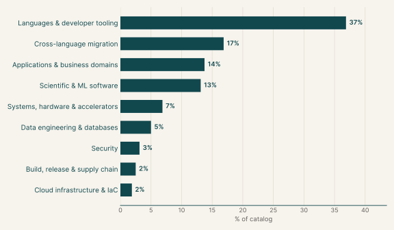
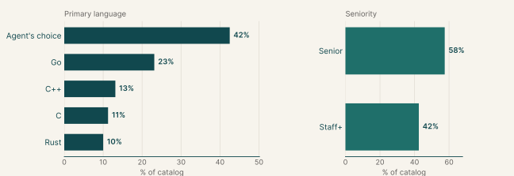
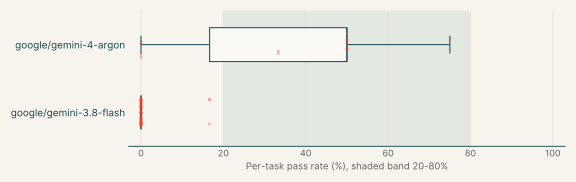
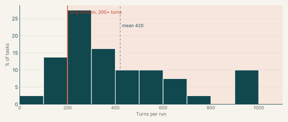
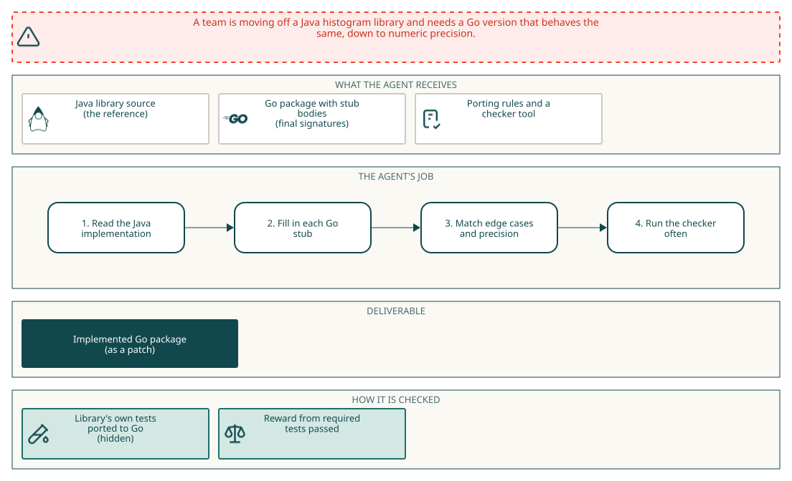
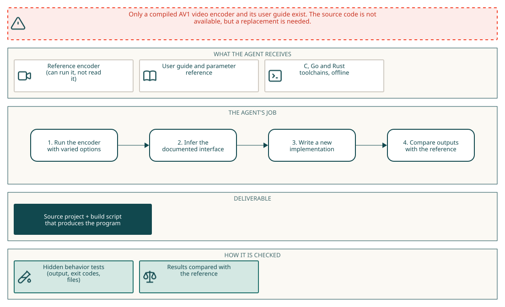

# ProgramBench and Migration

## Executive summary

283

Tasks

39%

Gemini 4 Argon pass rate

1%

Gemini 3.8 Flash pass rate

Each task asks the agent to make software behave exactly like a reference version. In the reimplementation tasks the agent writes a new program from scratch, in a language of its choice, from a reference program and its documentation. In the upgrade tasks the agent brings an existing repository up to the reference's newer release by changing its code. In the migration tasks the agent ports a Java or Rust library to Go or C++ behind fixed signatures. In 42% of tasks the agent chooses the language; the most common fixed languages are Go (23%) and C++ (13%).

Gemini 4 Argon passes 39% of its runs and fails every run on 27% of them. Gemini 3.8 Flash passes 1% of its runs and fails every run on 96% of them.

## Why this catalog

### Problems engineers face

Engineers often have to make software behave exactly like a version they cannot reuse: rebuilding a tool whose source is unavailable, bringing an old codebase up to a newer release, or replacing a Java or Rust dependency with a port in Go or C++. In each case the specification is observable behaviour. The hard part is inferring the rules from outputs and documentation, then matching exit codes, output, file effects, numeric precision and result ordering without seeing the tests.

### How the tasks reproduce them

Every task runs offline, and hidden tests compare the result with the reference. In reimplementation and upgrade tasks the reference is a program the agent can run but not read. For a reimplementation, the agent writes a source project and a `compile.sh` from the reference and its documentation. For an upgrade, the agent changes an existing repository in `/app/repo`, which is built with a fixed `/opt/task/build.sh`. Migration tasks provide the original source and a skeleton with final signatures, and most add a `mig-check` tool.

### Typical prompts

- Reproduce the documented behaviour of an execute-only program, delivered as source code plus `compile.sh`.
- Update an existing repository to match a reference program, after first writing a research and plan file.
- Port a named Java or Rust library to Go or C++ from a reference folder, keeping the given signatures, within per-test time and memory limits.

## Domain breakdown

The tasks span nine domains. The largest, Languages & developer tooling, makes up 37% of the catalog.

## Language and seniority

### Primary language

| Primary language | % of catalog |
|---|---:|
| Agent's choice | 42.5% |
| Go | 23.1% |
| C++ | 13.1% |
| C | 11.2% |
| Rust | 10.0% |

### Seniority

| Seniority | % of catalog |
|---|---:|
| Senior | 57.5% |
| Staff+ | 42.5% |

## Gemini pass rates across the catalog

| Model | Pass rate | Tasks at 0% | Tasks at 20-80% | Tasks at 100% |
|---|---:|---:|---:|---:|
| google/gemini-4-argon | 39% | 27% | 73% | 0% |
| google/gemini-3.8-flash | 1% | 96% | 0% | 0% |

## Turn counts and long-horizon tasks

A task's turn count is the average over its Gemini runs. A task is long horizon when that average is 200 or more turns.

| Measure | Value |
|---|---:|
| Average turn count | 420.4 |
| Median turn count | 341.1 |
| Range | 88 to 1000 |
| Long-horizon tasks (200+ turns) | 84% of tasks |

| Model | % of tasks | Mean turns | % with 200+ turns |
|---|---:|---:|---:|
| google/gemini-3.8-flash | 84% | 471.2 | 84% |
| google/gemini-4-argon | 19% | 257.1 | 67% |
| google/gemini-3.7-flash | 2% | 152.3 | 17% |

## Sample tasks

### Example 1: Statistics & numerical methods (Go)

| Field | Value |
|---|---|
| Task id | [`dynahist-go-port`](https://drive.google.com/file/d/1ChoekorIF6oHhZTUyDkKJex0iPC334b8/view) |
| Final category | Migration |
| Domain | Cross-language migration |
| Sub-domain | Statistics & numerical methods |
| Language | Go |
| Seniority | Senior |
| Turn count | 433 (google/gemini-3.8-flash), 244 (google/gemini-4-argon) |
| Long horizon | yes |

#### Prompt

Full instruction given to the agent (instruction.md)

We're moving a dependency from Java to Go, and I need a Go port of the `dynatrace-oss/dynahist` library. The Java source is in `/app/java_reference/`. I've already laid out the Go package in `/app/port/`: every type and function our code calls is there with its final signature, but the bodies are just stubs. Could you fill in the implementation so it behaves exactly like the Java library?

When you're done, I'll run the library's own test suite, ported to Go, against `/app/port`. I'm not including those tests here, so please work from the Java source itself and match it closely: error cases, edge cases, numeric precision and the order things come back in.

A few things that will save you some pain:

- Keep the signatures and the package name in `/app/port` as they are; our callers use them as-is. Edit the existing files in place and declare each type and function once.
- Run `mig-check` (on the PATH) often. It compares `/app/port` with the original stubs, runs `go build` and `go vet`, and flags package-level names that clash with our test helpers (they start with `mig` or `Mig`).
- Go's `regexp` is RE2, so Java-only syntax such as the `(?u)` flag, back-references, look-around and `\u{...}` escapes makes a package-level `regexp.MustCompile` panic at start-up.
- This package ends up inside a sandboxed service, so every non-test `.go` file under `/app/port` must stay off `os`, `os/exec`, `syscall`, `runtime`, `plugin`, `net`, `net/http`, `net/rpc`, `io/ioutil`, `embed`, `unsafe`, `flag` or `testing` (and anything under `testing/`), cgo, and the `//go:linkname` and `//go:embed` directives. Write the logic yourself rather than calling out to another program; the rest of the standard library is fine.
- Our test machine has 2 vCPUs, and each test gets 60 seconds and a 2 GB address-space limit, so keep things reasonably efficient.

#### Pass rates

| Model | Pass rate |
|---|---:|
| google/gemini-4-argon | 33% |
| google/gemini-3.8-flash | 0% |

#### Environment

### Example 2: Media processing (Agent's choice)

| Field | Value |
|---|---|
| Task id | [`svtav1-encoder-rebuild`](https://drive.google.com/file/d/1JmlCRxmj-7RJ9yZ698lASh-GGDr2N9Je/view) |
| Final category | ProgramBench reimplementation |
| Domain | Applications & business domains |
| Sub-domain | Media processing |
| Language | Agent's choice |
| Seniority | Staff+ |
| Turn count | 401 (google/gemini-4-argon) |
| Long horizon | yes |

#### Prompt

Full instruction given to the agent (instruction.md)

###### Task context

Reproduce the documented behavior of the program in this workspace. The reference program is `/opt/task-reference/executable`. Its bundled documentation is available in the workspace. The task runs model commands as the non-root `agent` user. The reference is execute-only for that user, so it can be run but not read, copied, hard-linked, or recovered through `/proc`. A root model shell means the task platform did not honor the declared user and is not part of the task contract.

###### Required result

Write a source code project and an executable `./compile.sh`. Running `./compile.sh` on a fresh checkout must produce `./executable` in the workspace root. The rebuilt executable must match the reference program's observable behavior, including output, exit codes, and file system effects.

You may choose the implementation language and design. You can learn the behavior from the bundled documentation and by running the reference program.

The grader checks only your submission's fresh offline build and its observable behavior. It does not assess your implementation language or how you learned the behavior. Do not include the reference executable's bytes in the submission under another name or embedded inside another file. Do not read or inspect the grader harness, hidden tests, or recorded expectations, even if a platform defect makes them accessible. During grading, the internet, package registries, the reference program, and system copies of the same tool are unavailable. Your build and executable must work without them.

###### Reusable input assets

When `/workspace/assets` exists, it contains hard-to-create reusable inputs
such as media, archives, databases, or custom binary files. You may inspect,
copy, or modify these inputs while recreating the program. Ordinary source and
text inputs are not provided and should be created as needed.

###### How your work is scored

Your executable is graded by replaying many recorded behaviors of the
reference program against it and scoring the fraction that match. A
match always requires the same exit code and the same file system effects.
Plain output and ordinary files are compared byte for byte. JSON output and
JSON files are normally compared as parsed values, so insignificant whitespace
and object key order do not matter unless the documentation makes formatting or
ordering part of the behavior. SQLite files are compared by their logical
contents. Terminal progress output is compared by its final visible text. A
recorded behavior can require exact bytes when formatting or ordering is part
of the documented behavior. Partial credit is the norm, so every additional
behavior you match raises your score, and there is no bonus for finishing early.

###### Coverage to aim for

Grading samples behavior from the documented interface. Only behavior that can be tested reliably in a bounded offline run is graded.

When applicable, support:

- commands, subcommands, options, aliases, and short forms
- representative documented values
- help and version output
- standard input, files, and directories
- configuration files and environment variables
- standard output, standard error, exit codes, and file system effects
- error handling
- empty, non-ASCII, binary, and unusually named inputs

The test suite may not cover every documented behavior.

###### Using the reference program

Run `/opt/task-reference/executable` to observe the reference. The file is
outside the submitted workspace and is unavailable during grading. Your
`./compile.sh` can therefore write `./executable` without replacing the
reference while you work.

###### Before you finish

Passing tests you wrote yourself is not evidence that you are done.
Before you stop:

1. list every option and subcommand in the reference program's help output;
2. for each one, run `/opt/task-reference/executable` and your executable on the
   same input and compare output using the scoring rules above, along with the
   exit code and files written;
3. fix every disagreement you find, then repeat from step 1.

Stop when no disagreement remains or when your budget is spent,
whichever comes first.

#### Pass rates

| Model | Pass rate |
|---|---:|
| google/gemini-4-argon | 0% |

#### Environment

### Example 3: Graph algorithms (Go)

| Field | Value |
|---|---|
| Task id | [`dagre-go-port`](https://drive.google.com/file/d/1LEUYx_W7eOkFA8s4EEXnSfVbyYqMdLiD/view) |
| Final category | Migration |
| Domain | Cross-language migration |
| Sub-domain | Graph algorithms |
| Language | Go |
| Seniority | Senior |
| Turn count | 306 (google/gemini-4-argon) |
| Long horizon | yes |

#### Prompt

Full instruction given to the agent (instruction.md)

We're moving a dependency from Rust to Go, and I need a Go port of the `kookyleo/dagre-rs` crate. The Rust source is in `/app/rust_reference/`. I've already laid out the Go package in `/app/port/`: every type and function our code calls is there with its final signature, but the bodies are just stubs. Could you fill in the implementation so it behaves exactly like the Rust crate?

When you're done, I'll run the crate's own test suite, ported to Go, against `/app/port`. I'm not including those tests here, so please work from the Rust source itself and match it closely: error cases, edge cases, numeric precision and the order things come back in.

A few things that will save you some pain:

- Keep the signatures and the package name in `/app/port` as they are; our callers use them as-is. Edit the existing files in place and declare each type and function once.
- Run `mig-check` (on the PATH) often. It compares `/app/port` with the original stubs, runs `go build` and `go vet`, and flags package-level names that clash with our test helpers (they start with `mig` or `Mig`).
- Go's `regexp` is RE2, so Rust-only syntax such as the `(?u)` flag, `\u{...}` escapes, back-references and look-around makes a package-level `regexp.MustCompile` panic at start-up.
- This package ends up inside a sandboxed service, so every non-test `.go` file under `/app/port` must stay off `os`, `os/exec`, `syscall`, `runtime`, `plugin`, `net`, `net/http`, `net/rpc`, `io/ioutil`, `embed`, `unsafe`, `flag` or `testing` (and anything under `testing/`), cgo, and the `//go:linkname` and `//go:embed` directives. Write the logic yourself rather than calling out to another program; the rest of the standard library is fine.
- Our test machine has 2 vCPUs, and each test gets 60 seconds and a 2 GB address-space limit, so keep things reasonably efficient.

#### Pass rates

| Model | Pass rate |
|---|---:|
| google/gemini-4-argon | 50% |

#### Environment

