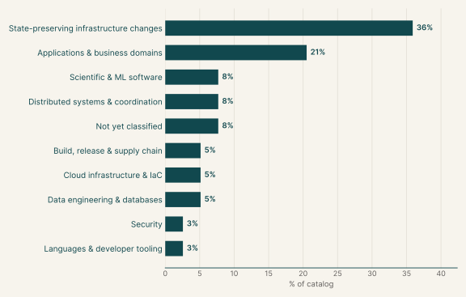
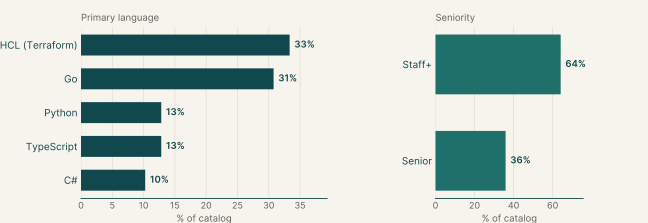
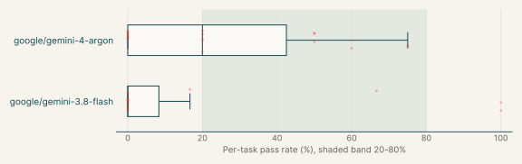
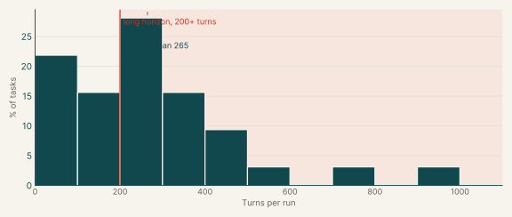
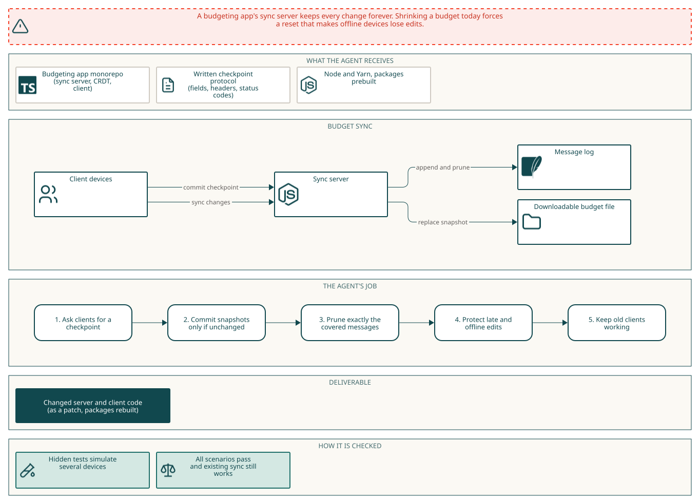
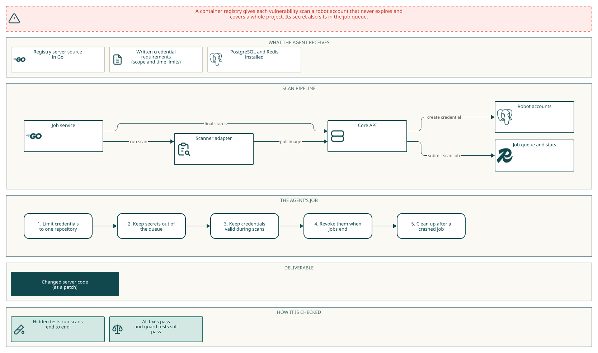
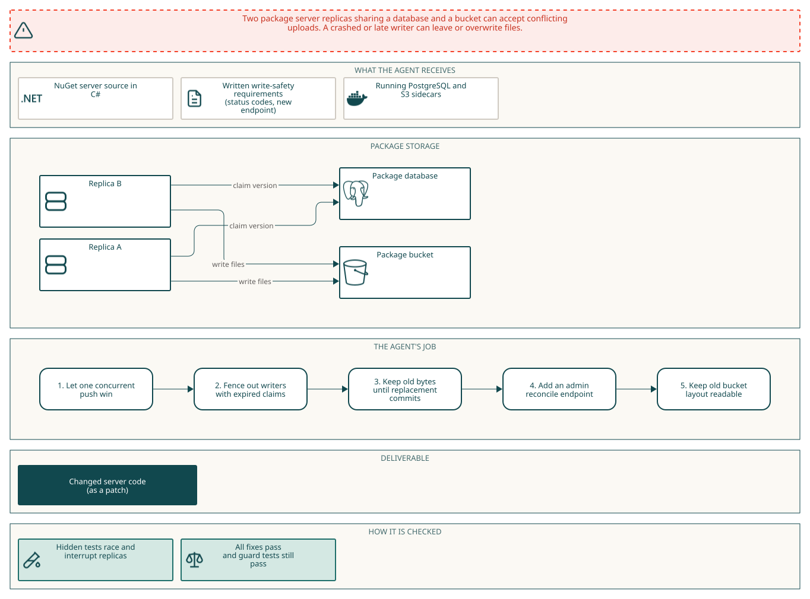

# System design & IaC

## Executive summary

123

Tasks

20%

Gemini 4 Argon pass rate

10%

Gemini 3.8 Flash pass rate

Each task changes a production system that must keep running. In the system design tasks the agent makes a multi-process service hold its guarantees through crashes, retries, races and returning stale writers. In the infrastructure tasks the agent restructures live Terraform or Pulumi code so that the plan against production state changes nothing that is deployed. The main languages are HCL (Terraform) (33%), Go (31%) and Python (13%).

Gemini 4 Argon passes 20% of its runs and fails every run on 44% of them. Gemini 3.8 Flash passes 10% of its runs and fails every run on 73% of them.

## Why this catalog

### Problems engineers face

Production systems fail in specific ways when they change while running. In services where several processes share state and any of them can stop, the failures are duplicate effects after retries, lost notifications, stale writers returning after a takeover, limits that hold in one process but not across instances, and partial state after a crash. In infrastructure code, a flat Terraform stack has to become modules with stable keys, or move to Pulumi, while every deployed resource stays exactly as it is.

### How the tasks reproduce them

Both kinds of task give the agent a working copy of the system and grade the result with hidden checks after the session. Service tasks pin an open-source repository at a base commit, with a short specification that often sets time limits. The agent runs the needed databases, caches or brokers locally and delivers a patch. Hidden tests then kill or pause processes and confirm existing behaviour still works. Infrastructure tasks ship the stack with its recorded production state. A verifier plans the result with refresh disabled, expects moves only, then plans hidden changes such as an added key.

### Typical prompts

- A capability gap stated as "X cannot do Y", followed by measurable requirements, many with time limits.
- A closing paragraph with the repository path, how to start each service and the build command.
- A first-person request to modularize a named production Terraform stack, followed by rules for modules, `for_each` keys, variables, outputs and banned constructs.

## Domain breakdown

The tasks span nine domains. The largest, State-preserving infrastructure changes, makes up 36% of the catalog.

## Language and seniority

### Primary language

| Primary language | % of catalog |
|---|---:|
| HCL (Terraform) | 33.3% |
| Go | 30.8% |
| Python | 12.8% |
| TypeScript | 12.8% |
| C# | 10.3% |

### Seniority

| Seniority | % of catalog |
|---|---:|
| Staff+ | 64.1% |
| Senior | 35.9% |

## Gemini pass rates across the catalog

| Model | Pass rate | Tasks at 0% | Tasks at 20-80% | Tasks at 100% |
|---|---:|---:|---:|---:|
| google/gemini-4-argon | 20% | 44% | 56% | 0% |
| google/gemini-3.8-flash | 10% | 73% | 7% | 13% |

## Turn counts and long-horizon tasks

A task's turn count is the average over its Gemini runs. A task is long horizon when that average is 200 or more turns.

| Measure | Value |
|---|---:|
| Average turn count | 264.6 |
| Median turn count | 241.0 |
| Range | 36 to 931 |
| Long-horizon tasks (200+ turns) | 62% of tasks |

| Model | % of tasks | Mean turns | % with 200+ turns |
|---|---:|---:|---:|
| google/gemini-3.8-flash | 47% | 259.7 | 52% |
| google/gemini-4-argon | 56% | 313.2 | 79% |

## Sample tasks

### Example 1: Payments & banking (TypeScript)

| Field | Value |
|---|---|
| Task id | [`actual-sync-compaction`](https://drive.google.com/file/d/1_sEAFRDztsqj6IIzgfOQ4KVr7m7Ff0-0/view) |
| Final category | System design |
| Domain | Applications & business domains |
| Sub-domain | Payments & banking |
| Language | TypeScript |
| Seniority | Staff+ |
| Turn count | 414 (google/gemini-4-argon) |
| Long horizon | yes |

#### Prompt

Full instruction given to the agent (instruction.md)

##### Checkpoint the budget sync log

We need the sync server to compact a budget's history from a client-built snapshot while keeping its sync group stable, so long-lived budgets stay small without offline devices losing edits; the server cannot inspect encrypted changes. Today it retains every change indefinitely, and resetting sync shrinks a budget only by replacing its group, which makes offline devices lose edits they have not uploaded.

###### What we need

- Configure the message-count threshold with `ACTUAL_SYNC_CHECKPOINT_THRESHOLD` (use 300 for this workload); below it no checkpoint is taken. After repeated transaction edits exceed it, two `sync()` calls leave no more than 300 server messages. A fresh download has the same transactions, payees, categories and budget amounts, and its local CRDT log contains at most one message per distinct cell.
- Extend `SyncRequest` with `checkpointId` (protobuf field 7) and `SyncResponse` with `checkpointWanted`, `checkpointRequired` and `checkpointBase` (fields 3, 4 and 6); retain the existing protobuf fields. File info exposes `messageCount`, `checkpointId` and `checkpointBase`; its `checkpointBase` is the current receive base as a decimal string, the value a client sends in `X-ACTUAL-CHECKPOINT-BASE` to checkpoint everything received so far. The receive base tracks received changes, including late arrivals with older timestamps. A client builds a compact snapshot after syncing and commits it with `POST /sync/commit-checkpoint`, sending `X-ACTUAL-FILE-ID`, `X-ACTUAL-GROUP-ID`, `X-ACTUAL-CHECKPOINT-BASE`, `X-ACTUAL-CHECKPOINT-ID`, `X-ACTUAL-CHECKPOINT-MERKLE` and an `application/encrypted-file` body. A successful commit replaces the downloadable file with the snapshot and updates the checkpoint ID; the commit succeeds only when its receive base and prior checkpoint still match, otherwise it returns 409. A malformed receive base returns 400. A successful commit removes every change the checkpoint covers, and only those.
- A disconnected device's unsent edits survive rejoining after a checkpoint, and its data converges with active and newly downloaded devices after two syncs. Repeated syncs after late, older-timestamp arrivals do not error, reset the group or discard changes. Concurrent checkpoint proposals install only one snapshot without surfacing a sync error.
- A truncated or interrupted checkpoint body leaves both the message log and downloadable file unchanged; a later valid checkpoint can succeed. Old-format requests needing pruned history receive HTTP 400 with `file-has-reset`, not partial data; old-format requests already past the checkpoint continue normal sync. New clients needing the checkpoint receive `checkpointRequired` without losing unsent work.

###### Keep working

Existing `/sync/sync`, `/sync/upload-user-file`, `/sync/download-user-file`, `/sync/get-user-file-info` and password login remain usable.

###### Setup

Work in `/app` (Node 22, Yarn 4); build the affected packages with `yarn workspace @actual-app/crdt build && yarn workspace @actual-app/core build && yarn workspace @actual-app/sync-server build && yarn workspace @actual-app/api build`. Grading runs the packages as you leave them built in `/app`, without rebuilding, so rebuild after your last change. The sync server runs via `node packages/sync-server/build/app.js`, with SQLite files in `ACTUAL_DATA_DIR` and `ACTUAL_USER_FILES`. No Docker daemon or internet access is available inside the container.

#### Pass rates

| Model | Pass rate |
|---|---:|
| google/gemini-4-argon | 20% |

#### Environment

### Example 2: Secrets & access control (Go)

| Field | Value |
|---|---|
| Task id | [`harbor-scanner-credentials`](https://drive.google.com/file/d/1aHmGorPxaObXqhuZbCDJxOM00L7U6V0m/view) |
| Final category | System design |
| Domain | Security |
| Sub-domain | Secrets & access control |
| Language | Go |
| Seniority | Staff+ |
| Turn count | 365 (google/gemini-4-argon) |
| Long horizon | yes |

#### Prompt

Full instruction given to the agent (instruction.md)

Harbor's vulnerability scans currently create nonexpiring, project-wide scanner robots and submit their secrets in jobservice parameters, which remain in Redis job stats. Replace that lifecycle for `IMAGE_SCAN` jobs started by the artifact scan API and scan-on-push.

- A scanner's credential, used directly (Basic) or exchanged at `/service/token` for a bearer token, gives only pull access to the scanned artifact's repository: no push anywhere, and no pull or push on any other repository in the same or another project. Scans started concurrently through two core instances each get a credential limited to their own repository.
- A credential keeps working while a scan runs for three minutes, and successful scans still publish their vulnerability reports to the artifact. Existing scanner adapters using Basic or Bearer registry authorization continue to work.
- After the task becomes final, Basic authentication using its credential is rejected with 401 or 403 by `/v2/` and `/service/token` within 30 seconds. If jobservice is killed mid-scan without a final hook, within two minutes the credential is rejected with 401 or 403 by `/v2/` and any robot account created for it is deleted. A scan requested through the artifact scan API while jobservice is down leaves no robot account behind.
- Neither Redis keys and values nor `GET /api/v1/jobs/{id}` expose a scanner credential secret during or after a scan. Job parameters and the core and jobservice logs must not carry it either.
- Preserve the existing artifact scan response and jobservice status API.

Work in `/app` (`src/` is the Go module). PostgreSQL and Redis are installed; start them with `sudo service postgresql start` and `sudo service redis-server start`. Build offline from `/app/src` with `GOPROXY=off go build ./core ./jobservice`; generated Swagger server packages are present. Docker is unavailable inside the agent container. SBOM, scan-all, scanner registration and proxy-cache scanning are outside this change.

#### Pass rates

| Model | Pass rate |
|---|---:|
| google/gemini-4-argon | 20% |

#### Environment

### Example 3: Software supply chain (C#)

| Field | Value |
|---|---|
| Task id | [`bagetter-fenced-writes`](https://drive.google.com/file/d/1yHr7nw0bfAZG5xO4uxrn_gH3GXffUFla/view) |
| Final category | System design |
| Domain | Build, release & supply chain |
| Sub-domain | Software supply chain |
| Language | C# |
| Seniority | Staff+ |
| Turn count | 203 (google/gemini-4-argon) |
| Long horizon | yes |

#### Prompt

Full instruction given to the agent (instruction.md)

Two BaGetter instances sharing PostgreSQL and an S3 bucket can accept conflicting package-version writes: the database describes one upload while the bucket serves another. An interrupted push leaves unowned objects, and a failed prerelease overwrite can remove the previous package.

To close this out:
- Coordinate version writes across instances so one of two different simultaneous pushes receives 201, while the loser does not; downloads, nuspecs, registration metadata and the flat-container index agree with the winner. A delayed S3 PUT from a writer whose database claim has expired must never replace the winner's served bytes or delete its objects. `Storage:WriteClaimTimeoutSeconds` defines the maximum database-disconnection window (3 seconds in the deployment).
- An interrupted push remains invisible; a failed overwrite keeps the old prerelease bytes and metadata available until a successful replacement commits. Hard deletion must return 204 only when the version ends absent with no objects under `packages/{id}/{version}/`, or 404 when it remains downloadable. Concurrent cold mirror requests for the same upstream version both download successfully without duplicate indexed versions or objects.
- Add API-key-protected `POST /api/v2/admin/reconcile`, returning JSON that identifies removed orphan objects and hidden versions missing a nupkg. It reclaims expired writes, removes unowned objects even if no claim or row exists, and removes broken versions from flat-container, registration and database search listings without affecting healthy versions. Recovery of expired uploads permits a fresh push. A deleted version leaves no version-prefix objects.

Keep existing packages from the old bucket layout (`{id}.{version}.nupkg` and `{id}.nuspec` under the same version prefix) readable, deletable and overwritable without reupload. Existing push, v3 download, registration, relist and hard-delete routes remain available. An existing PostgreSQL schema must upgrade in place, treating its rows as committed. A duplicate push of a non-overwritable version returns 409; push and delete routes, including relist, retain API-key protection (401 without a valid key). For a package containing only a nuspec, a committed version has exactly one owned nupkg and one owned nuspec object under its version prefix, including after a successful overwrite or reconciliation; abandoned attempts must not leave extra objects there.

The source is at `/app`. Build and run with `dotnet build src/BaGetter/BaGetter.csproj -p:NuGetAudit=false` from `/app`. PostgreSQL is `postgres:5432`, S3 is `s3:4566` (S3-compatible LocalStack with path-style requests); both are provided as sidecars and the container has no Docker daemon. The deployment uses `Database__Type=PostgreSql`, `Storage__Type=AwsS3`, `Search__Type=Database`, `AllowPackageOverwrites=PrereleaseOnly`, and `PackageDeletionBehavior=HardDelete`; cold-mirror requests use `Mirror__Enabled=true` with a configured `Mirror__PackageSource`. Application settings use `Database__ConnectionString`, `Storage__Endpoint`, `Storage__Bucket`, `Storage__AccessKey`, `Storage__SecretKey`, `Storage__ForcePathStyle`, and `ApiKey`. The deployment database is `sd` with app-role credentials `app`/`app`; the S3 bucket is `packages` with credentials `test`/`test`, path-style access enabled, and the API key is `secret` (sent as `X-NuGet-ApiKey`). The app has no internet access.

#### Pass rates

| Model | Pass rate |
|---|---:|
| google/gemini-4-argon | 20% |

#### Environment

