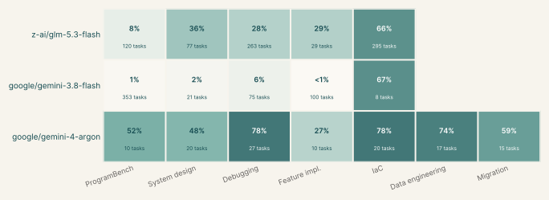
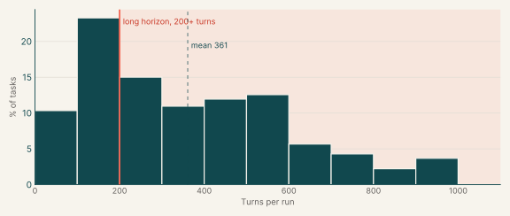

# Coding OTS RL Envs

1,305

Tasks

42%

z-ai/glm-5.3-flash pass rate

2%

google/gemini-3.8-flash pass rate

60%

google/gemini-4-argon pass rate

## Executive summary

These 1,305 tasks train and test AI coding agents on long, senior-level software work: rebuilding whole programs, fixing faults in real codebases and changing live systems without breaking them. Pass rates vary widely by model, from 2% for Gemini 3.8 Flash over 561 tasks to 60% for Gemini 4 Argon over the 119 tasks it ran.

The tasks fall into seven catalogs, and three of them hold 81%. In ProgramBench (434 tasks) the agent rebuilds a program from how it behaves. In Debugging (324) it finds and fixes faults, and in Infrastructure as code (301) it restructures deployed Terraform without changing what runs. Feature implementation (117) adds capabilities to existing libraries, and System design (94) keeps running services correct through crashes and retries. Data engineering (17) and Migration (18) cover data pipelines and ports to another language.

Almost all tasks are senior engineering work in a few languages. Senior engineers are the target for 86% of tasks and staff engineers for 13%. Go, Terraform and Python account for 67% of tasks, and Rust, C and C++ for another 22%.

The tasks are long. An agent averages 361 turns (one model reply plus its tool calls) on a task, and 66% of tasks average 200 turns or more. ProgramBench and System design run longest, at about 470 turns. Infrastructure as code tasks are the shortest, at 115 turns.

The closest public benchmarks are DeepSWE and SWE-bench Pro for long engineering work, and ProgramBench for rebuilding programs. With 1,305 tasks, our set is larger than DeepSWE (113) or ProgramBench (200) and, unlike DeepSWE, includes Terraform, C and C++. Like DeepSWE, most of its tasks were written for the catalog rather than taken from past fixes a model may have memorized.

## Catalogs

| Catalog | Tasks | What the tasks do | % of all tasks | Tasks with graded runs | Average turn count |
|---|---:|---|---:|---:|---:|
| [ProgramBench](programbench.md) | 434 | Rebuild or upgrade programs so they behave exactly like a reference version. | 33.3% | 434 | 476 |
| [System design](system-design.md) | 94 | Keep multi-process services correct through crashes, retries and races. | 7.2% | 94 | 460 |
| [Diagnosis, Debugging, and Bug Fixing](debugging.md) | 324 | Find and fix faults in real codebases from symptoms or documentation. | 24.8% | 324 | 423 |
| [Feature implementation](feature-implementation.md) | 117 | Add capabilities to existing libraries and services without breaking current behaviour. | 9.0% | 117 | 344 |
| [Infrastructure as code](infrastructure-as-code.md) | 301 | Restructure live Terraform, CDK and Pulumi code without touching deployed resources. | 23.1% | 301 | 115 |
| [Data engineering](data-engineering.md) | 17 | Repair pipelines and data libraries after an upstream format or schema change. | 1.3% | 17 | 173 |
| [Migration](migration.md) | 18 | Port Java and Rust libraries to Go or C++ with identical behaviour. | 1.4% | 18 | 364 |
| **Total** | **1,305** |  | **100%** | **1,305** |  |

## How the catalogs compare with public benchmarks

The closest professional benchmarks are DeepSWE (Datacurve, 2026: 113 original, long-horizon tasks in active open-source repositories, in TypeScript, Go, Python, JavaScript and Rust, checked by program-based verifiers), SWE-bench Pro (Scale: 1,865 long-horizon tasks across 41 repositories, some of them private commercial code), Terminal-Bench 2.0 (89 containerized terminal tasks) and METR's HCAST (180+ tasks that take people from a minute to more than eight hours). Like DeepSWE, most of our tasks are written for the catalog rather than mined from merged fixes, so a model cannot pass them from memory of the upstream change. The table maps each catalog to the benchmarks nearest its task type.

| Catalog | Closest public benchmarks | What ours add |
|---|---|---|
| ProgramBench | ProgramBench (Yang, Press et al., 2026): 200 programs, and no model fully rebuilds any of them | 434 programs, more than twice the public set |
| System design | DeepSWE and SWE-bench Pro for long-horizon work in real services; DDBench (60 bugs from open-source distributed systems) for distributed faults | New guarantees in running multi-process services, graded through crashes, retries and races |
| Diagnosis, Debugging, and Bug Fixing | SWE-bench Pro, SWE-bench Verified, Multi-SWE-bench | Go, C and Rust next to Python, with faults found from symptoms or documentation drift rather than from an issue text |
| Feature implementation | DeepSWE, FEA-Bench, SWE-Dev, NoCode-bench | Mostly Go, and existing behaviour must stay unchanged |
| Infrastructure as code | IaC-Eval, Multi-IaC-Eval | Changes to stacks that are already deployed, where the plan must change nothing that runs, instead of new templates |
| Data engineering | ELT-Bench, Spider 2.0 | Repairs to existing data libraries and pipelines after an upstream format or schema change |
| Migration | RustRepoTrans (translation into Rust) | Rust and Java ported into Go and C++, a direction the public translation benchmarks we found do not cover |

## Model pass rates

Pass rates and turn counts come from Horizon runs up to 2026-11-02. Each cell is a model's pass rate in one catalog: passed runs over graded runs, pooled across the tasks it ran there. A cell is blank when the model has graded runs on fewer than five tasks in that catalog.

| Model | Tasks run | Graded runs | Pass rate |
|---|---:|---:|---:|
| z-ai/glm-5.3-flash | 788 | 4,166 | 42% |
| google/gemini-3.8-flash | 561 | 3,546 | 2% |
| google/gemini-4-argon | 119 | 287 | 60% |

## Samples

Each sample is a full task, downloadable from its task id. The pass rate is that of the model with the most graded runs on the task.

| Catalog | Example | Task id | Model with most graded runs | Pass rate |
|---|---|---|---|---:|
| ProgramBench | [Example 1: Media processing (Agent's choice)](programbench.md#example-1-media-processing-agents-choice) | [`svtav1-encoder-rebuild`](https://drive.google.com/file/d/1JmlCRxmj-7RJ9yZ698lASh-GGDr2N9Je/view) | z-ai/glm-5.3-flash | 0% of 5 |
| ProgramBench | [Example 2: Build systems (Agent's choice)](programbench.md#example-2-build-systems-agents-choice) | `bazel-gazelle-rebuild` | google/gemini-4-argon | 0% of 5 |
| System design | [Example 1: Payments & banking (TypeScript)](system-design.md#example-1-payments-banking-typescript) | [`actual-sync-compaction`](https://drive.google.com/file/d/1_sEAFRDztsqj6IIzgfOQ4KVr7m7Ff0-0/view) | z-ai/glm-5.3-flash | 17% of 6 |
| System design | [Example 2: Secrets & access control (Go)](system-design.md#example-2-secrets-access-control-go) | [`harbor-scanner-credentials`](https://drive.google.com/file/d/1aHmGorPxaObXqhuZbCDJxOM00L7U6V0m/view) | google/gemini-4-argon | 20% of 5 |
| System design | [Example 3: Software supply chain (C#)](system-design.md#example-3-software-supply-chain-c) | [`bagetter-fenced-writes`](https://drive.google.com/file/d/1yHr7nw0bfAZG5xO4uxrn_gH3GXffUFla/view) | z-ai/glm-5.3-flash | 50% of 6 |
| System design | [Example 4: Web applications (TypeScript)](system-design.md#example-4-web-applications-typescript) | [`dittofeed-user-deletion`](https://drive.google.com/file/d/1cxE8Is6I9_6PCr0kAZZnMWp-ao9Z--xN/view) | google/gemini-4-argon | 75% of 4 |
| System design | [Example 5: Media processing (TypeScript)](system-design.md#example-5-media-processing-typescript) | [`immich-storage-quotas`](https://drive.google.com/file/d/1iooMPQxDSF99aj7XHO7rn2HfRhoZEiYJ/view) | google/gemini-4-argon | 80% of 5 |
| System design | [Example 6: Payments & banking (TypeScript)](system-design.md#example-6-payments-banking-typescript) | [`medusa-cart-completion`](https://drive.google.com/file/d/1U6jZxHDbr-NnxBgwRvkZQplrsuJlpWCD/view) | google/gemini-4-argon | 80% of 5 |
| Diagnosis, Debugging, and Bug Fixing | [Example 1: Compilers & language runtimes (Python)](debugging.md#example-1-compilers-language-runtimes-python) | [`exo-canonical-ots`](https://drive.google.com/file/d/1hqLtS09dPnqztGyE15JRg9AZ0pS3fdAD/view) | z-ai/glm-5.3-flash | 0% of 5 |
| Diagnosis, Debugging, and Bug Fixing | [Example 2: Medical imaging & healthcare (Python)](debugging.md#example-2-medical-imaging-healthcare-python) | [`torchio-canonical-ots`](https://drive.google.com/file/d/1dAuRMjByz3IKD2Q7Qux8ZUoDjKNsHrvc/view) | z-ai/glm-5.3-flash | 0% of 5 |
| Diagnosis, Debugging, and Bug Fixing | [Example 3: Machine learning & MLOps (Python)](debugging.md#example-3-machine-learning-mlops-python) | [`swanlab-nanpair-ots`](https://drive.google.com/file/d/1ycCPNxGlpkKdgs2MHARCrZvTi6koSwwP/view) | google/gemini-4-argon | 0% of 1 |
| Diagnosis, Debugging, and Bug Fixing | [Example 4: Web crawling (Python)](debugging.md#example-4-web-crawling-python) | [`scrapy-pdk-ots`](https://drive.google.com/file/d/1REQsLCXJtRnoruzB2WlCUywZX56GZX8F/view) | z-ai/glm-5.3-flash | 20% of 5 |
| Feature implementation | [Example 1: Databases & storage engines (Go)](feature-implementation.md#example-1-databases-storage-engines-go) | [`memdb-txn-ots`](https://drive.google.com/file/d/1M3HCkXFdoznYOiY4yc3LlI8olgAA1K15/view) | z-ai/glm-5.3-flash | 0% of 4 |
| Feature implementation | [Example 2: Networking & HTTP (Go)](feature-implementation.md#example-2-networking-http-go) | `hertz-buffer-leases` | google/gemini-4-argon | 0% of 3 |
| Infrastructure as code | [Example 1: Cloud infra: containers & self-hosted platforms (Terraform)](infrastructure-as-code.md#example-1-cloud-infra-containers-self-hosted-platforms-terraform) | [`dualipv6-module-refactor`](https://drive.google.com/file/d/1Yg1iLWpltsqLdJS0jpUj4v3Wb3K4JlE-/view) | z-ai/glm-5.3-flash | 40% of 5 |
| Infrastructure as code | [Example 2: Cloud infra: AWS platform stacks (Terraform)](infrastructure-as-code.md#example-2-cloud-infra-aws-platform-stacks-terraform) | [`centralwatch-module-refactor`](https://drive.google.com/file/d/18b23bcb7ot9dDpaMF3nvcUVTGvYhg3aA/view) | z-ai/glm-5.3-flash | 19% of 16 |
| Infrastructure as code | [Example 3: Cloud infra: AWS platform stacks (Terraform)](infrastructure-as-code.md#example-3-cloud-infra-aws-platform-stacks-terraform) | [`modelrouter-module-refactor`](https://drive.google.com/file/d/1VrmncKJo_ub16T50JNG8Ep_0vONojAMq/view) | z-ai/glm-5.3-flash | 80% of 5 |
| Infrastructure as code | [Example 4: Cloud infra: containers & self-hosted platforms (TypeScript)](infrastructure-as-code.md#example-4-cloud-infra-containers-self-hosted-platforms-typescript) | [`atlasgrid-pulumi-migration`](https://drive.google.com/file/d/1l8nNQLGUM8GbW_dp8HFuPQb2nHNGh6J-/view) | google/gemini-3.8-flash | 67% of 3 |
| Data engineering | [Example 1: Databases & storage engines (Python)](data-engineering.md#example-1-databases-storage-engines-python) | [`sqlite-history-repair`](https://drive.google.com/file/d/146Un1dIq2RerHMbYpd5aWBnrQ6VpXLLV/view) | google/gemini-4-argon | 0% of 2 |
| Data engineering | [Example 2: Data pipelines & ETL (Python)](data-engineering.md#example-2-data-pipelines-etl-python) | [`etlplus-csv-pipeline`](https://drive.google.com/file/d/1j76u3l7Bo5yUlUhQCeFMMRASnZxfB8WD/view) | google/gemini-4-argon | 0% of 2 |
| Data engineering | [Example 3: Data formats & serialization (Python)](data-engineering.md#example-3-data-formats-serialization-python) | [`xmltodict-nulls-etl`](https://drive.google.com/file/d/1seIRx1v4KsVyJvkEOHKyRWaV64otchUF/view) | google/gemini-4-argon | 50% of 2 |
| Migration | [Example 1: Statistics & numerical methods (Go)](migration.md#example-1-statistics-numerical-methods-go) | [`dynahist-go-port`](https://drive.google.com/file/d/1ChoekorIF6oHhZTUyDkKJex0iPC334b8/view) | google/gemini-4-argon | 33% of 3 |
| Migration | [Example 2: Graph algorithms (Go)](migration.md#example-2-graph-algorithms-go) | [`dagre-go-port`](https://drive.google.com/file/d/1LEUYx_W7eOkFA8s4EEXnSfVbyYqMdLiD/view) | google/gemini-4-argon | 50% of 2 |
| Migration | [Example 3: Probabilistic data structures (Go)](migration.md#example-3-probabilistic-data-structures-go) | [`heavykeeper-go-port`](https://drive.google.com/file/d/13JG9-uLtmoWpJ6xDy7VUyn2UjxIfHsyo/view) | google/gemini-4-argon | 75% of 4 |

## Turn counts

A task's turn count is the average over its completed runs, from every model. Across all catalogs the average is 361 turns, and 66% of tasks average 200 turns or more.

