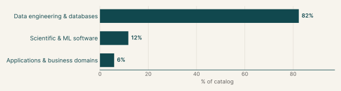
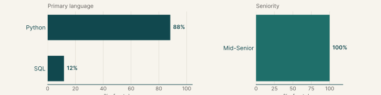
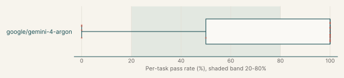
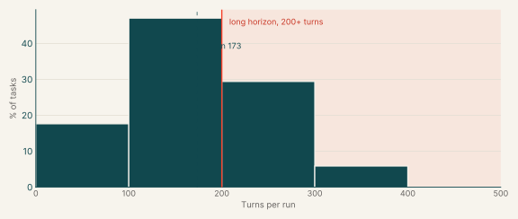
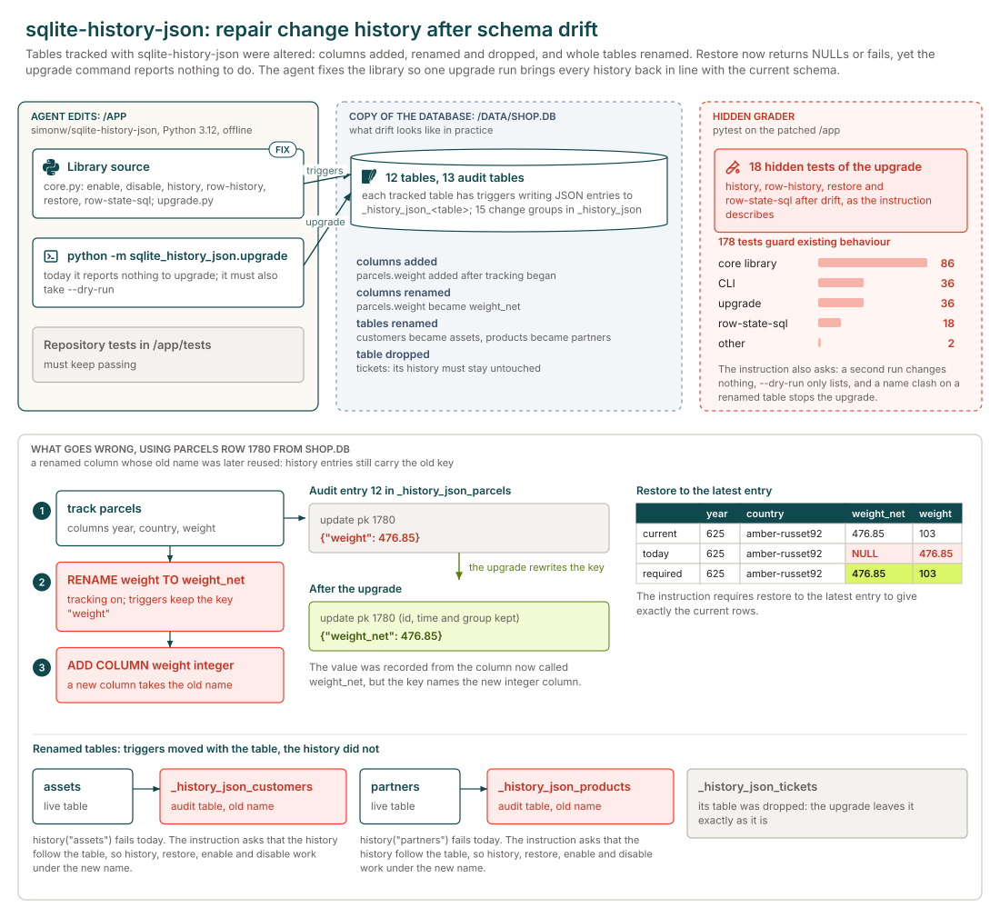
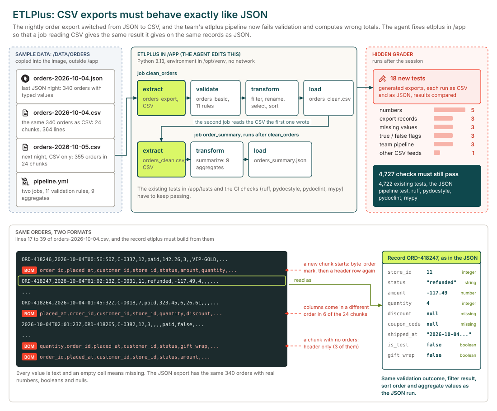
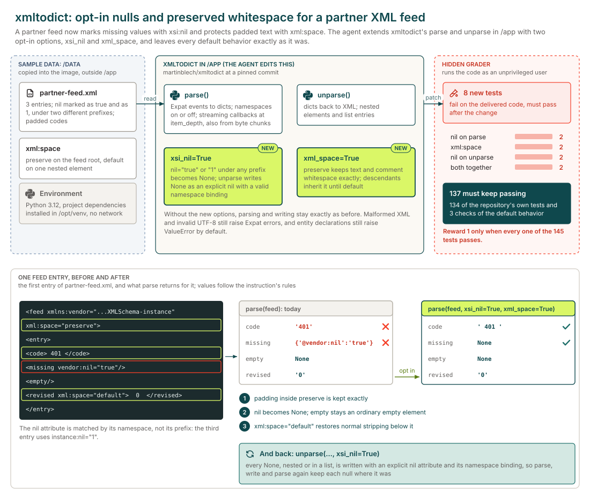

# Data engineering

## Executive summary

17

Tasks

17

Tasks with graded runs

74%

google/gemini-4-argon pass rate

Each task extends or repairs a data library or pipeline so it keeps producing correct results after an upstream format or schema change, while old inputs still read the same. The main languages are Python (88%) and SQL (12%).

Every task has graded runs. The model with the most runs here, google/gemini-4-argon, has an average@k pass rate of 74% over 34 graded runs and fails every run on 24% of the 17 tasks it ran.

## Why this catalog

### Problems engineers face

Data engineers repair pipelines after an upstream feed changes shape. A vendor or connector changes its format and the next run produces wrong data without failing: exports start resending changed records, files change encoding or layout, sheets arrive in another locale, or a schema changes in the middle of an incremental load. The fix must give the same results on reruns and keep existing tests passing.

### How the tasks reproduce them

Each task is a public repository at a pinned commit in `/app`, with a Python virtual environment and, where needed, dbt and DuckDB. Sample inputs such as CSV, Parquet, XML or SQLite files sit in `/data` or in the project, and there is no network. The prompt gives the symptom and the required behaviour, not the faulty code. After the session, a verifier applies the agent's diff, runs the repository's own checks and a hidden suite as an unprivileged user.

### Typical prompts

- A first-person production symptom after a vendor or connector change, with sample files in `/data`.
- A behaviour spec in prose with edge cases, defaults and idempotence rules, ending with a request to fix the library without breaking existing tests.
- An opt-in feature request for a parser or loader, with defaults that must not change.

## Domain breakdown

The tasks span three domains. The largest, Data engineering & databases, makes up 82% of the catalog.

## Language and seniority

### Primary language

| Primary language | % of catalog |
|---|---:|
| Python | 88.2% |
| SQL | 11.8% |

### Seniority

| Seniority | % of catalog |
|---|---:|
| Mid-Senior | 100.0% |

## Model pass rates across the catalog

A model's pass rate is average@k: the share of its graded runs that pass on each task, averaged over the tasks it ran. Runs that errored are left out. Models are listed by number of runs, and a model needs graded runs on five or more tasks for a row.

| Model | Tasks run | Graded runs | Pass rate | Tasks at 0% | Tasks at 20-80% | Tasks at 100% |
|---|---:|---:|---:|---:|---:|---:|
| google/gemini-4-argon | 17 | 34 | 74% | 24% | 6% | 71% |

## Turn counts and long-horizon tasks

A task's turn count is the average over its completed runs, from every model. A task is long horizon when that average is 200 or more turns. 17 of the 17 tasks have a completed run.

| Measure | Value |
|---|---:|
| Average turn count | 173.4 |
| Median turn count | 180.5 |
| Range | 72 to 306 |
| Long-horizon tasks (200+ turns) | 35% of tasks |

| Model | % of tasks | Mean turns | % of runs with 200+ turns |
|---|---:|---:|---:|
| google/gemini-4-argon | 100% | 173.4 | 35% |

## Sample tasks

### Example 1: Databases & storage engines (Python)

| Field | Value |
|---|---|
| Task id | [`sqlite-history-repair`](https://drive.google.com/file/d/146Un1dIq2RerHMbYpd5aWBnrQ6VpXLLV/view) |
| Final category | Data engineering |
| Domain | Data engineering & databases |
| Sub-domain | Databases & storage engines |
| Language | Python |
| Seniority | Mid-Senior |
| Turn count | 236 (google/gemini-4-argon) |
| Long horizon | yes |

#### Prompt

Full instruction given to the agent (instruction.md)

We track SQLite tables with sqlite-history-json (/app) and have since changed some: columns added with ALTER TABLE ADD COLUMN, columns and tables renamed with ALTER TABLE RENAME while tracking was on, and columns dropped by disabling tracking, dropping and enabling again. Now restore returns NULLs or fails with "no such column" and history on a renamed table fails, but `python -m sqlite_history_json.upgrade` says there's nothing to upgrade. A copy of the database is at /data/shop.db.

After the upgrade, restoring a table that has tracking on to its latest entry should give exactly its current rows, and later changes should be recorded as on a table tracked from scratch. Existing entries keep their id, timestamp, operation, primary key and group, with each value under the current name of the column it was recorded from, in history, row-history, restore and row-state-sql. Values for dropped columns stay in the history and restore ignores them. A renamed table's history follows it, so everything works under the new name, enable and disable included.

Tables with tracking off and history of dropped tables stay as they are. A second run changes nothing. With --dry-run it lists only the tables it would change and changes nothing. If a renamed table's new name already has its own history, the upgrade exits with an error naming the table and changes nothing. Databases from 0.3 and earlier must still upgrade, and the tests in /app/tests must keep passing.

Could you find what's wrong and fix it? There's no network here.

#### Pass rates

| Model | Graded runs | Pass rate |
|---|---:|---:|
| google/gemini-4-argon | 2 | 0% |

#### Environment

### Example 2: Data pipelines & ETL (Python)

| Field | Value |
|---|---|
| Task id | [`etlplus-csv-pipeline`](https://drive.google.com/file/d/1j76u3l7Bo5yUlUhQCeFMMRASnZxfB8WD/view) |
| Final category | Data engineering |
| Domain | Data engineering & databases |
| Sub-domain | Data pipelines & ETL |
| Language | Python |
| Seniority | Mid-Senior |
| Turn count | 248 (google/gemini-4-argon) |
| Long horizon | yes |

#### Prompt

Full instruction given to the agent (instruction.md)

Since the night of 2026-10-04 the order platform writes its nightly export as CSV instead of JSON. That first night it wrote both, so /data/orders has orders-2026-10-04.json and orders-2026-10-04.csv with the same orders, the CSV from the next night, and our pipeline config, /data/orders/pipeline.yml. The pipeline validates and cleans the export, then summarizes the cleaned CSV. On the CSV export, `etlplus run --config /data/orders/pipeline.yml --job order_summary` fails validation, and with validation turned off the summary totals are wrong.

Any etlplus job that reads a CSV file should give the result it gives on the same records as JSON: every record exactly once with the same fields, and the same validation outcome, filter result, sort order and aggregate values. An empty cell is a missing value. This also holds for a job reading a CSV file that an earlier job in the run wrote. Values in the output files may stay text.

Please fix etlplus in /app. The existing tests in /app/tests and the ruff, pydocstyle, pydoclint and mypy checks the project runs in CI have to keep passing. There's no network; the project's environment is installed in /opt/venv.

#### Pass rates

| Model | Graded runs | Pass rate |
|---|---:|---:|
| google/gemini-4-argon | 2 | 0% |

#### Environment

### Example 3: Data formats & serialization (Python)

| Field | Value |
|---|---|
| Task id | [`xmltodict-nulls-etl`](https://drive.google.com/file/d/1seIRx1v4KsVyJvkEOHKyRWaV64otchUF/view) |
| Final category | Data engineering |
| Domain | Data engineering & databases |
| Sub-domain | Data formats & serialization |
| Language | Python |
| Seniority | Mid-Senior |
| Turn count | 84 (google/gemini-4-argon) |
| Long horizon | no |

#### Prompt

Full instruction given to the agent (instruction.md)

Our partner's XML feed now carries explicit nulls and text where padding matters. A sample is in `/data/partner-feed.xml`. Extend the existing `xmltodict.parse` and `xmltodict.unparse` APIs in `/app` so callers can opt into the new feed without changing the defaults.

With `parse(..., xsi_nil=True)`, an element whose XML Schema instance `nil` attribute is `true` or `1` becomes `None`, regardless of its prefix, other attributes or text. Other values of `nil` and ordinary empty elements keep their existing behavior. This works with namespace processing on or off, and with streaming callbacks. With `parse(..., xml_space=True)`, `xml:space="preserve"` retains text and comment whitespace exactly, including whitespace only text; descendants inherit this policy until `xml:space="default"` restores the normal stripping rule. This also applies to streamed entries, even when the input arrives in byte chunks. The two options can be used together.

With `unparse(..., xsi_nil=True)`, every `None` element, including nested elements and list entries, emits an explicit schema instance nil attribute with a valid namespace binding. Empty strings remain ordinary empty elements. A nullable document can be parsed, written and parsed again without losing its null locations. Without the new options, existing parsing and writing behavior must stay the same. Malformed XML and invalid UTF-8 still raise Expat errors, and entity declarations remain disabled by default with `ValueError`.

The environment has Python 3.12, installed project dependencies and no network. The existing repository checks should still pass.

#### Pass rates

| Model | Graded runs | Pass rate |
|---|---:|---:|
| google/gemini-4-argon | 2 | 50% |

#### Environment

