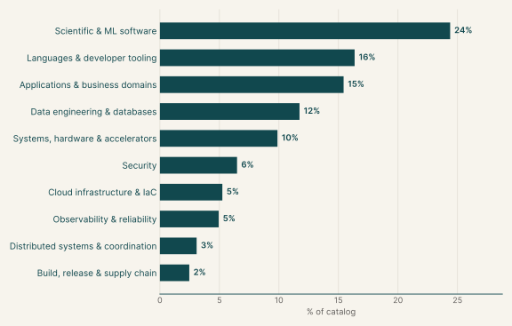
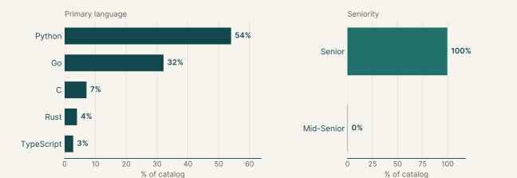
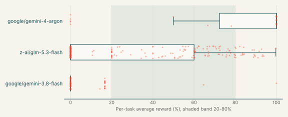
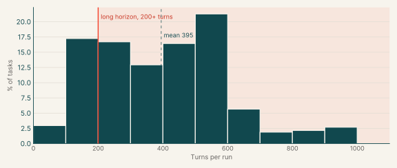
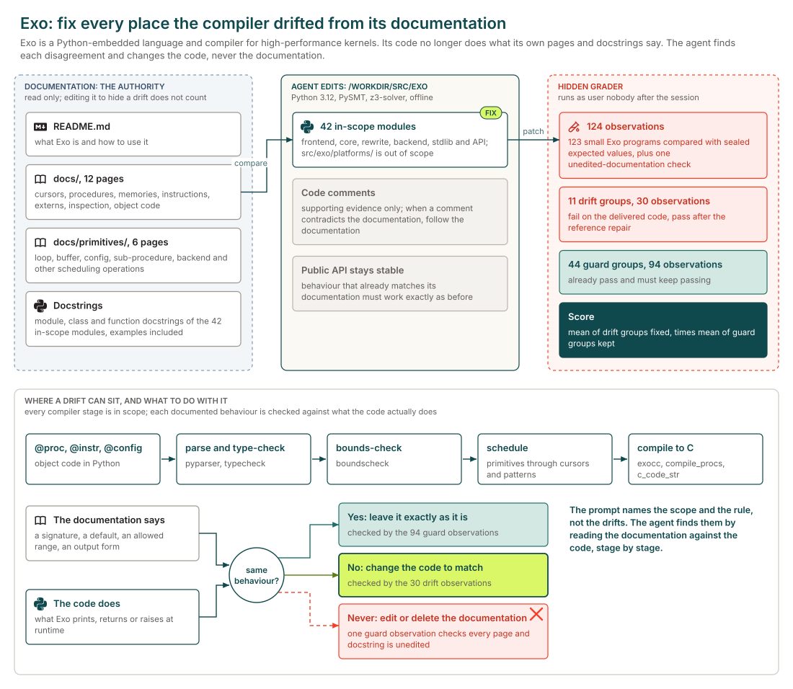
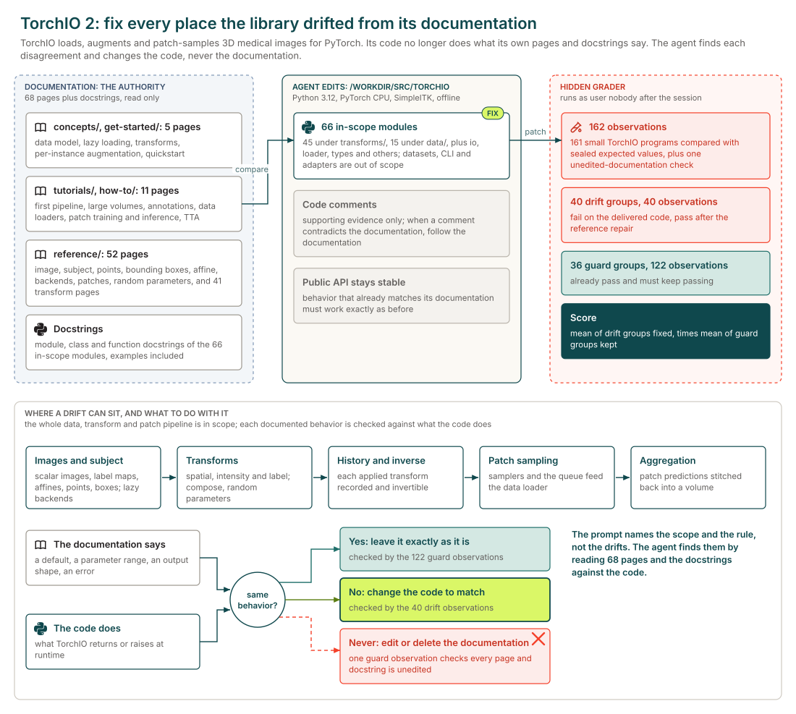
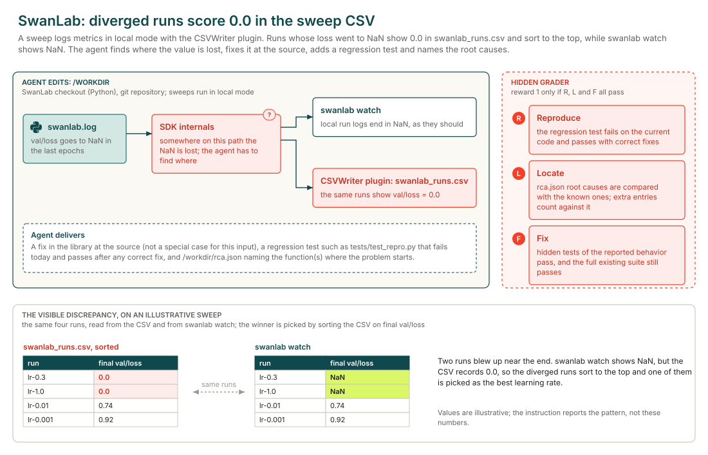
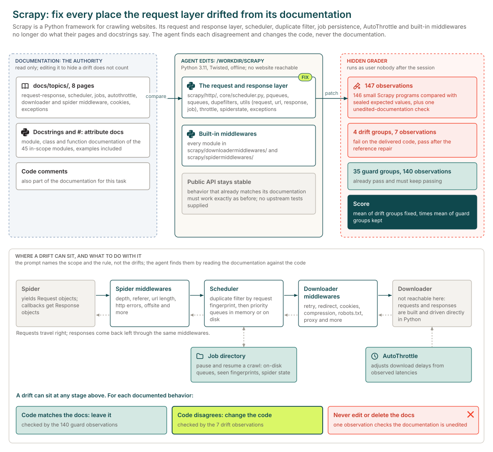

# Diagnosis, Debugging, and Bug Fixing

## Executive summary

<div class="kpis"><div class="kpi"><div class="kpi-value">371</div><div class="kpi-label">Tasks</div></div><div class="kpi"><div class="kpi-value">371</div><div class="kpi-label">Tasks with graded runs</div></div><div class="kpi"><div class="kpi-value">37%</div><div class="kpi-label">z-ai/glm-5.3-flash pass rate</div></div></div>

Each task gives the agent a codebase that misbehaves and a description of the symptoms or the documentation it should follow. The agent finds the faulty code, fixes it without breaking what already works, and in some tasks writes a report naming each root cause. The main languages are Python (60%), Go (28%) and C (6%).

Every task has graded runs. The model with the most runs here, z-ai/glm-5.3-flash, passes 37% of its 1,426 graded runs and fails every run on 51% of the 263 tasks it ran.

## Why this catalog

### Problems engineers face

Maintainers are handed code that is wrong in several places and must find the causes without a test suite to lean on. In the diagnosis tasks, many undocumented edits break unrelated features at once. In the documentation-drift tasks, the code still runs but contradicts its own documentation. Some tasks start from a single production symptom with a hidden root cause.

### How the tasks reproduce them

Each task ships a pinned checkout of an open-source project, with the tests withheld and no network. The prompt describes the symptoms or names the documentation in scope, never the location of the faults. Most diagnosis tasks also ask for `/app/rca.json`, which lists the file and function of each edit and is compared with an answer key. Drift tasks treat the documentation as the authority and forbid editing it. Hidden tests check the repairs and the behaviour that was already correct.

### Typical prompts

- A first-person list of symptoms grouped by feature, with no file or function named, ending in a request to fix and report.
- A stated number of undocumented edits and a JSON schema for the root-cause report.
- A library description with the source paths and documentation pages in scope, and the rule that documentation outranks code.

## Domain breakdown

The tasks span ten domains. The largest, Scientific & ML software, makes up 26% of the catalog.



## Language and seniority



### Primary language

| Primary language | % of catalog |
|---|---:|
| Python | 59.6% |
| Go | 28.0% |
| C | 6.2% |
| Rust | 3.5% |
| TypeScript | 2.7% |

### Seniority

| Seniority | % of catalog |
|---|---:|
| Senior | 99.7% |
| Mid-Senior | 0.3% |

## Model pass rates across the catalog

A model's pass rate is its passed runs over its graded runs, pooled across the tasks it ran; runs that errored are left out. Models are listed by number of runs, and a model needs graded runs on five or more tasks for a row.

| Model | Tasks run | Graded runs | Pass rate | Tasks at 0% | Tasks at 20-80% | Tasks at 100% |
|---|---:|---:|---:|---:|---:|---:|
| z-ai/glm-5.3-flash | 263 | 1,426 | 37% | 51% | 26% | 15% |
| google/gemini-3.8-flash | 75 | 425 | 4% | 76% | 0% | 3% |
| z-ai/glm-5.3 | 51 | 306 | <1% | 98% | 0% | 0% |
| google/gemini-4-argon | 27 | 43 | 79% | 19% | 7% | 74% |



## Turn counts and long-horizon tasks

A task's turn count is the average over its completed runs, from every model. A task is long horizon when that average is 200 or more turns. 371 of the 371 tasks have a completed run.

| Measure | Value |
|---|---:|
| Average turn count | 394.8 |
| Median turn count | 406.0 |
| Range | 50 to 998 |
| Long-horizon tasks (200+ turns) | 80% of tasks |



| Model | % of tasks | Mean turns | % of runs with 200+ turns |
|---|---:|---:|---:|
| z-ai/glm-5.3-flash | 71% | 392.7 | 78% |
| google/gemini-3.8-flash | 20% | 518.7 | 80% |
| z-ai/glm-5.3 | 14% | 207.3 | 41% |
| google/gemini-4-argon | 7% | 209.7 | 35% |

## Sample tasks

### Example 1: Compilers & language runtimes (Python)

| Field | Value |
|---|---|
| Task id | [`exo-canonical-ots`](https://drive.google.com/file/d/1hqLtS09dPnqztGyE15JRg9AZ0pS3fdAD/view) |
| Final category | Diagnosis, Debugging, and Bug Fixing |
| Domain | Languages & developer tooling |
| Sub-domain | Compilers & language runtimes |
| Language | Python |
| Seniority | Senior |
| Turn count | 500 (z-ai/glm-5.3-flash), 280 (google/gemini-4-argon) |
| Long horizon | yes |

#### Prompt

<details open><summary>Full instruction given to the agent (instruction.md)</summary>
<div class="prompt-md">

The repository at `/workdir` is Exo, a Python-embedded language and compiler for writing high-performance
kernels. Procedures written in Exo object code (`@proc`, `@instr`, `@config`) are parsed, type-checked and
bounds-checked, rewritten by user-scheduling primitives (loop and scope, buffer, configuration, sub-procedure,
memory/precision/parallelism and other operations) that are addressed through cursors and patterns, and compiled
to C (`exocc`, `compile_procs`, `Procedure.c_code_str`), with user-defined memories, instructions and externs and a
standard library of higher-level scheduling and inspection functions.

Fix all implementation drift from the documentation in this repository.
The code under repair is the Exo package src/exo except the platform instruction libraries in src/exo/platforms/.
The documentation in scope is: README.md, every page under docs/ (including docs/primitives/), and the module,
class and function docstrings of the in-scope modules of src/exo, including their examples.

Where the code and the documentation disagree about runtime behavior, the documentation is the
authority: change the implementation so that it does what the documentation says, and do not edit
or delete documentation to make a disagreement go away. The documentation is those pages and those
docstrings; in-package code comments are only supporting evidence, and when a comment conflicts with the
documentation, follow the documentation.

The environment runs Python 3.12 with PySMT, z3-solver, asdl-adt, yapf and pytest, and has no network access;
exo is imported from `/workdir/src`. Keep the public API stable and keep every behavior that already matches its
documentation working exactly as it does now.

</div>
</details>

#### Pass rates

| Model | Graded runs | Pass rate |
|---|---:|---:|
| z-ai/glm-5.3-flash | 5 | 0% |
| google/gemini-4-argon | 2 | 0% |

#### Environment



### Example 2: Medical imaging & healthcare (Python)

| Field | Value |
|---|---|
| Task id | [`torchio-canonical-ots`](https://drive.google.com/file/d/1dAuRMjByz3IKD2Q7Qux8ZUoDjKNsHrvc/view) |
| Final category | Diagnosis, Debugging, and Bug Fixing |
| Domain | Scientific & ML software |
| Sub-domain | Medical imaging & healthcare |
| Language | Python |
| Seniority | Senior |
| Turn count | 500 (z-ai/glm-5.3-flash), 312 (google/gemini-4-argon) |
| Long horizon | yes |

#### Prompt

<details open><summary>Full instruction given to the agent (instruction.md)</summary>
<div class="prompt-md">

The repository at `/workdir` is TorchIO 2, a Python library for loading, preprocessing, augmenting and
patch-sampling 3D medical images for deep learning with PyTorch. Its data model holds images (scalar images and
label maps with their affine matrices), subjects, points and bounding boxes, with lazy file backends and batch
containers for data loaders; its transforms cover composition, spatial transforms (resampling, affine and elastic
deformation, flipping, cropping, padding, reorientation and resizing), intensity transforms (normalization,
standardization, noise, blur, gamma, MRI artifacts and more) and label transforms, with random parameter
specifications, transform history and inversion; and its patch pipeline provides samplers, a queue and a patch
aggregator.

Fix all implementation drift from the documentation in this repository.
Everything in scope is the torchio Python package under src/torchio/ except src/torchio/datasets/, src/torchio/download.py, src/torchio/external/, src/torchio/visualization.py, src/torchio/cli.py, src/torchio/transforms/monai_adapter.py and src/torchio/transforms/cornucopia_adapter.py, together with the documentation pages docs/concepts/ (data-model, lazy-loading, transforms, per-instance-augmentation), docs/get-started/quickstart.md, docs/tutorials/ (first-pipeline, augmentation, large-volumes, annotations), docs/how-to/ (dataloader, custom-reader, save-nii-zarr, annotations, patch-inference, patch-training, tta), docs/reference/ (image, subject, points, bboxes, affine, axes, backends, loader, patches, random_parameters, transforms) and every page in docs/reference/transforms/ except monai_adapter.md and cornucopia_adapter.md, and the module, class and function docstrings of the in-scope modules.

Where the code and the documentation disagree about runtime behavior, the documentation is the
authority: change the implementation so that it does what the documentation says, and do not edit
or delete documentation to make a disagreement go away. The documentation is those pages and the
in-package docstrings, including their examples; in-package code comments are only supporting
evidence, and when a comment conflicts with the documentation, follow the documentation.

The environment runs Python 3.12 with TorchIO's runtime dependencies (PyTorch for CPU, NumPy, SimpleITK, NiBabel,
einops, jaxtyping, loguru, rich, tyro, humanize, platformdirs, fsspec and torch-interpol), the optional
NIfTI-Zarr backend (nifti-zarr and zarr), matplotlib and pytest installed, and has no network access; torchio is
imported from `/workdir/src`. Keep the public API stable and keep every behavior that already matches its
documentation working exactly as it does now.

</div>
</details>

#### Pass rates

| Model | Graded runs | Pass rate |
|---|---:|---:|
| z-ai/glm-5.3-flash | 5 | 0% |
| google/gemini-4-argon | 2 | 0% |

#### Environment



### Example 3: Machine learning & MLOps (Python)

| Field | Value |
|---|---|
| Task id | [`swanlab-nanpair-ots`](https://drive.google.com/file/d/1ycCPNxGlpkKdgs2MHARCrZvTi6koSwwP/view) |
| Final category | Diagnosis, Debugging, and Bug Fixing |
| Domain | Scientific & ML software |
| Sub-domain | Machine learning & MLOps |
| Language | Python |
| Seniority | Mid-Senior |
| Turn count | 54 (google/gemini-4-argon) |
| Long horizon | no |

#### Prompt

<details open><summary>Full instruction given to the agent (instruction.md)</summary>
<div class="prompt-md">

**Diverged runs come out on top of our sweep CSV**

We run our hyperparameter sweeps in local mode with the CSVWriter plugin and pick the winner by
sorting swanlab_runs.csv on the final val/loss. The runs that blew up near the end (loss going to
NaN in the last epochs) show up in that CSV with a val/loss of 0.0, so they sort straight to the
top. We only caught it because last week's "best" learning rate turned out to have diverged. In
`swanlab watch` the same runs do end in NaN, like they should.

The checkout is in /workdir. Could you track down where this actually goes wrong and fix it
there? Please include a regression test, somewhere under tests/ (say tests/test_repro.py), that
fails on the current code because of this problem (a real test failure, not an import error) and
passes once it's fixed. Test the reported behaviour, not your patch: it should still pass if the
bug gets fixed some other correct way, so no asserting on source text or on helpers only your fix
has. It should run on its own from a clean checkout with just your test files added.

I doubt I'm the only one hitting this. Anything else that goes through that code is probably
wrong too, so please fix it at the source rather than special-casing my input. The fix belongs in
the library itself, not in the tests. CI runs the full test suite on every change, so it
shouldn't break anything else.

When you're done, leave a short root-cause note at /workdir/rca.json:

```json
{
  "root_causes": [{"file": "path/from/repo/root.py", "function": "Class.method"}],
  "reproducer": "tests/test_repro.py"
}
```

`root_causes` lists the function(s) where the problem actually starts (one or more), not where it
shows up: the file relative to the repo root and the name as `function` or `Class.method`. Don't
pad the list with functions that only pass the bad value along; extra entries count against the
note. `reproducer` is the repo-relative path of your regression test.

</div>
</details>

#### Pass rates

| Model | Graded runs | Pass rate |
|---|---:|---:|
| google/gemini-4-argon | 1 | 0% |

#### Environment



### Example 4: Web crawling (Python)

| Field | Value |
|---|---|
| Task id | [`scrapy-pdk-ots`](https://drive.google.com/file/d/1REQsLCXJtRnoruzB2WlCUywZX56GZX8F/view) |
| Final category | Diagnosis, Debugging, and Bug Fixing |
| Domain | Applications & business domains |
| Sub-domain | Web crawling |
| Language | Python |
| Seniority | Senior |
| Turn count | 427 (z-ai/glm-5.3-flash), 166 (google/gemini-4-argon), 251 (google/gemini-3.8-flash) |
| Long horizon | yes |

#### Prompt

<details open><summary>Full instruction given to the agent (instruction.md)</summary>
<div class="prompt-md">

The repository at `/workdir` is Scrapy, a Python framework for crawling websites and extracting structured
data. Its request and response layer carries each `Request` from a spider through the spider and downloader
middlewares to the scheduler, which filters duplicates by request fingerprint, keeps requests in priority
queues (in memory, or on disk for a persistent job) and hands them to the downloader; responses come back through
the same middlewares. The AutoThrottle extension adjusts download delays, and a job directory lets a crawl be
paused and resumed.

Fix all implementation drift from the documentation in this part of the repository.
Everything in scope is Scrapy's request and response layer, its scheduling and duplicate filtering, job persistence, AutoThrottle and its built-in downloader and spider middlewares: the scrapy/http/ package, scrapy/core/scheduler.py, scrapy/pqueues.py, scrapy/squeues.py, scrapy/dupefilters.py, scrapy/utils/request.py, scrapy/utils/url.py, scrapy/utils/response.py, scrapy/utils/job.py, scrapy/extensions/throttle.py, scrapy/extensions/spiderstate.py, scrapy/exceptions.py and the scrapy/downloadermiddlewares/ and scrapy/spidermiddlewares/ packages, together with the documentation pages docs/topics/request-response.rst, scheduler.rst, jobs.rst, autothrottle.rst, downloader-middleware.rst, spider-middleware.rst, cookies.rst and exceptions.rst and the module, class and function docstrings of the in-scope modules.

Where the code and the documentation disagree about runtime behavior, the documentation is the
authority: change the implementation so that it does what the documentation says, and do not edit
or delete documentation to make a disagreement go away. The documentation is those pages and the
in-package docstrings and comments of the in-scope modules (including the `#:` attribute documentation
that the pages render), including their examples. The rest of the repository is context, not part of
the task.

The environment runs Python 3.11 with Scrapy's dependencies installed and has no network access;
`scrapy` is imported from `/workdir`. No website is reachable, and none of the work needs one: requests,
responses, middlewares and the scheduler can be built and driven directly in Python. The upstream test
suite is not supplied; write your own checks as needed. Keep the public API stable and keep every
behavior that already matches its documentation working exactly as it does now.

</div>
</details>

#### Pass rates

| Model | Graded runs | Pass rate |
|---|---:|---:|
| google/gemini-4-argon | 3 | 67% |
| z-ai/glm-5.3-flash | 5 | 20% |
| google/gemini-3.8-flash | 2 | 100% |

#### Environment


