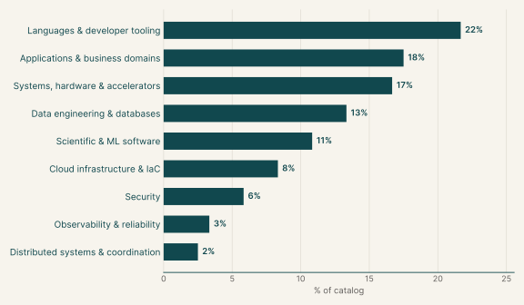
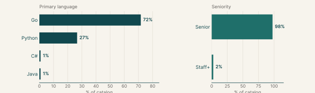
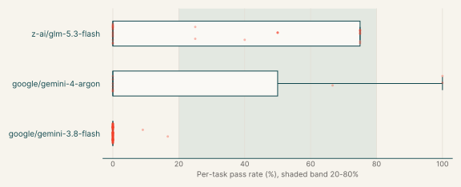
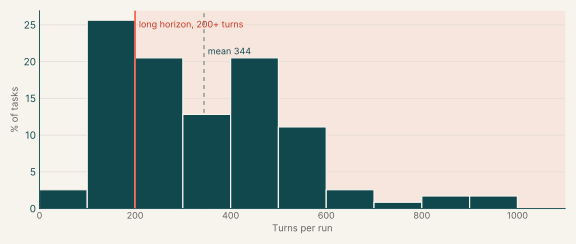
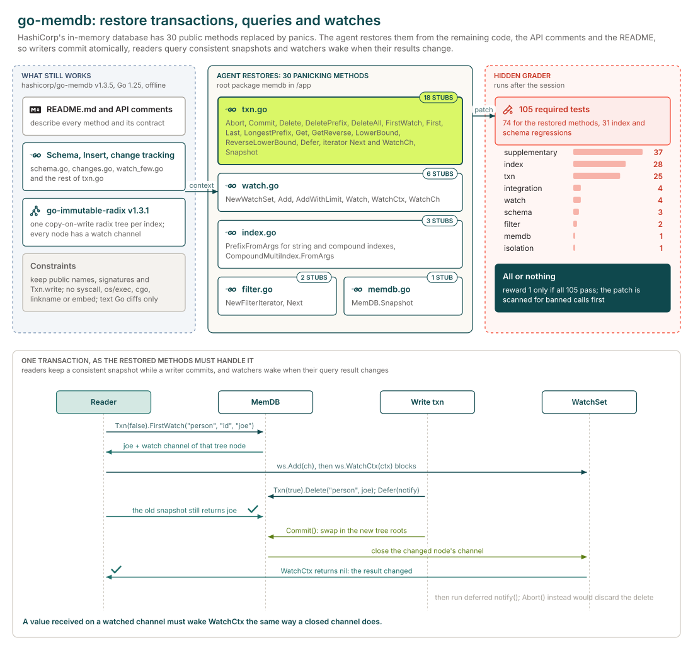

# Feature implementation

## Executive summary

120

Tasks

117

Tasks with graded runs

&lt;1%

google/gemini-3.8-flash pass rate

Each task asks the agent to add a capability to an existing open-source library or service, specified as the public types and functions to deliver, while existing callers see no change. The main languages are Go (72%), Python (27%) and C# (1%).

117 of the 120 tasks have graded runs from at least one model. The model with the most runs here, google/gemini-3.8-flash, passes <1% of its 641 graded runs and fails every run on 98% of the 100 tasks it ran.

## Why this catalog

### Problems engineers face

Maintainers add a capability that runs through many code paths of an unfamiliar library or service, while existing callers must see no change. Typical requests add an opt-in mode or policy, keep information the library currently drops, or make a subsystem safe under concurrency and failure.

### How the tasks reproduce them

Each task pins an open-source repository, mostly Go or Python, in an offline container and gives a written specification of the new behaviour. The agent's edits are collected as a diff against the base commit. After the session, hidden acceptance tests check the new behaviour and the project's existing tests check that nothing else changed.

### Typical prompts

- A capability gap stated as "X cannot Y", then dense paragraphs on the behaviour to add and the behaviour to preserve.
- A bullet list of required exported names, constants and signatures, with a research and plan file due before any code change.

## Domain breakdown

The tasks span nine domains. The largest, Languages & developer tooling, makes up 22% of the catalog.

## Language and seniority

### Primary language

| Primary language | % of catalog |
|---|---:|
| Go | 71.7% |
| Python | 26.7% |
| C# | 0.8% |
| Java | 0.8% |

### Seniority

| Seniority | % of catalog |
|---|---:|
| Senior | 97.5% |
| Staff+ | 2.5% |

## Model pass rates across the catalog

A model's pass rate is its passed runs over its graded runs, pooled across the tasks it ran; runs that errored are left out. Models are listed by number of runs, and a model needs graded runs on five or more tasks for a row.

| Model | Tasks run | Graded runs | Pass rate | Tasks at 0% | Tasks at 20-80% | Tasks at 100% |
|---|---:|---:|---:|---:|---:|---:|
| google/gemini-3.8-flash | 100 | 641 | <1% | 98% | 0% | 0% |
| z-ai/glm-5.3-flash | 29 | 148 | 23% | 52% | 48% | 0% |
| google/gemini-4-argon | 10 | 21 | 29% | 70% | 10% | 20% |

## Turn counts and long-horizon tasks

A task's turn count is the average over its completed runs, from every model. A task is long horizon when that average is 200 or more turns. 117 of the 120 tasks have a completed run.

| Measure | Value |
|---|---:|
| Average turn count | 344.3 |
| Median turn count | 321.7 |
| Range | 92 to 956 |
| Long-horizon tasks (200+ turns) | 72% of tasks |

| Model | % of tasks | Mean turns | % of runs with 200+ turns |
|---|---:|---:|---:|
| google/gemini-3.8-flash | 85% | 344.3 | 68% |
| z-ai/glm-5.3-flash | 25% | 300.6 | 66% |
| google/gemini-4-argon | 9% | 247.4 | 71% |

## Sample tasks

### Example 1: Databases & storage engines (Go)

| Field | Value |
|---|---|
| Task id | [`memdb-txn-ots`](https://drive.google.com/file/d/1M3HCkXFdoznYOiY4yc3LlI8olgAA1K15/view) |
| Final category | Feature implementation |
| Domain | Data engineering & databases |
| Sub-domain | Databases & storage engines |
| Language | Go |
| Seniority | Senior |
| Turn count | 262 (z-ai/glm-5.3-flash), 79 (google/gemini-4-argon) |
| Long horizon | no |

#### Prompt

Full instruction given to the agent (instruction.md)

I'm restoring transaction and query support in our copy of go-memdb so callers can update data, query snapshots, and watch query results for updates. Could you implement the methods that currently panic in the root `memdb` package? They live in `txn.go`, `memdb.go`, `index.go`, `filter.go`, and `watch.go`. The missing pieces cover transaction lifecycle, deletion, indexed queries and iteration, snapshots, deferred callbacks, filtering, and watch sets.

The existing code, API comments, and `README.md` provide context for the restoration. A received value must wake `WatchCtx` just as a closed watched channel does. Please keep the restored public names and signatures unchanged, and retain `Txn.write` for package compatibility; private helper functions are up to you. I'll check the restored behavior alongside index and schema regressions. Submit text Go source changes without new symbolic links, binary Go diffs, or Go line-position directives (`//line` and `/*line`). Use Go filenames that produce unquoted, whitespace-free paths in Git diffs.

In the non-test code you add, please avoid: new `init()` functions; the `syscall`, `golang.org/x/sys`, `os/exec`, `os/signal`, `plugin`, `embed`, `runtime/cgo`, `runtime/pprof`, `runtime/trace`, `testing` and `flag` packages, cgo, and `//go:linkname` or `//go:embed` directives; `os.Exit`, `os.StartProcess`, `os.FindProcess` and `runtime.Goexit`; reading `os.Args`, `os.Executable`, `/proc/self` or `runtime/debug` build info; caller or stack lookups (`runtime.Caller`, `Callers`, `CallersFrames`, `FuncForPC`, `Stack`, `debug.Stack`, `debug.PrintStack`, `log.Lshortfile`, `log.Llongfile`, and `AddSource` selectors or identifier keys); literal U+0016 or the text `\x16`; and printing test-runner lines such as `--- PASS`. These are rejected outright. Some checks read raw text and also match comments.

#### Pass rates

| Model | Graded runs | Pass rate |
|---|---:|---:|
| google/gemini-4-argon | 3 | 67% |
| z-ai/glm-5.3-flash | 4 | 0% |

#### Environment

