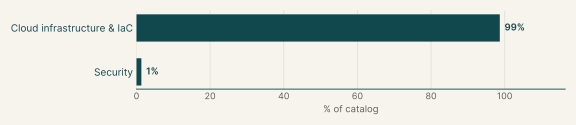
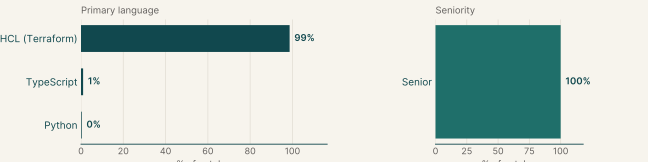
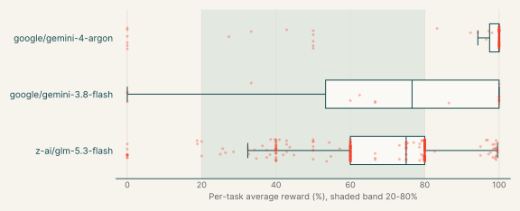
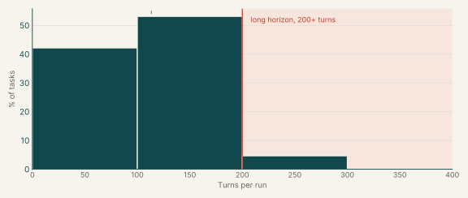
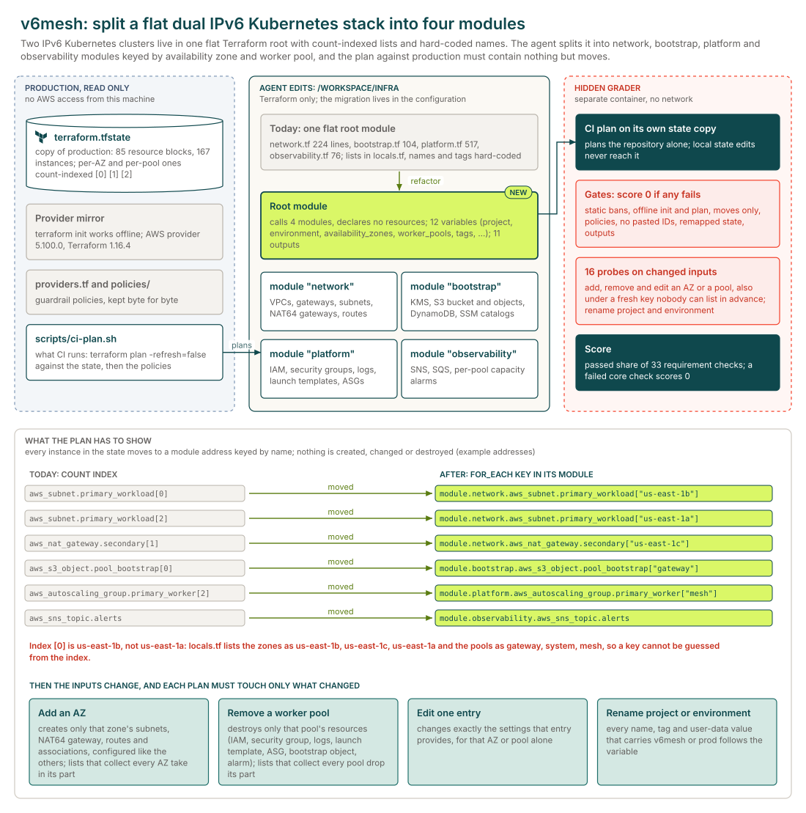
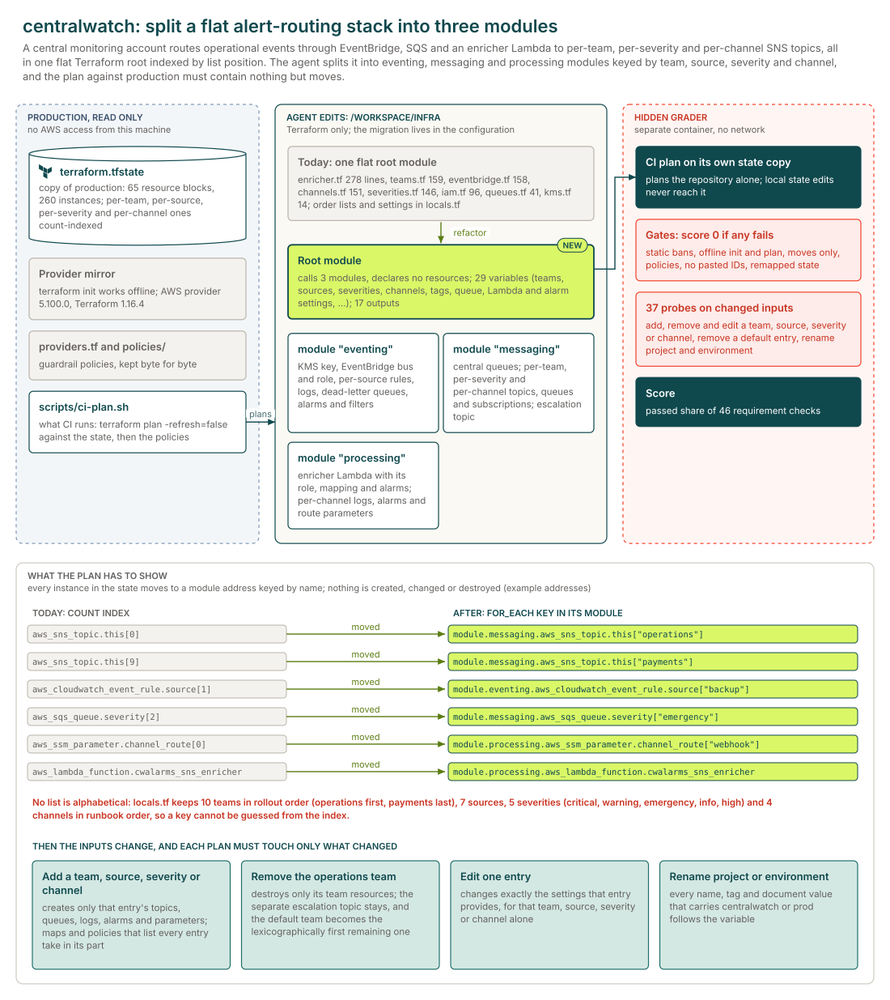
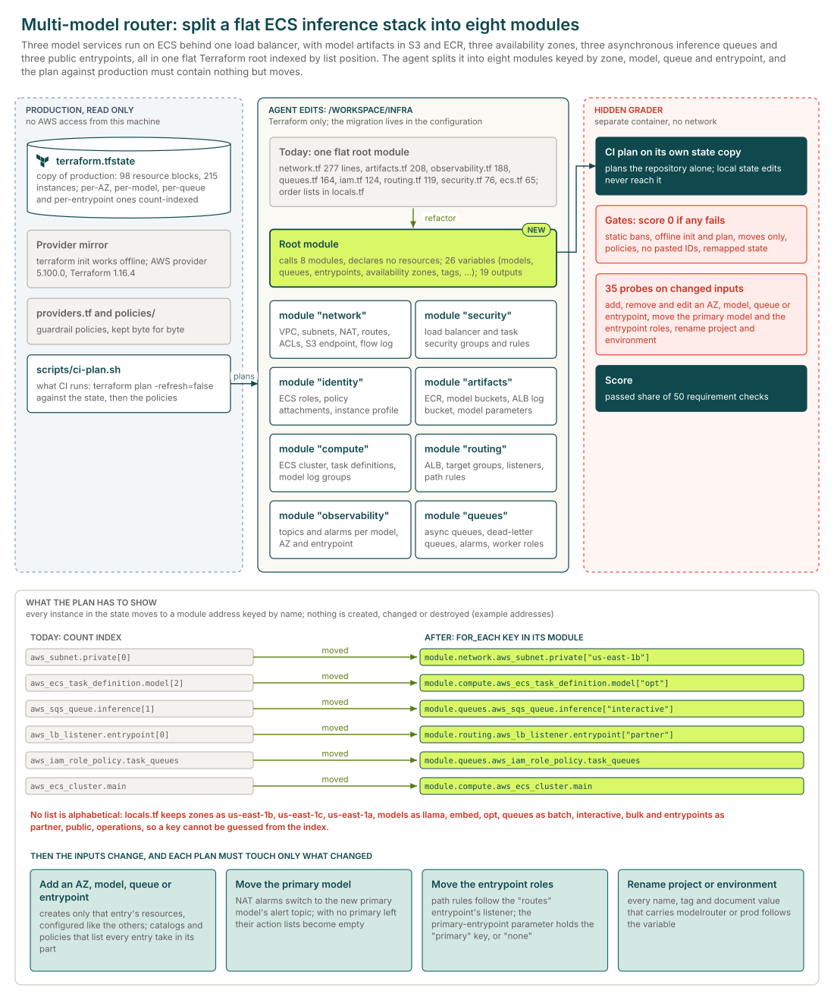
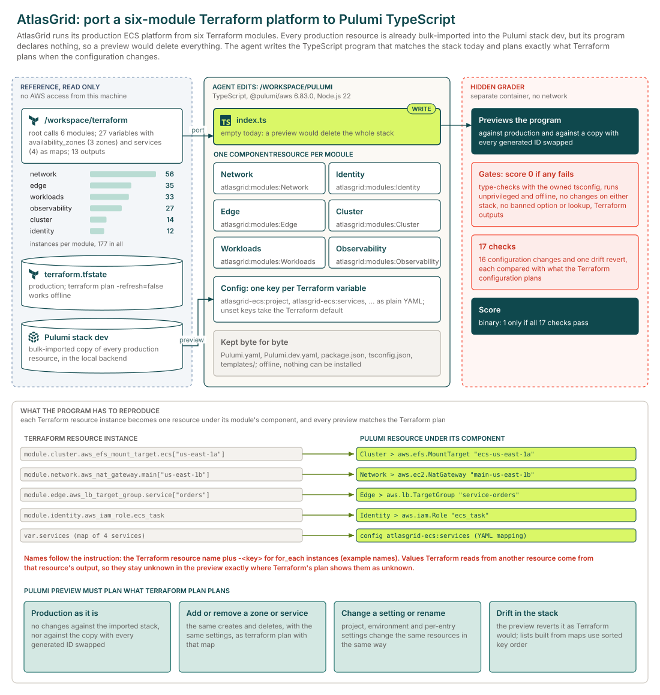

# Infrastructure as code

## Executive summary

300

Tasks

299

Tasks with graded runs

63%

z-ai/glm-5.3-flash pass rate

Each task restructures infrastructure code that is already deployed. The agent splits a flat Terraform stack into modules with stable keys, componentizes a CDK app or moves a stack to Pulumi, so that the plan against production state changes nothing that is running. The main languages are HCL (Terraform) (99%), TypeScript (1%) and Python (0%).

299 of the 300 tasks have graded runs from at least one model. The model with the most runs here, z-ai/glm-5.3-flash, passes 63% of its 1,586 graded runs and fails every run on 3% of the 292 tasks it ran.

## Why this catalog

### Problems engineers face

Platform engineers restructure infrastructure code that is already running, and the change must reach production as address moves only, because the team cannot plan against a live account. The most common case is a flat Terraform root module that has to become local modules with `for_each` keys. Others replace positional `count` with stable keys, extract reusable components from an app that builds everything inline, move a stack between tools while the preview stays clean, or bring a stack under a policy pack without replacing resources.

### How the tasks reproduce them

Each task ships a copy of the stack with its recorded production state or recorded templates, an offline toolchain and no network. The instruction states module ownership, key rules, root variables with today's defaults and outputs. After the session, a separate verifier with its own pristine state plans the agent's configuration with refresh disabled and expects moves only, then plans hidden changes such as an added key, a removed key or a changed entry. Most tasks score zero when a gate fails.

### Typical prompts

- A first-person request to modularize a named production stack, listing target modules, ownership, key rules, root variables and outputs, and requiring a plan of moves only.
- A componentization request that lists every construct class with its path, props and public properties, and requires identical synthesized templates.
- A migration brief for an imported stack with an empty program, with naming, config and equivalence rules and banned options.

## Domain breakdown

The tasks span two domains. The largest, Cloud infrastructure & IaC, makes up 99% of the catalog.

## Language and seniority

### Primary language

| Primary language | % of catalog |
|---|---:|
| HCL (Terraform) | 98.7% |
| TypeScript | 1.0% |
| Python | 0.3% |

### Seniority

| Seniority | % of catalog |
|---|---:|
| Senior | 100.0% |

## Model pass rates across the catalog

A model's pass rate is its passed runs over its graded runs, pooled across the tasks it ran; runs that errored are left out. Models are listed by number of runs, and a model needs graded runs on five or more tasks for a row.

| Model | Tasks run | Graded runs | Pass rate | Tasks at 0% | Tasks at 20-80% | Tasks at 100% |
|---|---:|---:|---:|---:|---:|---:|
| z-ai/glm-5.3-flash | 292 | 1,586 | 63% | 3% | 89% | 8% |
| google/gemini-4-argon | 20 | 40 | 78% | 15% | 15% | 70% |
| x-ai/grok-4.7 | 7 | 55 | 53% | 0% | 57% | 0% |
| google/gemini-3.8-flash | 7 | 21 | 71% | 14% | 43% | 43% |
| anthropic/claude-opus-5-5 | 7 | 7 | 86% | 14% | 0% | 86% |
| openai/gpt-6-astra | 7 | 7 | 100% | 0% | 0% | 100% |

The chart leaves out anthropic/claude-opus-5-5 and openai/gpt-6-astra, which pass every run on 80% or more of their tasks.

Also run on fewer than five tasks: meta/muse-wonder (1 task, 100% of 4 runs).

## Turn counts and long-horizon tasks

A task's turn count is the average over its completed runs, from every model. A task is long horizon when that average is 200 or more turns. 299 of the 300 tasks have a completed run.

| Measure | Value |
|---|---:|
| Average turn count | 112.6 |
| Median turn count | 109.0 |
| Range | 39 to 271 |
| Long-horizon tasks (200+ turns) | 3% of tasks |

| Model | % of tasks | Mean turns | % of runs with 200+ turns |
|---|---:|---:|---:|
| z-ai/glm-5.3-flash | 98% | 115.9 | 10% |
| x-ai/grok-4.7 | 2% | 105.8 | 0% |
| google/gemini-4-argon | 7% | 74.6 | 5% |
| google/gemini-3.8-flash | 2% | 156.8 | 24% |
| openai/gpt-6-astra | 2% | 41.0 | 0% |
| anthropic/claude-opus-5-5 | 2% | 45.7 | 0% |
| meta/muse-wonder | <1% | 165.0 | 0% |

## Sample tasks

### Example 1: Cloud infra: containers & self-hosted platforms (Terraform)

| Field | Value |
|---|---|
| Task id | [`dualipv6-module-refactor`](https://drive.google.com/file/d/1Yg1iLWpltsqLdJS0jpUj4v3Wb3K4JlE-/view) |
| Final category | Infrastructure as code |
| Domain | Cloud infrastructure & IaC |
| Sub-domain | Cloud infra: containers & self-hosted platforms |
| Language | HCL (Terraform) |
| Seniority | Senior |
| Turn count | 100 (z-ai/glm-5.3-flash), 46 (google/gemini-4-argon) |
| Long horizon | no |

#### Prompt

Full instruction given to the agent (instruction.md)

The Terraform for our dual IPv6 Kubernetes production stack in `/workspace/infra` has grown into one flat root module: everything is declared at the top level, the per-AZ resources are `count`-indexed by list position, and names, settings and tags are hard-coded all over the files. Split it into four local modules (network, bootstrap, platform and observability) without touching the running infrastructure: against the current state, the plan has to come out as nothing but moves.

There is no AWS access from this machine. `terraform init` works offline from the local provider mirror, `terraform.tfstate` is a copy of the production state, and `scripts/ci-plan.sh` runs what CI runs: a `terraform plan -refresh=false` against the state followed by the guardrail policies in `policies/`.

###### Detailed Constraints

**How CI judges the change.** CI takes the repository alone and plans it with `terraform plan -refresh=false` against its own copy of the production state. Local `terraform state` commands and edits to `terraform.tfstate` never reach it, so the whole migration has to be expressed in the configuration. That plan must:
- still manage every resource that is in the state today, and
- contain no create, update, replace, destroy or forget: only resources moving to new addresses.

The guardrail policies in `policies/` must pass on that plan, and `providers.tf` and everything in `policies/` stay exactly as they are, byte for byte.

**Layout.**
- The root module calls `module "network"`, `module "bootstrap"`, `module "platform"` and `module "observability"`, with sources `./modules/network`, `./modules/bootstrap`, `./modules/platform` and `./modules/observability` and one instance each, calls no other module and declares no resources of its own.
- Which module owns what (every instance of the resources described, wherever they are declared today):
  - network: both VPCs, their internet gateways, public and workload subnets, Elastic IPs and NAT64-capable NAT gateways, route tables, IPv4 and IPv6 routes, and route table associations;
  - bootstrap: the bootstrap KMS key and alias, S3 bucket and every bucket settings resource, the per-pool bootstrap objects, the DynamoDB bootstrap table, and the network and worker SSM configuration catalogs;
  - platform: both clusters' control-plane and worker IAM roles, inline policies and instance profiles, security groups and rules, CloudWatch log groups, launch templates and auto scaling groups;
  - observability: the alert SNS topic, SQS queue, subscription and queue policy, and both clusters' per-pool capacity alarms.
- Each of these modules declares the resources it owns itself and calls no other module.
- Modules get each other's IDs and ARNs through module outputs and variables. Never paste an ID, ARN, IP address or DNS name of an existing resource, or any part of one (such as an ARN suffix), into the `.tf` files or templates. The configuration reads files only through literal paths inside its own module (such as `"${path.module}/templates/..."`; in a child module a path starts with `${path.module}/`, because Terraform resolves any other relative path from the root directory, not from the module): no computed paths, no `terraform_remote_state` data sources, and never the state or a plan file.

**Keys.**
- Everything that exists once per availability zone today is a `for_each` resource keyed by the AZ name (for example `["us-east-1a"]`), including each instance of a list that also holds things that belong to no single availability zone.
- Everything that exists once per worker pool today is a `for_each` resource keyed by the pool name (for example `["mesh"]`), including each instance of a list that also holds things that belong to no single worker pool.
- Don't use `count` anywhere. Other repeated resources use `for_each` with string keys that are not numbers (a name such as `["assets"]`, never `["0"]`).
- Each existing availability zone's entry in `availability_zones` is the only source of its values: changing an entry changes, for that availability zone alone, exactly the settings the entry provides, and changes nothing else.
- Adding an availability zone to `availability_zones` must plan only the creation of that availability zone's resources, each configured exactly like its counterparts in the existing availability zones apart from the availability zone itself and the values its entry in `availability_zones` gives it (same settings, names and tags), and removing one only the destruction of that availability zone's resources. Beyond that, the only change either may plan is an in-place update of the settings that collect something from every availability zone today (wherever a setting holds a part of every availability zone: their names, IDs, ARNs, subnets or CIDRs, say, in a list, a policy document or an environment value): each of them must take in, or drop, exactly that availability zone's part where it belongs, in the same form as today (today's parts keep their order; where a new part goes is up to you), and change nothing else. No other resource may be created, updated, replaced or destroyed.
- Each existing worker pool's entry in `worker_pools` is the only source of its values: changing an entry changes, for that worker pool alone, exactly the settings the entry provides, and changes nothing else.
- Adding a worker pool to `worker_pools` must plan only the creation of that worker pool's resources, each configured exactly like its counterparts in the existing worker pools apart from the worker pool itself and the values its entry in `worker_pools` gives it (same settings, names and tags), and removing one only the destruction of that worker pool's resources. Beyond that, the only change either may plan is an in-place update of the settings that collect something from every worker pool today (wherever a setting holds a part of every worker pool: their names, IDs, ARNs, subnets or CIDRs, say, in a list, a policy document or an environment value): each of them must take in, or drop, exactly that worker pool's part where it belongs, in the same form as today (today's parts keep their order; where a new part goes is up to you), and change nothing else. No other resource may be created, updated, replaced or destroyed.

**Root variables.** Declare these in the root module, each defaulting to today's value:
- `project` (`string`, `"v6mesh"`): every whole-word occurrence of `v6mesh` in a resource name, identifier or tag value today comes from it (whole word: not part of a longer run of letters and digits, so `v6mesh-api`, `v6mesh_key` and `/v6mesh/` count, while a longer word that merely contains `v6mesh` stays as it is), and so does every mention of those names elsewhere in the configuration (for example a resource name inside a policy); inside documents such as policies, container definitions and environment values, every whole-word occurrence of `v6mesh` that stands for it comes from it too; This includes the `PROJECT` value in every launch template's user data, project fields in the SSM catalogs and bootstrap objects, and the project token in alarm namespaces and dimensions.
- `environment` (`string`, `"prod"`): every whole-word occurrence of `prod` in a resource name, identifier or tag value today, and the `ENVIRONMENT` value in every launch template's user data, the environment fields in the SSM catalogs and bootstrap objects, and the environment token in alarm namespaces and dimensions, comes from it (whole word: not part of a longer run of letters and digits, so `prod-api`, `prod_key` and `/prod/` count, while a longer word that merely contains `prod` stays as it is), and so does every mention of those names elsewhere in the configuration (for example a resource name inside a policy); inside documents such as policies, container definitions and environment values, every whole-word occurrence of `prod` that stands for it comes from it too.
- `primary_vpc_cidr` (`string`, `"172.20.0.0/16"`): the alpha cluster VPC's IPv4 CIDR and its control-plane API security-group rule.
- `secondary_vpc_cidr` (`string`, `"172.21.0.0/16"`): the beta cluster VPC's IPv4 CIDR and its control-plane API security-group rule.
- `availability_zones`: `map(object({ order = number, primary_public_cidr = string, primary_workload_cidr = string, secondary_public_cidr = string, secondary_workload_cidr = string }))`, keyed by AZ name, defaulting to today's three AZs, their stable collection order and all four subnet CIDRs. It is the only source of AZ membership, AZ order and subnet CIDRs.
- `worker_pools`: `map(object({ order = number, instance_type = string, disk_size = number, min_size = number, max_size = number, desired_size = number }))`, keyed by pool name, defaulting to today's gateway, system and mesh pools, their stable collection order, instance type, root disk size and scaling bounds. It is the only source of worker-pool membership, order and sizing.
- `tags` (`map(string)`, `{ Owner = "soloio-platform", CostCenter = "cc-6204", ManagedBy = "terraform" }`): the shared tags (`Owner`, `CostCenter` and `ManagedBy`) that tagged resources carry today. Wherever the configuration writes them out today, in any form, they come from this variable, so that a different map (other keys, other values) reaches every one of those places; a resource's other tags stay as they are, and resources that are untagged today stay untagged.
- `node_ami_id` (`string`, `"ami-0009de7aaac3fdbb1"`): the AMI of every control-plane and worker launch template.
- `master_instance_type` (`string`, `"t3.medium"`): the instance type of both control-plane launch templates.
- `log_retention_days` (`number`, `30`): the retention period of every control-plane and worker CloudWatch log group.
- `bootstrap_version_retention_days` (`number`, `30`): the bootstrap bucket's noncurrent-version retention period.
- `alarm_period_seconds` (`number`, `60`): the metric period of every worker-pool capacity alarm.
- Changing `primary_vpc_cidr`, `secondary_vpc_cidr`, `node_ami_id`, `master_instance_type`, `log_retention_days`, `bootstrap_version_retention_days` and `alarm_period_seconds` changes only what each one's line above says it controls: every other setting keeps today's value, including a setting that merely has the same value today.

**Root outputs.** Keep `primary_vpc_id`, `secondary_vpc_id`, `bootstrap_bucket_name` and `alerts_topic_arn` with their current values. `primary_workload_subnet_ids` becomes a map from the AZ name to the `id` of that availability zone's `aws_subnet.primary_workload`. `secondary_workload_subnet_ids` becomes a map from the AZ name to the `id` of that availability zone's `aws_subnet.secondary_workload`. `primary_nat64_public_ips` becomes a map from the AZ name to the `public_ip` of that availability zone's `aws_eip.primary_nat64`. `secondary_nat64_public_ips` becomes a map from the AZ name to the `public_ip` of that availability zone's `aws_eip.secondary_nat64`. `primary_worker_asg_names` becomes a map from the pool name to the `name` of that worker pool's `aws_autoscaling_group.primary_worker`. `secondary_worker_asg_names` becomes a map from the pool name to the `name` of that worker pool's `aws_autoscaling_group.secondary_worker`. `bootstrap_object_keys` is a new output: a map from the pool name to the `key` of that worker pool's `aws_s3_object.pool_bootstrap`. Each output passes through outputs of the module that owns the resource (network for `primary_vpc_id`, `secondary_vpc_id`, `primary_workload_subnet_ids`, `secondary_workload_subnet_ids`, `primary_nat64_public_ips` and `secondary_nat64_public_ips`; bootstrap for `bootstrap_bucket_name` and `bootstrap_object_keys`; platform for `primary_worker_asg_names` and `secondary_worker_asg_names`; observability for `alerts_topic_arn`): the root output is a plain reference to an output of that module, and that module output is a plain reference to the resource. A plain reference is a reference such as `module.network.<output>` or `<resource type>.<name>.<attribute>`, a local that holds one, or a `for` expression that only re-keys one (`{ for k, v in <reference> : k => v.id }`) or iterates a plain reference and looks each key up in one (`{ for k, v in var.<map> : k => <reference>[k].id }`); no literals, function calls, conditionals or string templates anywhere along the way.

**Not allowed anywhere in the configuration:** `ignore_changes`, `prevent_destroy` and `replace_triggered_by`, `removed` and `import` blocks, provisioners, `external` data sources, backend or cloud blocks, provider blocks other than the one in `providers.tf`, override files and `.tf.json` files.

#### Pass rates

| Model | Graded runs | Pass rate |
|---|---:|---:|
| google/gemini-4-argon | 2 | 0% |
| z-ai/glm-5.3-flash | 5 | 40% |

#### Environment

### Example 2: Cloud infra: AWS platform stacks (Terraform)

| Field | Value |
|---|---|
| Task id | [`centralwatch-module-refactor`](https://drive.google.com/file/d/18b23bcb7ot9dDpaMF3nvcUVTGvYhg3aA/view) |
| Final category | Infrastructure as code |
| Domain | Cloud infrastructure & IaC |
| Sub-domain | Cloud infra: AWS platform stacks |
| Language | HCL (Terraform) |
| Seniority | Senior |
| Turn count | 140 (z-ai/glm-5.3-flash), 70 (google/gemini-4-argon) |
| Long horizon | no |

#### Prompt

Full instruction given to the agent (instruction.md)

The Terraform for our centralwatch production alert-routing stack in `/workspace/infra` has grown into one flat root module: everything is declared at the top level, the per-team resources are `count`-indexed by list position, and names, settings and tags are hard-coded all over the files. Split it into three local modules (eventing, messaging and processing) without touching the running infrastructure: against the current state, the plan has to come out as nothing but moves.

There is no AWS access from this machine. `terraform init` works offline from the local provider mirror, `terraform.tfstate` is a copy of the production state, and `scripts/ci-plan.sh` runs what CI runs: a `terraform plan -refresh=false` against the state followed by the guardrail policies in `policies/`.

###### Detailed Constraints

**How CI judges the change.** CI takes the repository alone and plans it with `terraform plan -refresh=false` against its own copy of the production state. Local `terraform state` commands and edits to `terraform.tfstate` never reach it, so the whole migration has to be expressed in the configuration. That plan must:
- still manage every resource that is in the state today, and
- contain no create, update, replace, destroy or forget: only resources moving to new addresses.

The guardrail policies in `policies/` must pass on that plan, and `providers.tf` and everything in `policies/` stay exactly as they are, byte for byte.

**Layout.**
- The root module calls `module "eventing"`, `module "messaging"` and `module "processing"`, with sources `./modules/eventing`, `./modules/messaging` and `./modules/processing` and one instance each, calls no other module and declares no resources of its own.
- Which module owns what (every instance of the resources described, wherever they are declared today):
  - eventing: the KMS key and alias, the central EventBridge bus, the EventBridge service role, the per-source event rules, log groups, dead-letter queues, age and backlog alarms, filter parameters, and the shared source-map and default-source parameters;
  - messaging: the central alarm queue and central dead-letter queue with the alarm queue policy, the per-source queue and log targets with the EventBridge role's inline policy, every per-team SNS topic, topic policy and email subscription, delivery dead-letter queue and queue policy, team log group, both delivery alarms and routing parameter, the shared team-map and default-team parameters, every per-severity SNS topic, topic policy and subscription, queue and queue policy, log group, both queue alarms and routing parameter, the shared severity-map and default-severity parameters, every per-channel SNS topic, topic policy, SQS queue and dead-letter queue, queue policy and subscription, the deployment parameter, and the operations escalation topic, topic policy and subscription;
  - processing: the enricher Lambda function and its archive, event source mapping, log group, IAM role and inline policy, the queue-depth, Lambda-error and Lambda-throttle alarms, every per-channel log group, backlog alarm, age alarm and route parameter, and the shared channel-map, routing-inventory and default-channel parameters.
- Each of these modules declares the resources it owns itself and calls no other module.
- Modules get each other's IDs and ARNs through module outputs and variables. Never paste an ID, ARN, IP address or DNS name of an existing resource, or any part of one (such as an ARN suffix), into the `.tf` files or templates. The configuration reads files only through literal paths inside its own module (such as `"${path.module}/templates/..."`; in a child module a path starts with `${path.module}/`, because Terraform resolves any other relative path from the root directory, not from the module): no computed paths, no `terraform_remote_state` data sources, and never the state or a plan file.

**Keys.**
- Everything that exists once per notification team today is a `for_each` resource keyed by the team name (for example `["payments"]`), including each instance of a list that also holds things that belong to no single notification team.
- The default-team parameter and `primary_team_topic_arn` choose `operations` while that team exists; removing it destroys only its keyed team resources, leaves the separate operations escalation topic, policy and subscription unchanged, and makes both defaults choose the lexicographically first remaining team rather than a list position.
- Everything that exists once per event source today is a `for_each` resource keyed by the source name (for example `["backup"]`), including each instance of a list that also holds things that belong to no single event source.
- The default-source parameter and `primary_source_rule_arn` choose `rds` while that source exists; removing it destroys its keyed source resources and makes both defaults choose the lexicographically first remaining source rather than a list position.
- Everything that exists once per severity route today is a `for_each` resource keyed by the severity name (for example `["critical"]`), including each instance of a list that also holds things that belong to no single severity route.
- The default-severity parameter and `primary_severity_topic_arn` choose `critical` while that severity exists; removing it destroys its keyed severity resources and makes both defaults choose the lexicographically first remaining severity rather than a list position.
- Everything that exists once per delivery channel today is a `for_each` resource keyed by the channel name (for example `["chatops"]`), including each instance of a list that also holds things that belong to no single delivery channel.
- The default-channel parameter and `primary_channel_queue_arn` choose `webhook` while that channel exists; removing it destroys only its keyed channel resources and makes both defaults choose the lexicographically first remaining channel rather than a list position.
- Don't use `count` anywhere. Other repeated resources use `for_each` with string keys that are not numbers (a name such as `["assets"]`, never `["0"]`).
- Each existing notification team's entry in `teams` is the only source of its values: changing an entry changes, for that notification team alone, exactly the settings the entry provides, and changes nothing else.
- Adding a notification team to `teams` must plan only the creation of that notification team's resources, each configured exactly like its counterparts in the existing notification teams apart from the notification team itself and the values its entry in `teams` gives it (same settings, names and tags), and removing one only the destruction of that notification team's resources. Beyond that, the only change either may plan is an in-place update of the settings that collect something from every notification team today (wherever a setting holds a part of every notification team: their names, IDs, ARNs, subnets or CIDRs, say, in a list, a policy document or an environment value): each of them must take in, or drop, exactly that notification team's part where it belongs, in the same form as today (today's parts keep their order; where a new part goes is up to you), and change nothing else. No other resource may be created, updated, replaced or destroyed.
- Each existing event source's entry in `sources` is the only source of its values: changing an entry changes, for that event source alone, exactly the settings the entry provides, and changes nothing else.
- Adding an event source to `sources` must plan only the creation of that event source's resources, each configured exactly like its counterparts in the existing event sources apart from the event source itself and the values its entry in `sources` gives it (same settings, names and tags), and removing one only the destruction of that event source's resources. Beyond that, the only change either may plan is an in-place update of the settings that collect something from every event source today (wherever a setting holds a part of every event source: their names, IDs, ARNs, subnets or CIDRs, say, in a list, a policy document or an environment value): each of them must take in, or drop, exactly that event source's part where it belongs, in the same form as today (today's parts keep their order; where a new part goes is up to you), and change nothing else. No other resource may be created, updated, replaced or destroyed.
- Each existing severity route's entry in `severities` is the only source of its values: changing an entry changes, for that severity route alone, exactly the settings the entry provides, and changes nothing else.
- Adding a severity route to `severities` must plan only the creation of that severity route's resources, each configured exactly like its counterparts in the existing severity routes apart from the severity route itself and the values its entry in `severities` gives it (same settings, names and tags), and removing one only the destruction of that severity route's resources. Beyond that, the only change either may plan is an in-place update of the settings that collect something from every severity route today (wherever a setting holds a part of every severity route: their names, IDs, ARNs, subnets or CIDRs, say, in a list, a policy document or an environment value): each of them must take in, or drop, exactly that severity route's part where it belongs, in the same form as today (today's parts keep their order; where a new part goes is up to you), and change nothing else. No other resource may be created, updated, replaced or destroyed.
- Each existing delivery channel's entry in `channels` is the only source of its values: changing an entry changes, for that delivery channel alone, exactly the settings the entry provides, and changes nothing else.
- Adding a delivery channel to `channels` must plan only the creation of that delivery channel's resources, each configured exactly like its counterparts in the existing delivery channels apart from the delivery channel itself and the values its entry in `channels` gives it (same settings, names and tags), and removing one only the destruction of that delivery channel's resources. Beyond that, the only change either may plan is an in-place update of the settings that collect something from every delivery channel today (wherever a setting holds a part of every delivery channel: their names, IDs, ARNs, subnets or CIDRs, say, in a list, a policy document or an environment value): each of them must take in, or drop, exactly that delivery channel's part where it belongs, in the same form as today (today's parts keep their order; where a new part goes is up to you), and change nothing else. No other resource may be created, updated, replaced or destroyed.

**Root variables.** Declare these in the root module, each defaulting to today's value:
- `project` (`string`, `"centralwatch"`): every whole-word occurrence of `centralwatch` in a resource name, identifier or tag value today comes from it (whole word: not part of a longer run of letters and digits, so `centralwatch-api`, `centralwatch_key` and `/centralwatch/` count, while a longer word that merely contains `centralwatch` stays as it is), and so does every mention of those names elsewhere in the configuration (for example a resource name inside a policy); inside documents such as policies, container definitions and environment values, every whole-word occurrence of `centralwatch` that stands for it comes from it too.
- `environment` (`string`, `"prod"`): every whole-word occurrence of `prod` in a resource name, identifier or tag value today comes from it (whole word: not part of a longer run of letters and digits, so `prod-api`, `prod_key` and `/prod/` count, while a longer word that merely contains `prod` stays as it is), and so does every mention of those names elsewhere in the configuration (for example a resource name inside a policy); inside documents such as policies, container definitions and environment values, every whole-word occurrence of `prod` that stands for it comes from it too.
- `tags` (`map(string)`, `{ Owner = "monitoring-team", CostCenter = "cc-4170", ManagedBy = "terraform" }`): the shared tags (`Owner`, `CostCenter` and `ManagedBy`) that tagged resources carry today. Wherever the configuration writes them out today, in any form, they come from this variable, so that a different map (other keys, other values) reaches every one of those places; a resource's other tags stay as they are, and resources that are untagged today stay untagged.
- `teams`: `map(object({ email = string, retention_days = number, delivery_threshold = number, dlq_visibility_seconds = number, dlq_delay_seconds = number, dlq_receive_wait_seconds = number, dlq_max_message_size = number, dlq_age_threshold_seconds = number }))`, keyed by team name, defaulting to today's ten teams, their primary notification email, team log retention, failed-delivery threshold, delivery-queue visibility timeout, delay, receive wait, maximum message size and oldest-message threshold. It is the only source of team names and those per-team settings.
- `sources`: `map(object({ detail_type = string, log_retention_days = number, age_threshold_seconds = number, dlq_visibility_seconds = number, dlq_retention_seconds = number, dlq_delay_seconds = number, dlq_receive_wait_seconds = number, backlog_threshold = number }))`, keyed by source name, defaulting to today's seven event sources, their EventBridge detail type, source log retention, oldest-message and backlog thresholds, and dead-letter-queue visibility timeout, retention, delay and receive wait. It is the only source of source names and those per-source settings.
- `kms_deletion_window_days` (`number`, `20`): the KMS key's deletion window in days.
- `queue_visibility_timeout_seconds` (`number`, `90`): the visibility timeout of the central alarm queue.
- `queue_message_retention_seconds` (`number`, `345600`): the message retention of the central alarm queue.
- `dlq_message_retention_seconds` (`number`, `1209600`): the message retention of the central dead-letter queue and every team delivery dead-letter queue.
- `lambda_memory_size` (`number`, `256`): the enricher Lambda function's memory in MiB.
- `lambda_timeout_seconds` (`number`, `20`): the enricher Lambda function's timeout in seconds.
- `lambda_reserved_concurrency` (`number`, `25`): the enricher Lambda function's reserved concurrency.
- `enricher_log_retention_days` (`number`, `120`): the enricher Lambda log group's retention in days.
- `alarm_period_seconds` (`number`, `300`): the metric period of every CloudWatch alarm in the stack.
- `alarm_evaluation_periods` (`number`, `2`): the evaluation periods of every CloudWatch alarm in the stack.
- `severities`: `map(object({ email = string, log_retention_days = number, queue_visibility_seconds = number, queue_retention_seconds = number, backlog_threshold = number, queue_delay_seconds = number, queue_receive_wait_seconds = number, age_threshold_seconds = number }))`, keyed by severity name, defaulting to today's five severity routes, their notification email, log retention, queue visibility timeout, retention, delay and receive wait, and backlog and oldest-message thresholds. It is the only source of severity names and those per-severity settings.
- `kms_enable_key_rotation` (`bool`, `true`): whether automatic rotation is enabled for the KMS key.
- `event_target_maximum_event_age_seconds` (`number`, `3600`): the maximum event age in seconds for every EventBridge queue and log target.
- `event_target_maximum_retry_attempts` (`number`, `8`): the maximum retry attempts for every EventBridge queue and log target.
- `central_dlq_visibility_timeout_seconds` (`number`, `120`): the visibility timeout of the central dead-letter queue.
- `central_queue_delay_seconds` (`number`, `5`): the delivery delay of the central alarm queue.
- `lambda_batch_size` (`number`, `10`): the enricher event source mapping's batch size.
- `lambda_batching_window_seconds` (`number`, `5`): the enricher event source mapping's maximum batching window in seconds.
- `queue_depth_threshold` (`number`, `100`): the central queue-depth alarm's threshold.
- `lambda_error_threshold` (`number`, `5`): the enricher Lambda error alarm's threshold.
- `lambda_throttle_threshold` (`number`, `3`): the enricher Lambda throttle alarm's threshold.
- `alarm_datapoints_to_alarm` (`number`, `2`): the datapoints-to-alarm setting of every CloudWatch alarm in the stack.
- `operations_email` (`string`, `"operations-escalation@example.com"`): the operations escalation topic subscription's email endpoint.
- `channels`: `map(object({ queue_visibility_seconds = number, queue_retention_seconds = number, queue_delay_seconds = number, queue_receive_wait_seconds = number, queue_max_message_size = number, dlq_retention_seconds = number, log_retention_days = number, backlog_threshold = number, age_threshold_seconds = number }))`, keyed by channel name, defaulting to today's four delivery channels, their queue visibility timeout, retention, delay, receive wait and maximum message size, dead-letter retention, log retention, backlog threshold and oldest-message threshold. It is the only source of channel names and those per-channel settings.
- Changing `kms_deletion_window_days`, `queue_visibility_timeout_seconds`, `queue_message_retention_seconds`, `dlq_message_retention_seconds`, `lambda_memory_size`, `lambda_timeout_seconds`, `lambda_reserved_concurrency`, `enricher_log_retention_days`, `alarm_period_seconds`, `alarm_evaluation_periods`, `kms_enable_key_rotation`, `event_target_maximum_event_age_seconds`, `event_target_maximum_retry_attempts`, `central_dlq_visibility_timeout_seconds`, `central_queue_delay_seconds`, `lambda_batch_size`, `lambda_batching_window_seconds`, `queue_depth_threshold`, `lambda_error_threshold`, `lambda_throttle_threshold`, `alarm_datapoints_to_alarm` and `operations_email` changes only what each one's line above says it controls: every other setting keeps today's value, including a setting that merely has the same value today.

**Root outputs.** Keep `event_bus_arn`, `alerts_queue_arn`, `enricher_function_arn`, `kms_key_arn`, `primary_team_topic_arn`, `primary_source_rule_arn`, `primary_severity_topic_arn` and `primary_channel_queue_arn` with their current values. `team_topic_arns` becomes a map from the team name to the `arn` of that notification team's `aws_sns_topic.this`. `team_route_parameter_names` becomes a map from the team name to the `name` of that notification team's `aws_ssm_parameter.team_route`. `source_rule_arns` becomes a map from the source name to the `arn` of that event source's `aws_cloudwatch_event_rule.source`. `source_log_group_names` becomes a map from the source name to the `name` of that event source's `aws_cloudwatch_log_group.event_rule`. `severity_topic_arns` becomes a map from the severity name to the `arn` of that severity route's `aws_sns_topic.severity`. `severity_queue_arns` becomes a map from the severity name to the `arn` of that severity route's `aws_sqs_queue.severity`. `channel_topic_arns` becomes a map from the channel name to the `arn` of that delivery channel's `aws_sns_topic.channel`. `channel_queue_arns` becomes a map from the channel name to the `arn` of that delivery channel's `aws_sqs_queue.channel`. `channel_route_parameter_names` becomes a map from the channel name to the `name` of that delivery channel's `aws_ssm_parameter.channel_route`. Each output passes through outputs of the module that owns the resource (eventing for `event_bus_arn`, `kms_key_arn`, `source_rule_arns`, `source_log_group_names` and `primary_source_rule_arn`; messaging for `alerts_queue_arn`, `team_topic_arns`, `team_route_parameter_names`, `severity_topic_arns`, `severity_queue_arns`, `channel_topic_arns`, `channel_queue_arns`, `primary_team_topic_arn`, `primary_severity_topic_arn` and `primary_channel_queue_arn`; processing for `enricher_function_arn` and `channel_route_parameter_names`): the root output is a plain reference to an output of that module, and that module output is a plain reference to the resource. A plain reference is a reference such as `module.eventing.<output>` or `<resource type>.<name>.<attribute>`, a local that holds one, or a `for` expression that only re-keys one (`{ for k, v in <reference> : k => v.id }`) or iterates a plain reference and looks each key up in one (`{ for k, v in var.<map> : k => <reference>[k].id }`); no literals, function calls, conditionals or string templates anywhere along the way.

**Not allowed anywhere in the configuration:** `ignore_changes`, `prevent_destroy` and `replace_triggered_by`, `removed` and `import` blocks, provisioners, `external` data sources, backend or cloud blocks, provider blocks other than the one in `providers.tf`, override files and `.tf.json` files.

#### Pass rates

| Model | Graded runs | Pass rate |
|---|---:|---:|
| z-ai/glm-5.3-flash | 16 | 19% |
| google/gemini-4-argon | 2 | 0% |

#### Environment

### Example 3: Cloud infra: AWS platform stacks (Terraform)

| Field | Value |
|---|---|
| Task id | [`modelrouter-module-refactor`](https://drive.google.com/file/d/1VrmncKJo_ub16T50JNG8Ep_0vONojAMq/view) |
| Final category | Infrastructure as code |
| Domain | Cloud infrastructure & IaC |
| Sub-domain | Cloud infra: AWS platform stacks |
| Language | HCL (Terraform) |
| Seniority | Senior |
| Turn count | 177 (z-ai/glm-5.3-flash), 58 (google/gemini-4-argon) |
| Long horizon | no |

#### Prompt

Full instruction given to the agent (instruction.md)

The Terraform for our multi-model router production stack in `/workspace/infra` has grown into one flat root module: everything is declared at the top level, the per-AZ resources are `count`-indexed by list position, and names, settings and tags are hard-coded all over the files. Split it into eight local modules (network, security, identity, artifacts, compute, routing, observability and queues) without touching the running infrastructure: against the current state, the plan has to come out as nothing but moves.

There is no AWS access from this machine. `terraform init` works offline from the local provider mirror, `terraform.tfstate` is a copy of the production state, and `scripts/ci-plan.sh` runs what CI runs: a `terraform plan -refresh=false` against the state followed by the guardrail policies in `policies/`.

###### Detailed Constraints

**How CI judges the change.** CI takes the repository alone and plans it with `terraform plan -refresh=false` against its own copy of the production state. Local `terraform state` commands and edits to `terraform.tfstate` never reach it, so the whole migration has to be expressed in the configuration. That plan must:
- still manage every resource that is in the state today, and
- contain no create, update, replace, destroy or forget: only resources moving to new addresses.

The guardrail policies in `policies/` must pass on that plan, and `providers.tf` and everything in `policies/` stay exactly as they are, byte for byte.

**Layout.**
- The root module calls `module "network"`, `module "security"`, `module "identity"`, `module "artifacts"`, `module "compute"`, `module "routing"`, `module "observability"` and `module "queues"`, with sources `./modules/network`, `./modules/security`, `./modules/identity`, `./modules/artifacts`, `./modules/compute`, `./modules/routing`, `./modules/observability` and `./modules/queues` and one instance each, calls no other module and declares no resources of its own.
- Which module owns what (every instance of the resources described, wherever they are declared today):
  - network: the VPC and internet gateway, public and private subnets, NAT gateways and their Elastic IPs, public and private route tables and associations, private network ACLs and their rules, the S3 gateway endpoint and its route table associations, per-AZ network metadata parameters and the all-AZ catalog, the task role's network-parameter access policy, and the VPC flow log together with its log group, IAM role and inline policy;
  - security: the load balancer and ECS task security groups, every entrypoint ingress rule, all shared egress rules, and every model-specific inference-port rule;
  - identity: the central ECS infrastructure, instance, task execution and task IAM roles, their managed policy attachments, the infrastructure role's pass-role policy, and the ECS instance profile; it does not own resource-specific access policies;
  - artifacts: the per-model ECR repositories and lifecycle policies, artifact buckets and every one of their settings resources, runtime, route and deployment parameters, the all-model catalog, per-model artifact-reader policies, the task role's model-data inline policy, and the ALB access-log bucket with all of its settings resources and bucket policy;
  - compute: the ECS cluster, every model task definition, and both operational and audit log groups for every model;
  - routing: the application load balancer, every model target group and path-routing rule, every entrypoint listener and configuration parameter, the all-entrypoint catalog, and the primary-entrypoint parameter;
  - observability: every model alert and deployment topic, every model target, CPU, memory, error and latency alarm, every per-AZ network operations log group and NAT gateway alarm, every entrypoint log group, alert topic and request and error alarm, and the task role's entrypoint-observability inline policy;
  - queues: every asynchronous inference queue and dead-letter queue, its redrive policy, configuration parameter, log group, alert topic and age, depth and dead-letter error alarms, its worker role and inline policy and publisher policy, the all-queue catalog parameter, and the task role's queue-access inline policy.
- Modules get each other's IDs and ARNs through module outputs and variables. Never paste an ID, ARN, IP address or DNS name of an existing resource, or any part of one (such as an ARN suffix), into the `.tf` files or templates. The configuration reads files only through literal paths inside its own module (such as `"${path.module}/templates/..."`): no computed paths, no `terraform_remote_state` data sources, and never the state or a plan file.

**Keys.**
- Everything that exists once per availability zone today is a `for_each` resource keyed by the AZ name (for example `["us-east-1a"]`), including each instance of a list that also holds things that belong to no single availability zone (the S3 gateway endpoint's associations with private route tables; its association with the public route table is not per AZ).
- Everything that exists once per model service today is a `for_each` resource keyed by the short model key (for example `["opt"]`), including each instance of a list that also holds things that belong to no single model service.
- Exactly one model has network_alert_role equal to "primary" today, and every probe-supplied model map that changes the designation also has exactly one primary. NAT alarms use that model's alert topic; if the primary entry is removed and no remaining entry has that role, their alarm-action lists become empty, and changing the roles switches them to the newly primary model.
- Everything that exists once per asynchronous inference queue today is a `for_each` resource keyed by the queue key (for example `["interactive"]`), including each instance of a list that also holds things that belong to no single asynchronous inference queue.
- Everything that exists once per public entrypoint today is a `for_each` resource keyed by the entrypoint key (for example `["operations"]`), including each instance of a list that also holds things that belong to no single public entrypoint.
- Exactly one entrypoint has purpose "routes" today and model path rules attach to that entrypoint's listener. Exactly one has purpose "primary" today; the primary-entrypoint parameter's value is that entrypoint key, or the literal string "none" when no remaining entry has that purpose. Probe-supplied updates preserve exactly one "routes" and one "primary" purpose while moving both roles to different entries.
- Don't use `count` anywhere. Other repeated resources use `for_each` with string keys that are not numbers (a name such as `["assets"]`, never `["0"]`).
- Each existing availability zone's entry in `availability_zones` is the only source of its values: changing an entry changes, for that availability zone alone, exactly the settings the entry provides, and changes nothing else.
- Adding an availability zone to `availability_zones` must plan only the creation of that availability zone's resources, each configured exactly like its counterparts in the existing availability zones apart from the availability zone itself and the values its entry in `availability_zones` gives it (same settings, names and tags), and removing one only the destruction of that availability zone's resources. Beyond that, the only change either may plan is an in-place update of the settings that collect something from every availability zone today (wherever a setting holds a part of every availability zone: their names, IDs, ARNs, subnets or CIDRs, say, in a list, a policy document or an environment value): each of them must take in, or drop, exactly that availability zone's part where it belongs, in the same form as today (today's parts keep their order; where a new part goes is up to you), and change nothing else. No other resource may be created, updated, replaced or destroyed.
- Each existing model service's entry in `models` is the only source of its values: changing an entry changes, for that model service alone, exactly the settings the entry provides, and changes nothing else.
- Adding a model service to `models` must plan only the creation of that model service's resources, each configured exactly like its counterparts in the existing model services apart from the model service itself and the values its entry in `models` gives it (same settings, names and tags), and removing one only the destruction of that model service's resources. Beyond that, the only change either may plan is an in-place update of the settings that collect something from every model service today (wherever a setting holds a part of every model service: their names, IDs, ARNs, subnets or CIDRs, say, in a list, a policy document or an environment value): each of them must take in, or drop, exactly that model service's part where it belongs, in the same form as today (today's parts keep their order; where a new part goes is up to you), and change nothing else. No other resource may be created, updated, replaced or destroyed.
- Each existing asynchronous inference queue's entry in `queues` is the only source of its values: changing an entry changes, for that asynchronous inference queue alone, exactly the settings the entry provides, and changes nothing else.
- Adding an asynchronous inference queue to `queues` must plan only the creation of that asynchronous inference queue's resources, each configured exactly like its counterparts in the existing asynchronous inference queues apart from the asynchronous inference queue itself and the values its entry in `queues` gives it (same settings, names and tags), and removing one only the destruction of that asynchronous inference queue's resources. Beyond that, the only change either may plan is an in-place update of the settings that collect something from every asynchronous inference queue today (wherever a setting holds a part of every asynchronous inference queue: their names, IDs, ARNs, subnets or CIDRs, say, in a list, a policy document or an environment value): each of them must take in, or drop, exactly that asynchronous inference queue's part where it belongs, in the same form as today (today's parts keep their order; where a new part goes is up to you), and change nothing else. No other resource may be created, updated, replaced or destroyed.
- Each existing public entrypoint's entry in `entrypoints` is the only source of its values: changing an entry changes, for that public entrypoint alone, exactly the settings the entry provides, and changes nothing else.
- Adding a public entrypoint to `entrypoints` must plan only the creation of that public entrypoint's resources, each configured exactly like its counterparts in the existing public entrypoints apart from the public entrypoint itself and the values its entry in `entrypoints` gives it (same settings, names and tags), and removing one only the destruction of that public entrypoint's resources. Beyond that, the only change either may plan is an in-place update of the settings that collect something from every public entrypoint today (wherever a setting holds a part of every public entrypoint: their names, IDs, ARNs, subnets or CIDRs, say, in a list, a policy document or an environment value): each of them must take in, or drop, exactly that public entrypoint's part where it belongs, in the same form as today (today's parts keep their order; where a new part goes is up to you), and change nothing else. No other resource may be created, updated, replaced or destroyed.

**Root variables.** Declare these in the root module, each defaulting to today's value:
- `project` (`string`, `"modelrouter"`): every whole-word occurrence of `modelrouter` in a resource name, identifier or tag value today comes from it (whole word: not part of a longer run of letters and digits, so `modelrouter-api`, `modelrouter_key` and `/modelrouter/` count, while a longer word that merely contains `modelrouter` stays as it is), and so does every mention of those names elsewhere in the configuration (for example a resource name inside a policy); inside documents such as policies, container definitions and environment values, every whole-word occurrence of `modelrouter` that stands for it comes from it too.
- `environment` (`string`, `"prod"`): every whole-word occurrence of `prod` in a resource name, identifier or tag value today comes from it (whole word: not part of a longer run of letters and digits, so `prod-api`, `prod_key` and `/prod/` count, while a longer word that merely contains `prod` stays as it is), and so does every mention of those names elsewhere in the configuration (for example a resource name inside a policy); inside documents such as policies, container definitions and environment values, every whole-word occurrence of `prod` that stands for it comes from it too.
- `tags` (`map(string)`, `{ Owner = "ai-platform", CostCenter = "cc-7310", ManagedBy = "terraform" }`): the shared tags (`Owner`, `CostCenter` and `ManagedBy`) that tagged resources carry today. Wherever the configuration writes them out today, in any form, they come from this variable, so that a different map (other keys, other values) reaches every one of those places; a resource's other tags stay as they are, and resources that are untagged today stay untagged.
- `vpc_cidr` (`string`, `"10.60.0.0/16"`): the VPC's address range; subnet CIDRs remain controlled by the availability-zone map.
- `availability_zones`: `map(object({ public_cidr = string, private_cidr = string, acl_rule_number = number, nat_error_threshold = number, nat_packet_threshold = number, ingress_from_port = number, egress_to_port = number }))`, keyed by AZ name, defaulting to today's three AZs and their public and private subnet CIDRs, private network ACL rule number, NAT error and packet thresholds, ingress start port and egress end port. It is the only source of AZ names and all seven per-AZ settings.
- `models`: `map(object({ cpu = string, memory = string, desired_count = number, priority = number, port = number, health_path = string, error_limit = number, latency_limit = number, runtime_mode = string, network_alert_role = string, cpu_alarm_threshold = number, memory_alarm_threshold = number, health_timeout = number }))`, keyed by short model name, defaulting to today's three models and their task CPU, task memory, desired-capacity metadata, listener priority, inference port, health path, error and latency thresholds, runtime mode, network-alert role, CPU and memory alarm thresholds and health timeout. It is the only source of model keys and all thirteen per-model settings.
- `log_retention_days` (`number`, `30`): the retention of every CloudWatch log group, including VPC flow, per-AZ network, per-model operational and audit, per-queue and per-entrypoint groups.
- `health_check_interval` (`number`, `30`): the health-check interval of every model target group.
- `deregistration_delay` (`number`, `120`): the deregistration delay of every model target group.
- `alarm_period` (`number`, `60`): the period of every CloudWatch metric alarm.
- `alarm_evaluation_periods` (`number`, `2`): the evaluation-period count of every CloudWatch metric alarm.
- `bucket_expiration_days` (`number`, `365`): the expiration in every model-artifact lifecycle rule and the access-log lifecycle rule.
- `bucket_noncurrent_days` (`number`, `90`): the noncurrent-version expiration in every model-artifact lifecycle rule.
- `force_destroy_buckets` (`bool`, `false`): the force-destroy setting of every model-artifact bucket and the access-log bucket.
- `alb_idle_timeout` (`number`, `60`): the application load balancer's idle timeout.
- `enable_deletion_protection` (`bool`, `false`): the application load balancer's deletion-protection setting.
- `task_ephemeral_storage` (`number`, `50`): the ephemeral storage size in every model task definition.
- `ecr_scan_on_push` (`bool`, `true`): the image scan-on-push setting of every model repository.
- `queues`: `map(object({ visibility_timeout_seconds = number, message_retention_seconds = number, max_receive_count = number, age_alarm_threshold = number, depth_alarm_threshold = number, delay_seconds = number, dlq_retention_seconds = number, error_alarm_threshold = number }))`, keyed by queue name, defaulting to today's three asynchronous inference queues and their visibility timeout, message retention, maximum receive count, oldest-message and visible-depth alarm thresholds, delivery delay, dead-letter retention and dead-letter error threshold. It is the only source of queue keys and all eight per-queue settings.
- `queue_long_poll_seconds` (`number`, `20`): the long-poll wait time of every asynchronous inference queue.
- `alarm_actions_enabled` (`bool`, `true`): whether actions are enabled on every CloudWatch metric alarm.
- `entrypoints`: `map(object({ port = number, cidr_blocks = list(string), purpose = string, response_prefix = string, status_code = string, request_threshold = number, error_threshold = number }))`, keyed by entrypoint name, defaulting to today's partner, public and operations entrypoints and their listener port, ingress CIDR list, purpose, fixed-response prefix and status code, request threshold and error threshold. It is the only source of entrypoint keys and all seven per-entrypoint settings.
- `alarm_datapoints_to_alarm` (`number`, `2`): the datapoints-to-alarm count of every CloudWatch metric alarm.
- `ecr_images_to_keep` (`number`, `20`): the retained image count in every model repository lifecycle policy.
- `queue_max_message_size` (`number`, `262144`): the maximum message size of every asynchronous inference queue and dead-letter queue.
- `flow_log_aggregation_interval` (`number`, `600`): the VPC flow log's maximum aggregation interval.
- Changing `vpc_cidr`, `log_retention_days`, `health_check_interval`, `deregistration_delay`, `alarm_period`, `alarm_evaluation_periods`, `bucket_expiration_days`, `bucket_noncurrent_days`, `force_destroy_buckets`, `alb_idle_timeout`, `enable_deletion_protection`, `task_ephemeral_storage`, `ecr_scan_on_push`, `queue_long_poll_seconds`, `alarm_actions_enabled`, `alarm_datapoints_to_alarm`, `ecr_images_to_keep`, `queue_max_message_size` and `flow_log_aggregation_interval` changes only what each one's line above says it controls: every other setting keeps today's value, including a setting that merely has the same value today.

**Root outputs.** Keep `vpc_id`, `cluster_name`, `alb_name`, `alb_dns_name`, `access_logs_bucket_name` and `task_role_arn` with their current values. `public_subnet_ids` becomes a map from the AZ name to the `id` of that availability zone's `aws_subnet.public`. `private_subnet_ids` becomes a map from the AZ name to the `id` of that availability zone's `aws_subnet.private`. `nat_public_ips` becomes a map from the AZ name to the `public_ip` of that availability zone's `aws_eip.nat`. `model_bucket_names` becomes a map from the short model key to the `bucket` of that model service's `aws_s3_bucket.model`. `model_repository_urls` becomes a map from the short model key to the `repository_url` of that model service's `aws_ecr_repository.model`. `target_group_arns` becomes a map from the short model key to the `arn` of that model service's `aws_lb_target_group.model`. `log_group_names` becomes a map from the short model key to the `name` of that model service's `aws_cloudwatch_log_group.model`. `alert_topic_arns` becomes a map from the short model key to the `arn` of that model service's `aws_sns_topic.model_alerts`. `queue_urls` becomes a map from the queue key to the `url` of that asynchronous inference queue's `aws_sqs_queue.inference`. `queue_alert_topic_arns` becomes a map from the queue key to the `arn` of that asynchronous inference queue's `aws_sns_topic.queue_alerts`. `az_network_parameter_names` becomes a map from the AZ name to the `name` of that availability zone's `aws_ssm_parameter.az_network`. `entrypoint_listener_arns` becomes a map from the entrypoint key to the `arn` of that public entrypoint's `aws_lb_listener.entrypoint`. `entrypoint_alert_topic_arns` becomes a map from the entrypoint key to the `arn` of that public entrypoint's `aws_sns_topic.entrypoint_alerts`. Each output passes through outputs of the module that owns the resource (network for `vpc_id`, `public_subnet_ids`, `private_subnet_ids`, `nat_public_ips` and `az_network_parameter_names`; identity for `task_role_arn`; artifacts for `model_bucket_names`, `model_repository_urls` and `access_logs_bucket_name`; compute for `log_group_names` and `cluster_name`; routing for `target_group_arns`, `alb_name`, `alb_dns_name` and `entrypoint_listener_arns`; observability for `alert_topic_arns` and `entrypoint_alert_topic_arns`; queues for `queue_urls` and `queue_alert_topic_arns`): the root output is a plain reference to an output of that module, and that module output is a plain reference to the resource. A plain reference is a reference such as `module.network.<output>` or `<resource type>.<name>.<attribute>`, a local that holds one, or a `for` expression that only re-keys one (`{ for k, v in <reference> : k => v.id }`) or iterates a plain reference and looks each key up in one (`{ for k, v in var.<map> : k => <reference>[k].id }`); no literals, function calls, conditionals or string templates anywhere along the way.

**Not allowed anywhere in the configuration:** `ignore_changes`, `prevent_destroy` and `replace_triggered_by`, `removed` and `import` blocks, provisioners, `external` data sources, backend or cloud blocks, provider blocks other than the one in `providers.tf`, override files and `.tf.json` files.

#### Pass rates

| Model | Graded runs | Pass rate |
|---|---:|---:|
| z-ai/glm-5.3-flash | 5 | 80% |
| google/gemini-4-argon | 2 | 50% |

#### Environment

### Example 4: Cloud infra: containers & self-hosted platforms (TypeScript)

| Field | Value |
|---|---|
| Task id | [`atlasgrid-pulumi-migration`](https://drive.google.com/file/d/1l8nNQLGUM8GbW_dp8HFuPQb2nHNGh6J-/view) |
| Final category | Infrastructure as code |
| Domain | Cloud infrastructure & IaC |
| Sub-domain | Cloud infra: containers & self-hosted platforms |
| Language | TypeScript |
| Seniority | Senior |
| Turn count | 92 (x-ai/grok-4.7), 210 (google/gemini-3.8-flash), 89 (google/gemini-4-argon), 68 (openai/gpt-6-astra), 39 (anthropic/claude-opus-5-5) |
| Long horizon | no |

#### Prompt

Full instruction given to the agent (instruction.md)

##### Pulumi program for AtlasGrid's imported `dev` stack

AtlasGrid's production ECS platform is managed with Terraform (`/workspace/terraform`; `terraform.tfstate` is production). The platform team bulk-imported every production resource into stack `dev` of the Pulumi project `/workspace/pulumi`, but its entry point `index.ts` declares nothing, so a preview would delete everything. We need the matching TypeScript program.

###### What we need

- Each module call is a `pulumi.ComponentResource` under the stack, named after the module and typed `atlasgrid:modules:<Module>` (`Network`, `Identity`, `Edge`, `Cluster`, `Workloads`, `Observability`).
- Each Terraform resource instance is one `@pulumi/aws` resource under its module's component, named after the Terraform resource plus `-<key>` for `for_each` instances (`ecs-us-east-1a`).
- Each variable in `variables.tf` is a same-named config key (`atlasgrid-ecs:project`, …) holding its value as plain YAML (integers, strings, mappings); unset keys take the Terraform default.
- For any values Terraform and AWS accept, `pulumi preview` plans the same creates, updates, replacements, deletions, settings and outputs as `terraform plan` with those values.
- Values Terraform reads from another resource's attribute come from that attribute's output (unknown in preview exactly where unknown in Terraform's plan).
- Lists built from maps use sorted key order, and later maps win in `merge()`.
- If the stack state drifts, the preview reverts the drift as Terraform would.
- Stack outputs match `outputs.tf`: same names and values (maps as objects).
- Default `aws` provider only; no `protect`, `ignoreChanges`, `retainOnDelete`, `deletedWith`, `import`, `aliases`, `replaceOnChanges`, `replaceWith`, `customTimeouts`, `transforms` or `hooks` options, stack transforms, remote components, `.get()` lookups, `StackReference`s or provider functions like `aws.getRegion()`.
- No production-generated IDs, ARNs, account ID, IPs or DNS names anywhere in `/workspace/pulumi`, even partly or in notes; constants from the Terraform code are fine.
- The program runs offline from the regular files in `/workspace/pulumi` alone (no symlinks).

###### Keep working

- Production: `pulumi preview --refresh=false` on `dev` shows no changes
- A clean `npx tsc --noEmit`
- `Pulumi.yaml`, `Pulumi.dev.yaml`, `package.json`, `tsconfig.json`, `templates/`, byte for byte (undo any `pulumi config set`)

###### Setup

No AWS access; `pulumi preview --refresh=false` works offline (backend `/workspace/pulumi-state` and passphrase preset) and `pulumi stack export` shows every URN. In `/workspace/terraform`, `terraform init -input=false` and `terraform plan -refresh=false` work offline from a provider mirror, including with `-var`/`-var-file`. `node_modules` links to the image's packages (Node.js 22, versions per `package.json`; `@pulumi/aws` 6.83.0 is built on Terraform's AWS provider 5.100.0); nothing can be installed. `templates/userdata.sh.tpl` copies the cluster module's template.

#### Pass rates

| Model | Graded runs | Pass rate |
|---|---:|---:|
| x-ai/grok-4.7 | 8 | 12% |
| google/gemini-3.8-flash | 3 | 67% |
| google/gemini-4-argon | 2 | 50% |
| openai/gpt-6-astra | 1 | 100% |
| anthropic/claude-opus-5-5 | 1 | 100% |

#### Environment

