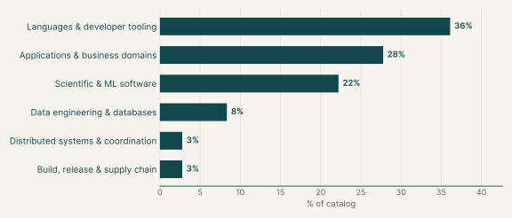
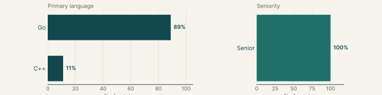
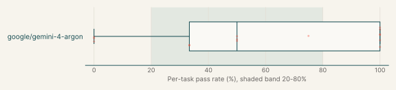
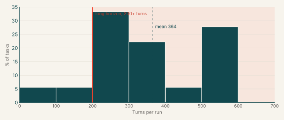
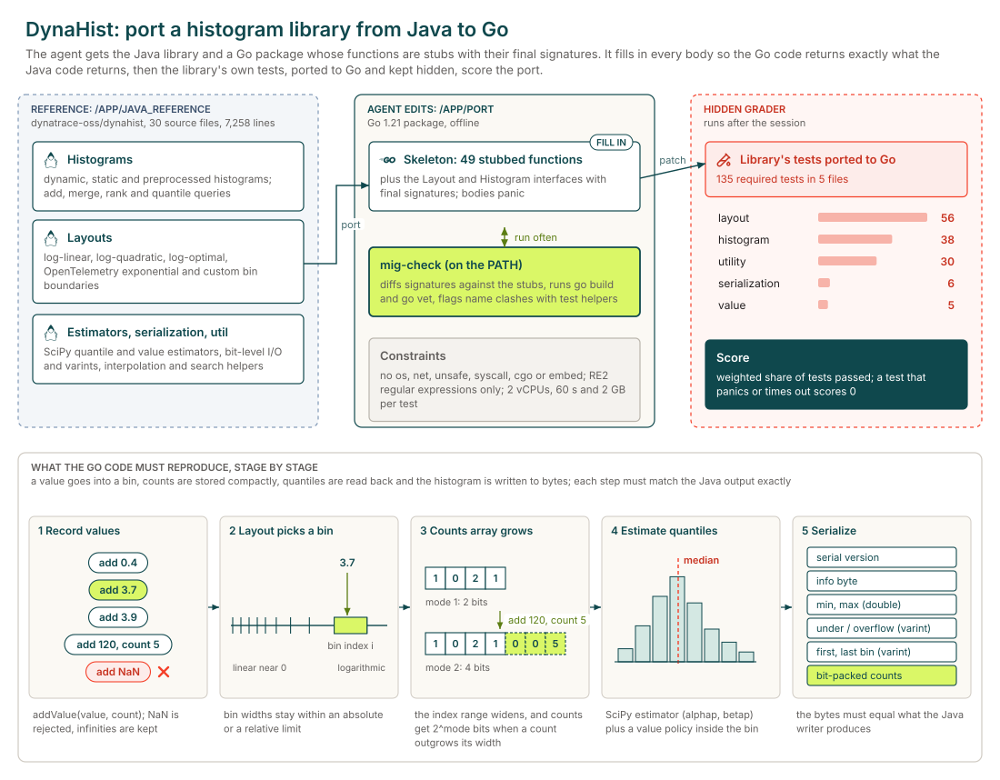
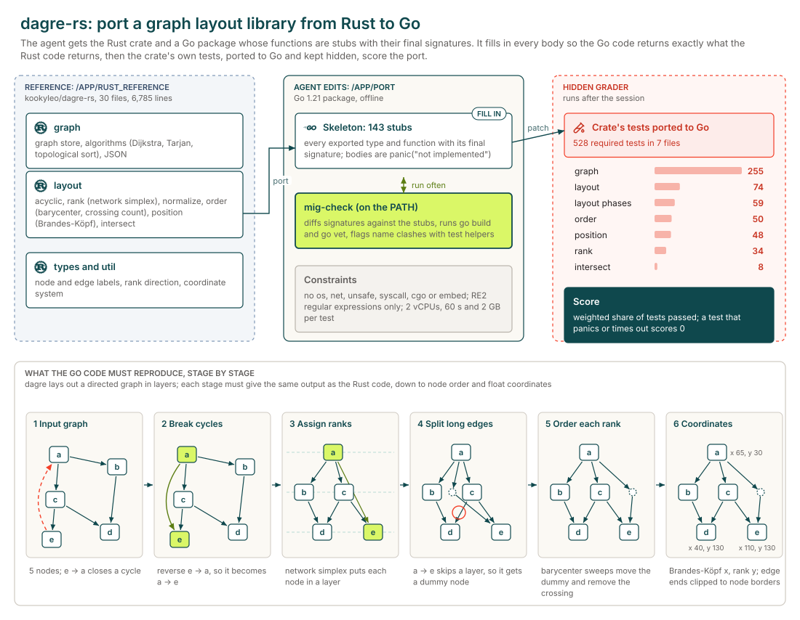
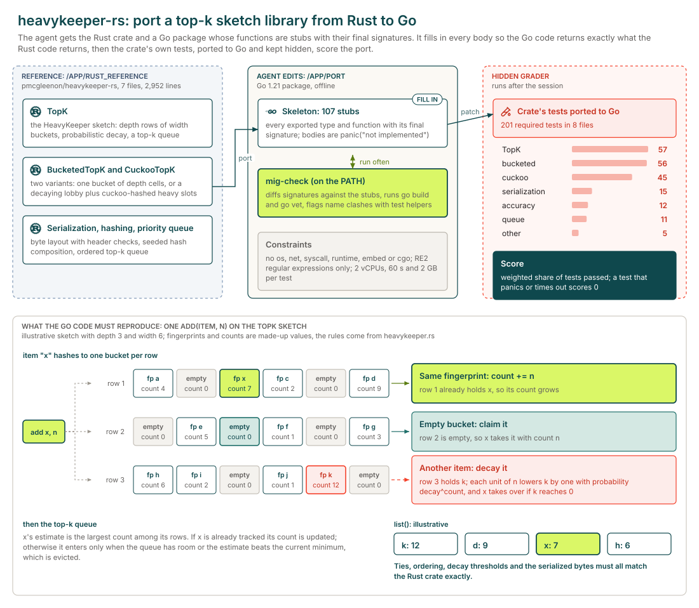

# Migration

## Executive summary

36

Tasks

18

Tasks with graded runs

58%

google/gemini-4-argon pass rate

Each task asks the agent to port a Java or Rust library to Go or C++ behind fixed signatures, so that the original project's own tests, translated to the target language, pass against the port. The main languages are Go (89%) and C++ (11%).

18 of the 36 tasks have graded runs from at least one model. The model with the most runs here, google/gemini-4-argon, passes 58% of its 31 graded runs and fails every run on 20% of the 15 tasks it ran.

## Why this catalog

### Problems engineers face

Engineers remove a dependency in one language by replacing it with a port in another. The hard part is exact behavioural equivalence without seeing the tests: numeric precision, bit-exact random sequences, parser and error-case fidelity, and the order of results. The target language adds its own rules, such as Go's RE2 regular expressions or C++ header conventions, and house constraints limit imports and naming.

### How the tasks reproduce them

Each task provides the original source as a reference, a skeleton in the target language with final signatures and stub bodies, and a `mig-check` tool that compares the skeleton, builds and vets the port. The original project's tests, translated to the target language, are withheld and run after the session within per-test time and memory limits.

### Typical prompts

- A first-person request to port a named library to Go from a reference folder, with a stub skeleton and withheld tests.
- A request framed by a business reason for the move, such as retiring a JVM dependency, with emphasis on exact reproduction of seeded output.
- A bullet list of language-specific pitfalls, such as RE2 regular expression syntax and reserved name prefixes.

## Domain breakdown

The tasks span six domains. The largest, Languages & developer tooling, makes up 36% of the catalog.

## Language and seniority

### Primary language

| Primary language | % of catalog |
|---|---:|
| Go | 88.9% |
| C++ | 11.1% |

### Seniority

| Seniority | % of catalog |
|---|---:|
| Senior | 100.0% |

## Model pass rates across the catalog

A model's pass rate is its passed runs over its graded runs, pooled across the tasks it ran; runs that errored are left out. Models are listed by number of runs, and a model needs graded runs on five or more tasks for a row.

| Model | Tasks run | Graded runs | Pass rate | Tasks at 0% | Tasks at 20-80% | Tasks at 100% |
|---|---:|---:|---:|---:|---:|---:|
| google/gemini-4-argon | 15 | 31 | 58% | 20% | 40% | 40% |

Also run on fewer than five tasks: z-ai/glm-5.3-flash (4 tasks, 35% of 20 runs), google/gemini-3.8-flash (4 tasks, 0% of 4 runs).

## Turn counts and long-horizon tasks

A task's turn count is the average over its completed runs, from every model. A task is long horizon when that average is 200 or more turns. 18 of the 36 tasks have a completed run.

| Measure | Value |
|---|---:|
| Average turn count | 364.2 |
| Median turn count | 335.8 |
| Range | 96 to 600 |
| Long-horizon tasks (200+ turns) | 89% of tasks |

| Model | % of tasks | Mean turns | % of runs with 200+ turns |
|---|---:|---:|---:|
| google/gemini-4-argon | 83% | 277.5 | 71% |
| z-ai/glm-5.3-flash | 22% | 600.0 | 100% |
| google/gemini-3.8-flash | 22% | 515.5 | 100% |

## Sample tasks

### Example 1: Statistics & numerical methods (Go)

| Field | Value |
|---|---|
| Task id | [`dynahist-go-port`](https://drive.google.com/file/d/1ChoekorIF6oHhZTUyDkKJex0iPC334b8/view) |
| Final category | Migration |
| Domain | Scientific & ML software |
| Sub-domain | Statistics & numerical methods |
| Language | Go |
| Seniority | Senior |
| Turn count | 244 (google/gemini-4-argon), 433 (google/gemini-3.8-flash) |
| Long horizon | yes |

#### Prompt

Full instruction given to the agent (instruction.md)

We're moving a dependency from Java to Go, and I need a Go port of the `dynatrace-oss/dynahist` library. The Java source is in `/app/java_reference/`. I've already laid out the Go package in `/app/port/`: every type and function our code calls is there with its final signature, but the bodies are just stubs. Could you fill in the implementation so it behaves exactly like the Java library?

When you're done, I'll run the library's own test suite, ported to Go, against `/app/port`. I'm not including those tests here, so please work from the Java source itself and match it closely: error cases, edge cases, numeric precision and the order things come back in.

A few things that will save you some pain:

- Keep the signatures and the package name in `/app/port` as they are; our callers use them as-is. Edit the existing files in place and declare each type and function once.
- Run `mig-check` (on the PATH) often. It compares `/app/port` with the original stubs, runs `go build` and `go vet`, and flags package-level names that clash with our test helpers (they start with `mig` or `Mig`).
- Go's `regexp` is RE2, so Java-only syntax such as the `(?u)` flag, back-references, look-around and `\u{...}` escapes makes a package-level `regexp.MustCompile` panic at start-up.
- This package ends up inside a sandboxed service, so every non-test `.go` file under `/app/port` must stay off `os`, `os/exec`, `syscall`, `runtime`, `plugin`, `net`, `net/http`, `net/rpc`, `io/ioutil`, `embed`, `unsafe`, `flag` or `testing` (and anything under `testing/`), cgo, and the `//go:linkname` and `//go:embed` directives. Write the logic yourself rather than calling out to another program; the rest of the standard library is fine.
- Our test machine has 2 vCPUs, and each test gets 60 seconds and a 2 GB address-space limit, so keep things reasonably efficient.

#### Pass rates

| Model | Graded runs | Pass rate |
|---|---:|---:|
| google/gemini-4-argon | 3 | 33% |
| google/gemini-3.8-flash | 1 | 0% |

#### Environment

### Example 2: Graph algorithms (Go)

| Field | Value |
|---|---|
| Task id | [`dagre-go-port`](https://drive.google.com/file/d/1LEUYx_W7eOkFA8s4EEXnSfVbyYqMdLiD/view) |
| Final category | Migration |
| Domain | Scientific & ML software |
| Sub-domain | Graph algorithms |
| Language | Go |
| Seniority | Senior |
| Turn count | 306 (google/gemini-4-argon) |
| Long horizon | yes |

#### Prompt

Full instruction given to the agent (instruction.md)

We're moving a dependency from Rust to Go, and I need a Go port of the `kookyleo/dagre-rs` crate. The Rust source is in `/app/rust_reference/`. I've already laid out the Go package in `/app/port/`: every type and function our code calls is there with its final signature, but the bodies are just stubs. Could you fill in the implementation so it behaves exactly like the Rust crate?

When you're done, I'll run the crate's own test suite, ported to Go, against `/app/port`. I'm not including those tests here, so please work from the Rust source itself and match it closely: error cases, edge cases, numeric precision and the order things come back in.

A few things that will save you some pain:

- Keep the signatures and the package name in `/app/port` as they are; our callers use them as-is. Edit the existing files in place and declare each type and function once.
- Run `mig-check` (on the PATH) often. It compares `/app/port` with the original stubs, runs `go build` and `go vet`, and flags package-level names that clash with our test helpers (they start with `mig` or `Mig`).
- Go's `regexp` is RE2, so Rust-only syntax such as the `(?u)` flag, `\u{...}` escapes, back-references and look-around makes a package-level `regexp.MustCompile` panic at start-up.
- This package ends up inside a sandboxed service, so every non-test `.go` file under `/app/port` must stay off `os`, `os/exec`, `syscall`, `runtime`, `plugin`, `net`, `net/http`, `net/rpc`, `io/ioutil`, `embed`, `unsafe`, `flag` or `testing` (and anything under `testing/`), cgo, and the `//go:linkname` and `//go:embed` directives. Write the logic yourself rather than calling out to another program; the rest of the standard library is fine.
- Our test machine has 2 vCPUs, and each test gets 60 seconds and a 2 GB address-space limit, so keep things reasonably efficient.

#### Pass rates

| Model | Graded runs | Pass rate |
|---|---:|---:|
| google/gemini-4-argon | 2 | 50% |

#### Environment

### Example 3: Probabilistic data structures (Go)

| Field | Value |
|---|---|
| Task id | [`heavykeeper-go-port`](https://drive.google.com/file/d/13JG9-uLtmoWpJ6xDy7VUyn2UjxIfHsyo/view) |
| Final category | Migration |
| Domain | Scientific & ML software |
| Sub-domain | Probabilistic data structures |
| Language | Go |
| Seniority | Senior |
| Turn count | 96 (google/gemini-4-argon) |
| Long horizon | no |

#### Prompt

Full instruction given to the agent (instruction.md)

We're moving a dependency from Rust to Go, and I need a Go port of the `pmcgleenon/heavykeeper-rs` crate. The Rust source is in `/app/rust_reference/`. I've already laid out the Go package in `/app/port/`: every type and function our code calls is there with its final signature, but the bodies are just stubs. Could you fill in the implementation so it behaves exactly like the Rust crate?

When you're done, I'll run the crate's own test suite, ported to Go, against `/app/port`. I'm not including those tests here, so please work from the Rust source itself and match it closely: error cases, edge cases, numeric precision and the order things come back in.

A few things that will save you some pain:

- Keep the signatures and the package name in `/app/port` as they are; our callers use them as-is. Edit the existing files in place and declare each type and function once.
- Run `mig-check` (on the PATH) often. It compares `/app/port` with the original stubs, runs `go build` and `go vet`, and flags package-level names that clash with our test helpers (they start with `mig` or `Mig`).
- Go's `regexp` is RE2, so Rust-only syntax such as the `(?u)` flag, `\u{...}` escapes, back-references and look-around makes a package-level `regexp.MustCompile` panic at start-up.
- This package ends up inside a sandboxed service, so every non-test `.go` file under `/app/port` must stay off `os`, `os/exec`, `syscall`, `runtime`, `plugin`, `net`, `net/http`, `net/rpc`, `io/ioutil`, `embed`, `flag` or `testing` (and anything under `testing/`), cgo, and the `//go:linkname` and `//go:embed` directives. Write the logic yourself rather than calling out to another program; the rest of the standard library is fine (`unsafe` and `reflect` included).
- Our test machine has 2 vCPUs, and each test gets 60 seconds and a 2 GB address-space limit, so keep things reasonably efficient.

#### Pass rates

| Model | Graded runs | Pass rate |
|---|---:|---:|
| google/gemini-4-argon | 4 | 75% |

#### Environment

