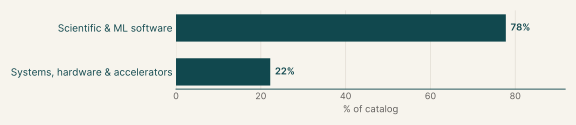
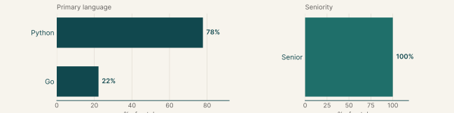
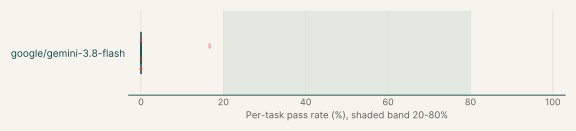
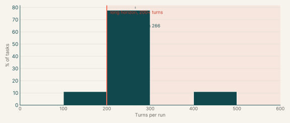

# Optimization

## Executive summary

9

Tasks

9

Tasks with graded runs

4%

google/gemini-3.8-flash pass rate

Each task asks the agent to make existing code cheaper in time or memory without changing its behaviour, its public API or its existing tests. The tasks cover Go HTTP code and Python scientific libraries. The main languages are Python (78%) and Go (22%).

Every task has graded runs. The model with the most runs here, google/gemini-3.8-flash, passes 4% of its 54 graded runs and fails every run on 78% of the 9 tasks it ran.

## Why this catalog

### Problems engineers face

Performance engineers are asked to remove unnecessary work from a slow path in a library they did not write. The task names a workload and the entry points that must keep their behaviour. The engineer has to profile and read before editing, find where the time or memory goes, and avoid special-casing the visible benchmark.

### How the tasks reproduce them

Each task gives the agent a repository in `/app` in an offline container, with workload scripts or a benchmark command. The instruction lists the behaviour that must be preserved and limits where code may change. After the session, the verifier restores its own workloads and tests, checks that results are unchanged and compares the candidate's speed with the baseline's on inputs the agent has not seen.

### Typical prompts

- A title of the form "Reduce X overhead", a description of the slow component, a list of workload scripts or a benchmark command, then requirements and grading sections.
- A list of the exact public functions whose behaviour must be preserved and where edits may be made.

## Domain breakdown

The tasks span two domains. The largest, Scientific & ML software, makes up 78% of the catalog.

## Language and seniority

### Primary language

| Primary language | % of catalog |
|---|---:|
| Python | 77.8% |
| Go | 22.2% |

### Seniority

| Seniority | % of catalog |
|---|---:|
| Senior | 100.0% |

## Model pass rates across the catalog

A model's pass rate is its passed runs over its graded runs, pooled across the tasks it ran; runs that errored are left out. Models are listed by number of runs, and a model needs graded runs on five or more tasks for a row.

| Model | Tasks run | Graded runs | Pass rate | Tasks at 0% | Tasks at 20-80% | Tasks at 100% |
|---|---:|---:|---:|---:|---:|---:|
| google/gemini-3.8-flash | 9 | 54 | 4% | 78% | 0% | 0% |

Also run on fewer than five tasks: z-ai/glm-5.3-flash (2 tasks, 8% of 12 runs).

## Turn counts and long-horizon tasks

A task's turn count is the average over its completed runs, from every model. A task is long horizon when that average is 200 or more turns. 9 of the 9 tasks have a completed run.

| Measure | Value |
|---|---:|
| Average turn count | 273.4 |
| Median turn count | 262.3 |
| Range | 215 to 410 |
| Long-horizon tasks (200+ turns) | 100% of tasks |

| Model | % of tasks | Mean turns | % of runs with 200+ turns |
|---|---:|---:|---:|
| google/gemini-3.8-flash | 100% | 279.6 | 80% |
| z-ai/glm-5.3-flash | 22% | 193.0 | 42% |

## Sample tasks

This catalog has no sample task yet.
