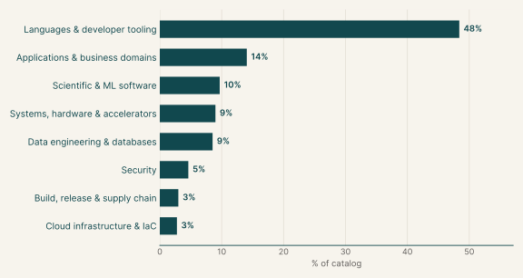
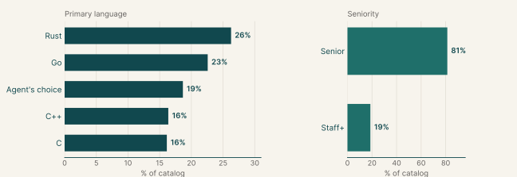
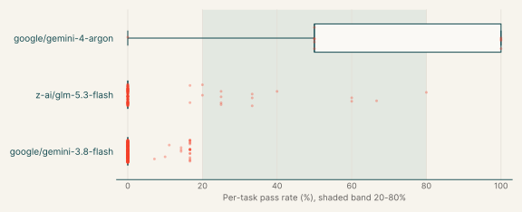
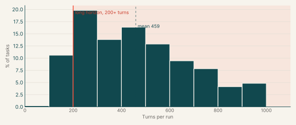
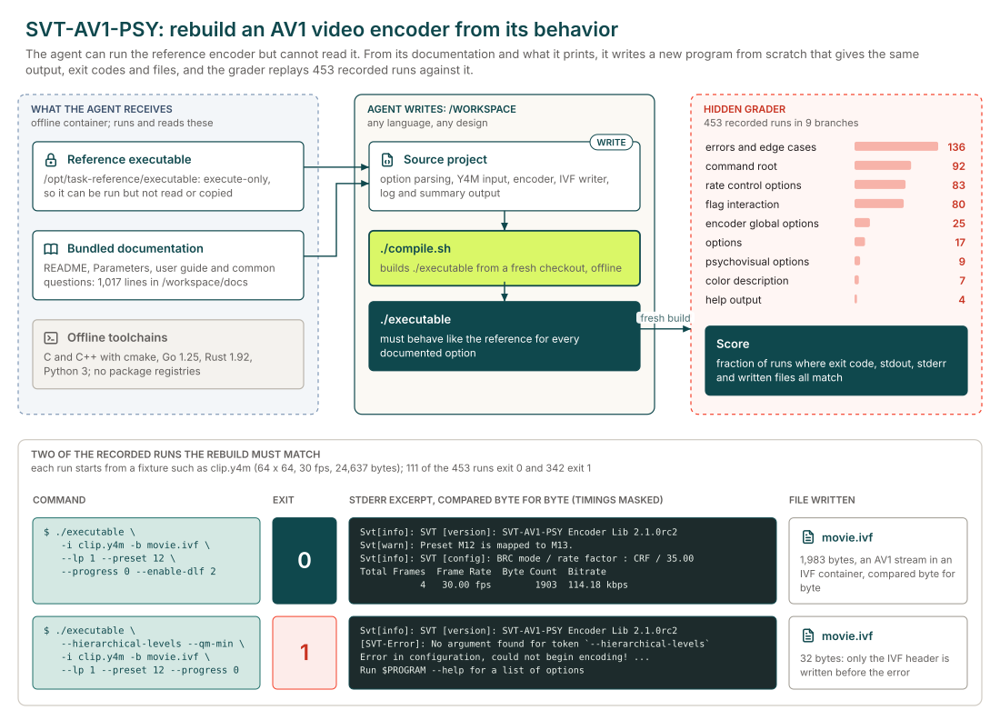

# ProgramBench

## Executive summary

435

Tasks

145

Tasks with graded runs

1%

google/gemini-3.8-flash pass rate

Each task asks the agent to make software behave exactly like a reference version. In the reimplementation tasks the agent writes a new program from scratch, in a language of its choice, from a reference program and its documentation. In the upgrade tasks the agent brings an existing repository up to the reference's newer release by changing its code. In 19% of tasks the agent chooses the language; the most common fixed languages are Rust (26%) and Go (22%).

145 of the 435 tasks have graded runs from at least one model. The model with the most runs here, google/gemini-3.8-flash, passes 1% of its 424 graded runs and fails every run on 95% of the 64 tasks it ran.

## Why this catalog

### Problems engineers face

Engineers often have to make software behave exactly like a version they cannot reuse: rebuilding a tool whose source is unavailable, or bringing an old codebase up to a newer release. In both cases the specification is observable behaviour. The hard part is inferring the rules from outputs and documentation, then matching exit codes, output, file effects and numeric precision without seeing the tests.

### How the tasks reproduce them

Every task runs offline, and hidden tests compare the result with a reference program the agent can run but not read. For a reimplementation, the agent writes a source project and a `compile.sh` from the reference and its documentation. For an upgrade, the agent changes an existing repository in `/app/repo`, which is built with a fixed `/opt/task/build.sh`.

### Typical prompts

- Reproduce the documented behaviour of an execute-only program, delivered as source code plus `compile.sh`.
- Update an existing repository to match a reference program, after first writing a research and plan file.

## Domain breakdown

The tasks span eight domains. The largest, Languages & developer tooling, makes up 48% of the catalog.

## Language and seniority

### Primary language

| Primary language | % of catalog |
|---|---:|
| Rust | 26.2% |
| Go | 22.5% |
| Agent's choice | 18.9% |
| C++ | 16.3% |
| C | 16.1% |

### Seniority

| Seniority | % of catalog |
|---|---:|
| Senior | 81.1% |
| Staff+ | 18.9% |

## Model pass rates across the catalog

A model's pass rate is its passed runs over its graded runs, pooled across the tasks it ran; runs that errored are left out. Models are listed by number of runs, and a model needs graded runs on five or more tasks for a row.

| Model | Tasks run | Graded runs | Pass rate | Tasks at 0% | Tasks at 20-80% | Tasks at 100% |
|---|---:|---:|---:|---:|---:|---:|
| google/gemini-3.8-flash | 64 | 424 | 1% | 95% | 0% | 0% |
| z-ai/glm-5.3-flash | 85 | 360 | 6% | 85% | 14% | 0% |
| google/gemini-4-argon | 10 | 19 | 63% | 10% | 50% | 40% |

Also run on fewer than five tasks: cohere/command-a (4 tasks, 0% of 4 runs).

## Turn counts and long-horizon tasks

A task's turn count is the average over its completed runs, from every model. A task is long horizon when that average is 200 or more turns. 145 of the 435 tasks have a completed run.

| Measure | Value |
|---|---:|
| Average turn count | 585.7 |
| Median turn count | 594.2 |
| Range | 115 to 1000 |
| Long-horizon tasks (200+ turns) | 94% of tasks |

| Model | % of tasks | Mean turns | % of runs with 200+ turns |
|---|---:|---:|---:|
| google/gemini-3.8-flash | 44% | 470.6 | 84% |
| z-ai/glm-5.3-flash | 59% | 685.2 | 92% |
| google/gemini-4-argon | 7% | 319.5 | 79% |
| cohere/command-a | 3% | 11.8 | 0% |

## Sample tasks

### Example 1: Media processing (Agent's choice)

| Field | Value |
|---|---|
| Task id | [`svtav1-encoder-rebuild`](https://drive.google.com/file/d/1JmlCRxmj-7RJ9yZ698lASh-GGDr2N9Je/view) |
| Final category | ProgramBench reimplementation |
| Domain | Applications & business domains |
| Sub-domain | Media processing |
| Language | Agent's choice |
| Seniority | Staff+ |
| Turn count | 752 (z-ai/glm-5.3-flash), 401 (google/gemini-4-argon), 9 (cohere/command-a) |
| Long horizon | yes |

#### Prompt

Full instruction given to the agent (instruction.md)

###### Task context

Reproduce the documented behavior of the program in this workspace. The reference program is `/opt/task-reference/executable`. Its bundled documentation is available in the workspace. The task runs model commands as the non-root `agent` user. The reference is execute-only for that user, so it can be run but not read, copied, hard-linked, or recovered through `/proc`. A root model shell means the task platform did not honor the declared user and is not part of the task contract.

###### Required result

Write a source code project and an executable `./compile.sh`. Running `./compile.sh` on a fresh checkout must produce `./executable` in the workspace root. The rebuilt executable must match the reference program's observable behavior, including output, exit codes, and file system effects.

You may choose the implementation language and design. You can learn the behavior from the bundled documentation and by running the reference program.

The grader checks only your submission's fresh offline build and its observable behavior. It does not assess your implementation language or how you learned the behavior. Do not include the reference executable's bytes in the submission under another name or embedded inside another file. Do not read or inspect the grader harness, hidden tests, or recorded expectations, even if a platform defect makes them accessible. During grading, the internet, package registries, the reference program, and system copies of the same tool are unavailable. Your build and executable must work without them.

###### Reusable input assets

When `/workspace/assets` exists, it contains hard-to-create reusable inputs
such as media, archives, databases, or custom binary files. You may inspect,
copy, or modify these inputs while recreating the program. Ordinary source and
text inputs are not provided and should be created as needed.

###### How your work is scored

Your executable is graded by replaying many recorded behaviors of the
reference program against it and scoring the fraction that match. A
match always requires the same exit code and the same file system effects.
Plain output and ordinary files are compared byte for byte. JSON output and
JSON files are normally compared as parsed values, so insignificant whitespace
and object key order do not matter unless the documentation makes formatting or
ordering part of the behavior. SQLite files are compared by their logical
contents. Terminal progress output is compared by its final visible text. A
recorded behavior can require exact bytes when formatting or ordering is part
of the documented behavior. Partial credit is the norm, so every additional
behavior you match raises your score, and there is no bonus for finishing early.

###### Coverage to aim for

Grading samples behavior from the documented interface. Only behavior that can be tested reliably in a bounded offline run is graded.

When applicable, support:

- commands, subcommands, options, aliases, and short forms
- representative documented values
- help and version output
- standard input, files, and directories
- configuration files and environment variables
- standard output, standard error, exit codes, and file system effects
- error handling
- empty, non-ASCII, binary, and unusually named inputs

The test suite may not cover every documented behavior.

###### Using the reference program

Run `/opt/task-reference/executable` to observe the reference. The file is
outside the submitted workspace and is unavailable during grading. Your
`./compile.sh` can therefore write `./executable` without replacing the
reference while you work.

###### Before you finish

Passing tests you wrote yourself is not evidence that you are done.
Before you stop:

1. list every option and subcommand in the reference program's help output;
2. for each one, run `/opt/task-reference/executable` and your executable on the
   same input and compare output using the scoring rules above, along with the
   exit code and files written;
3. fix every disagreement you find, then repeat from step 1.

Stop when no disagreement remains or when your budget is spent,
whichever comes first.

#### Pass rates

| Model | Graded runs | Pass rate |
|---|---:|---:|
| z-ai/glm-5.3-flash | 5 | 0% |
| google/gemini-4-argon | 2 | 0% |
| cohere/command-a | 1 | 0% |

#### Environment

